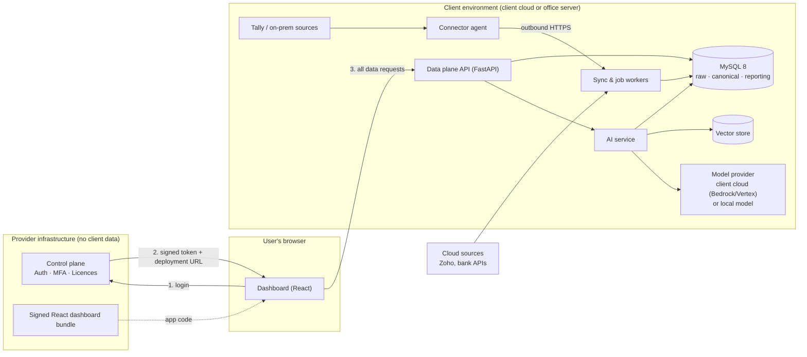

# Architecture: Accounting Data Integration & Analytics Platform

| Field | Value |
| --- | --- |
| Version | 0.16 (Draft) |
| Date | 2026-10-13 |
| Related | `docs/requirements.md`, `CLAUDE.md` |

---

## 1. Design principles

1. **Data sovereignty.** The provider stores only logins, user-to-client mapping and licences. All client data lives and is processed in the client's own environment (PM-003 to PM-006).
2. **Read-only towards sources.** The platform never writes to Tally, Zoho, banks or upstream systems (CON-008).
3. **Pluggable connectors.** Every data source is an adapter behind one interface; the core never depends on a specific source (CON-001, MNT-002).
4. **One codebase, many clients.** Client differences are configuration, never forks (MNT-001).
5. **Secure by default.** Encryption, least privilege, signed releases, no telemetry (Section 5 of requirements).
6. **Verifiable numbers.** Every figure, including AI answers, can be traced to source records (AI-002, RPT-007).

## 2. System overview

The system has three deployable parts:

| Part | Hosted by | Holds client data? | Purpose |
| --- | --- | --- | --- |
| **Control plane** | Provider | **No** | Login, MFA, licence checks, user-to-client mapping, serving the signed dashboard bundle. |
| **Client deployment (data plane)** | Client (own cloud account by default, or office server) | Yes | Database, connectors, sync, validation, reporting API, AI layer, audit log. |
| **Connector agent** | Client (on machine near Tally or other on-prem sources) | Transiently | Reads on-prem sources and pushes changes outbound to the client deployment. |



## 3. Control plane

**Responsibilities:** user accounts, password hashing, MFA, login, token issuance, licence status, client registry (client ID → deployment URL), platform admin console, hosting the signed frontend bundle.

**Stores only:**

- `clients` — client ID, name, licence status, deployment URL, token-signing settings.
- `users` — user ID, email, password hash, MFA secret (encrypted), client ID, status.
- `auth_events` — security events only (login success/failure, lockouts), no business activity.

**Does not store:** roles, entity permissions, connection details, any accounting data, report or AI activity. Those live in the client deployment.

**Token flow:**

1. User logs in at the control plane (password + MFA).
2. Control plane checks the licence and issues a short-lived signed JWT (e.g. 15 minutes, refreshable) containing user ID, client ID and audience = that client's deployment.
3. Browser calls the client deployment directly with the token.
4. Client deployment verifies the signature using the control plane's published public keys (JWKS), then applies its own local roles and permissions.

## 4. Client deployment (data plane)

### 4.1 Components

| Component | Technology | Role |
| --- | --- | --- |
| API | Python, FastAPI | Reporting, admin, connections, AI endpoints; token verification; authorization. |
| Workers | Python, Celery (or equivalent) + Redis | Sync jobs, imports, validation, scheduled reports, alerts. |
| Database | MySQL 8 | All accounting data, local roles/permissions, audit log. |
| Vector store | Qdrant (self-hosted) | Embeddings for schema docs, business definitions, uploaded documents. |
| AI service | Python module within the API/workers | Text-to-SQL, explanations, insights; provider abstraction. |
| File storage | Local volume or client's object storage | Raw uploaded files, backup files, (later) scanned documents. |
| Reverse proxy | Caddy or Nginx | TLS termination, CORS limited to the dashboard origin. |

### 4.2 Data layers

| Layer | MySQL database (ADR-016) | Purpose | Examples |
| --- | --- | --- | --- |
| **Raw** | `ledgerbridge_source` | Data exactly as received, with source metadata. Enables reprocessing (DAT-008). | `raw_records` (source, connection, batch, entity type, payload, received_at) |
| **Canonical** | `ledgerbridge_accounting` | Standard, source-independent accounting model, and the client's own planning data (budgets, ADR-026) in separate tables. | ledgers, vouchers, voucher lines, parties; budgets, budget lines |
| **Reporting** | `ledgerbridge_reporting` | Views and aggregates used by dashboards and AI (the semantic layer). The only database the AI user can read. | `v_trial_balance`, `v_pnl_monthly`, `v_receivables_ageing` |
| **System** | `ledgerbridge_system` | Connections, sync runs, validation, users and roles, audit, settings. | `connections`, `sync_runs`, `audit_log` |

### 4.3 Canonical model (initial outline)

To be detailed in `docs/schema.md`.

- **Organization:** `entities`, `branches`, `financial_years`, `currencies`, `exchange_rates`
- **Masters:** `account_groups` (hierarchical), `ledgers`, `parties`, `items`, `units`, `godowns`, `cost_centres`, `projects`, `tax_codes`
- **Transactions:** `vouchers` (header), `voucher_lines` (double-entry lines), `voucher_line_dimensions`, `inventory_lines`, `tax_lines`, `bill_allocations`
- **Dimensions:** `dimensions`, `dimension_values` (user-defined dimensions, DAT-005)
- **Integration:** `sources`, `connections` (credentials encrypted), `sync_runs`, `import_batches`, `record_origins`, `account_mappings`
- **Quality:** `validation_runs`, `validation_issues`
- **Security:** `roles`, `permissions`, `user_roles`, `user_entity_access`, `masking_rules`
- **Audit:** `audit_log`

Every canonical row carries `entity_id`, source origin and timestamps. Amounts use `DECIMAL(20,4)`, never floating point.

### 4.4 Connector framework

Each connector implements:

```text
test_connection() -> status
list_entities() -> companies/entities available in the source
fetch_masters(entity, since_marker) -> raw records + new marker
fetch_transactions(entity, since_marker) -> raw records + new marker
to_canonical(raw_record) -> canonical records
```

The framework handles scheduling, retries, markers (last AlterID, last modified time), logging to `sync_runs` and validation after each run.

In code, the interface is the `Connector` protocol in `data-plane/connectors/base.py`; `fetch_*` return iterators of `SourceRecord` so large sources stream. A registry maps a source code (`tally`, later `file`, `zoho`, ...) to its connector. Nothing outside `connectors/<source>/` knows about a particular source.

The pipeline, all source-independent (M3):

1. **Fetch** (`workers/sync.py`, `workers/fetch.py`): objects changed since each object type's marker, or everything on the first run; chunk by chunk with checkpoints, splitting and source checks when the connector supports it (ADR-022), else as one stream per kind (`fetch_masters`, `fetch_transactions`). Steps 1 to 4 run per entity.
2. **Store raw** (`core/raw_store.py`): payloads are stored unchanged; identical re-deliveries are skipped.
3. **Map:** the connector's `to_canonical()` turns each raw record into plain canonical records (`core/canonical.py`): amounts with the canonical sign, masters referred to by name.
4. **Transform** (`core/transform.py`): upserts on `(connection_id, source_key)`, resolves names within the entity, inherits group hints down the group tree (nature, standard account, ledger kind, party type), and replaces each changed voucher's child rows in one transaction (schema.md 8, rule 7). Stored records can be transformed again without the source (DAT-008): `transform retry` (failed and pending) and `transform rebuild` (every object of the chosen entities). Both only queue an object's latest raw record, mark older failed versions `skipped`, and keep objects deleted in the source deleted.
5. **Deletions:** a separate deletion check run compares the keys from `list_keys()` with the stored rows; keys that are gone become soft deletes. It runs on its own, longer schedule (ADR-018).
6. **Log:** one `sync_runs` row per run; markers advance only when it succeeds.

Run it with `python -m workers.cli sync` (or `./dev.ps1 sync`), and the deletion check with `python -m workers.cli check-deletions` (or `./dev.ps1 sync deletions`). The worker runs both on a schedule (ADR-017, ADR-018).

**Tally:** XML requests over Tally's HTTP interface (default port 9000). The adapter sends only Export requests (TDL collections with explicit fetch lists, targeting a company by name), fetches vouchers month by month, and handles UTF-16 responses and invalid character references emitted by Tally. Incremental sync uses AlterID/MasterID values. Version differences are handled inside the Tally adapter. Historical Tally backups are restored into a Tally instance and extracted through the same adapter.

**Files (CSV/TXT):** upload or watched folder; saved column mappings per file layout.

**Cloud APIs (Zoho, banks):** OAuth where supported; webhooks for near real-time updates, polling as fallback.

### 4.5 Connector agent

- Lightweight service installed on the machine running Tally (or near other on-prem sources).
- Polls the local source at the configured interval and pushes changes to the client deployment over outbound HTTPS with mutual authentication (agent certificate or signed agent token).
- Local queue so data is not lost during network outages.
- If the client deployment runs on the same network as Tally, the agent runs alongside the deployment instead.
- Holds only its own credentials; no long-term storage of data.

### 4.6 Validation

After each sync or import: voucher balance check, trial balance check, ledger closing balance comparison against source-reported figures. Results go to `validation_runs` / `validation_issues` and feed the data-quality dashboard and alerts.

How it works (M4, `core/validation.py`, source-independent):

- **When:** after every successful sync and deletion check, for each entity in the run, inside the same worker job (ADR-019). Also on demand: `python -m workers.cli validate` (`./dev.ps1 validate`).
- **As of a date** (default today): balances count only vouchers dated on or before it. Post-dated vouchers are stored as they are (`is_post_dated` recorded, `is_effective` unchanged) and simply fall outside earlier dates. All reports in M6 also calculate as of a date.
- **Checks:** `voucher_unbalanced`, `tb_unbalanced`, `opening_difference` (warning), `closing_mismatch`, `ledger_missing`, `profit_carrier_mismatch` (schema.md 5.2). Closing balances come from the connector's `closing_balances(entity, as_of)`; a connector without it gets an info issue and no closing checks.
- **Thorough checks (VAL-005 to VAL-008):** `validate`, full syncs and `transform retry` also compare the source's own controls, read through optional connector methods (`connectors.base.SourceControls`): vouchers per month and voucher type (`voucher_count_mismatch`), each stock item's closing quantity (`stock_quantity_mismatch`), each party's bill-wise outstanding (`bills_mismatch`, as of today only: Tally reports bills as outstanding now) and every ledger's balance at each financial year end before the validation date (`year_end_mismatch`). A control the source can't provide gets an info issue (`*_not_supported`); one that fails to read gets an error (`*_unavailable`). Stock values per item aren't compared: they depend on the source's valuation method (info `stock_values_not_compared`; the total closing stock is part of the profit check). Scheduled incremental syncs skip these checks (`validate -Quick` too): they take a request per month.
- **Root cause (VAL-009):** when raw records of the entity failed to transform, the report names them (per object type, and vouchers that failed for an unknown ledger) and counts the balance and count failures that are likely their consequences, so the first thing to fix is obvious.
- **Profit carriers:** a ledger whose source balance includes the period's computed profit (Tally's *Profit & Loss A/c*) is reconciled instead of compared: source closing − our posted balance must equal our computed profit for the period, adjusted by the change in stock value the source reports.
- **Tolerance:** exact by default; `VALIDATION_TOLERANCE` or `connections.config.validation_tolerance`.
- **Issues:** stored per run. A problem still present in the next run is the same open problem; one that disappears gets `resolved_at` on its earlier rows.

**Alerts (SYN-006, ADR-019):** `core/alerts.py` raises an alert when a sync or deletion check fails, or when validation finds errors, and resolves it when the next run of that kind succeeds or passes. One open alert per connection and kind (per entity for validation), so a failure repeating every 5 minutes doesn't create a new alert each time. Alerts go through channels: the log (counts and codes only, never amounts or names) and in-app (`ledgerbridge_system.alerts`). An email channel plugs into the same interface later.

### 4.7 Budget planning and analysis (BUD-001 to BUD-016, milestone M7b)

Budgets are **user-entered data alongside source data** (ADR-026): they live in their own tables in `ledgerbridge_accounting` (schema.md 4.7) and never in the tables the sync writes.

- **Creation paths:** a source budget importer behind the connector interface (an optional `fetch_budgets(entity)` method; Tally budget masters through a read-only Export request, CON-008); a month-by-account grid in the dashboard; an Excel template downloaded and uploaded through the API (validated row by row before anything is saved); copying last year's actuals from the reporting views with growth percentages. All four produce the same thing: a draft budget version with lines and monthly amounts.
- **Spreading:** a service in `core/budgets` turns yearly amounts into months (equal, or last year's seasonality from `v_actual_monthly`), rounds to the currency's decimals and puts the rounding difference in the last month, so a line's months always sum to its yearly amount.
- **Versions and states:** original and revised versions, each `draft → approved → locked`. Only drafts change; every change is written to the append-only `budget_changes` in the same transaction as the change (BUD-006), plus a summary in `audit_log`.
- **Signs:** budget amounts are stored in the canonical sign (debit positive, schema.md 1), like actuals, so budget and actual compare directly; the dashboard shows natural signs (income and expenses as positive numbers).
- **Analysis:** reporting views in `ledgerbridge_reporting` (schema.md 6) join the current budget version with monthly actuals and last year's actuals at the budget's level, rolled up through the group tree and to standard accounts, per company and consolidated. Period totals (quarter, YTD, full year), variance, favourable or unfavourable by nature and the full-year projection are computed in these views, so the dashboard, the alerts and the AI all use one definition.
- **Alerts:** variance rules (`budget_alert_rules`) are evaluated after each sync and after budget approval, by the M6 rule-based alert engine, and feed "Needs your attention".
- **Permissions:** `budget.view`, `budget.edit`, `budget.approve` (M5), checked on every budget endpoint together with the user's entity access.

## 5. AI layer

### 5.1 Approach

Numeric and analytical questions use **text-to-SQL** against the semantic layer, not plain retrieval of data chunks, so totals and comparisons are exact.

1. User asks a question.
2. Relevant schema descriptions and business definitions are retrieved from the vector store (RAG). Embeddings are always computed locally (AI-016).
3. **Data protection gate** (5.5): the question is masked (AI-015) if it will go to an external model.
4. The model generates SQL restricted to semantic-layer views.
5. SQL is validated (single read-only `SELECT`, allowed views only, user's entity filters injected).
6. Query runs locally under a read-only database user with timeout and row limits.
7. The result is explained and formatted. *Who* does this depends on the privacy mode (5.4): in `private` and `schema-only` it never leaves the client environment. The answer shows the SQL and links to source records.

Every model call in steps 2, 4 and 7 goes through the data protection gate and is recorded in the model call log (5.7).

### 5.2 Guardrails

- Dedicated read-only MySQL user (`ai_ro`) with `SELECT` on `ledgerbridge_reporting` only.
- Entity/branch filters from the user's permissions are enforced in SQL, not left to the model.
- **The model has no outbound tools (AI-017).** The model interface offers one capability: proposing a SQL query, which application code validates and runs. There are no tools for HTTP, web search, email, messaging, file writes or uploads, and no plug-in mechanism that could add one. Model output is treated as untrusted text: it's never executed except as validated SQL, and never used as a URL, file path or command.
- **What may be sent is decided by the privacy mode in code**, not by prompt instructions (5.4, 5.5).
- **Outbound network allowlist (SEC-010, 5.6)**, so even a bug can't send data elsewhere.
- **Every model call is logged** with the exact payload sent (AI-018, 5.7).

### 5.3 Model provider abstraction

A single internal interface (`ModelProvider`) with one implementation per provider. The client's privacy mode decides which providers may be configured (5.4). The embedding model is a separate, always-local provider (AI-016).

| Provider option | Data location | Allowed in modes | Notes |
| --- | --- | --- | --- |
| Open-weight model on client hardware or in the deployment (e.g. via Ollama) | Fully local | `private` (required), and as the local formatter in `schema-only` | **Default.** Used for the pilot on client data. Lower quality on complex questions. |
| Claude via AWS Bedrock (client's own account) | Client's cloud agreement | `schema-only`, `full` | Endpoint is the client's account and region. |
| Claude via Google Vertex AI (client's own account) | Client's cloud agreement | `schema-only`, `full` | Endpoint is the client's project and region. |
| Anthropic API (direct) | Anthropic | **None for client data** | **Development and test environment only**, on synthetic data (architecture §13). Never configurable for a client deployment (AI-014). |
| Local embedding model (e.g. a sentence-embedding model served locally) | Fully local | All modes | Embeds the semantic catalog, definitions, ledger names and documents into Qdrant (AI-016). |

No provider path sends data to provider (our) infrastructure.

### 5.4 Privacy modes (AI-011 to AI-014)

The mode is a per-client setting held in the data plane (`ledgerbridge_system.settings`). Only a Client Admin can change it, and the change is audited. The default for every new deployment is `private`.

| Step | `private` (default) | `schema-only` | `full` |
| --- | --- | --- | --- |
| Embeddings (RAG) | local | local | local |
| SQL generation | local model | external model receives **only** the masked question and semantic-layer descriptions | external model receives the masked question and semantic-layer descriptions |
| SQL execution | local | local | local |
| Explaining and formatting results | local model | **local only**, by deterministic templates or the local model. Results are never sent out. | external model, receiving **masked** result rows |
| External endpoint on the allowlist | none | one: the client's Bedrock or Vertex endpoint | one: the client's Bedrock or Vertex endpoint |

The gate (5.5) enforces these columns in code. In `schema-only`, the request builder for an external call can't accept result rows or sample values at all: its input type only has fields for the question and catalog descriptions. So a mistake in prompt code can't leak data.

### 5.5 Data protection gate: masking and pseudonymization (AI-015)

Every payload bound for a model passes through one component (the "gate") before it reaches a provider:

1. **Mode check:** the gate refuses the payload if its content type isn't allowed in the client's mode (e.g. result rows in `schema-only`).
2. **Detection:** finds sensitive values:
   - **party names**: matched against the known party and ledger master (`ledgerbridge_accounting.parties`, party ledgers), not guessed
   - **GSTIN and PAN**: by format and checksum
   - **bank account numbers**: from bank ledgers' details and by pattern
   - **salary amounts**: values from ledgers and views tagged as salary, using the masking rules of ACC-003
3. **Pseudonymization:** each value gets a consistent token for the conversation, e.g. `PARTY_017`, `GSTIN_003`, `PAN_002`, `BANKAC_001`. Salary amounts become `SALARY_AMOUNT_n`, or are dropped where the mode allows no figures. The same value always maps to the same token, so the model can still reason about "the same customer".
4. **Send** through the allowlisted provider (5.6), and log the payload exactly as sent (5.7).
5. **Reverse locally:** tokens in the response are replaced with real values inside the data plane before the user sees the answer.

The token map exists only in memory for the request, or in a short-lived local cache. It's never sent, never logged and never written to the model call log. Role-based masking (ACC-003) is applied first, so a user can't see real values through the AI that they couldn't see directly.

### 5.6 Outbound network allowlist (SEC-010)

The data plane can reach only its configured sources and the one approved AI endpoint:

- **Network level:** data-plane containers sit on an internal Docker network with no default route out. Outbound traffic goes through an egress proxy (or host firewall rules) holding the allowlist: the configured source hosts (e.g. the Tally host), plus the AI endpoint for the client's mode (Bedrock or Vertex in `schema-only` and `full`; nothing in `private`). Local model and embedding services run inside the deployment, so they need no outbound access.
- **Application level:** every outbound HTTP client in the data plane is built by one factory that checks the destination against the same allowlist before connecting. This catches mistakes earlier and logs refusals.
- The allowlist is derived from configuration (connections and the AI mode), not edited by hand. Changes are audited. The local pilot will apply the same allowlist from M8.

### 5.7 Model call log (AI-018)

Every call to any model, local or external, writes one append-only record in the client's database: user, time, mode, provider, endpoint, model, the payload **as sent after masking**, the response **as received**, token counts, duration and outcome. It extends `ledgerbridge_system.ai_query_log` (one row per question) with one row per model call. The exact table is designed in M8, and `docs/schema.md` is updated then. Client Admins can view it. Retention follows AUD-002.

## 6. Frontend

- React + TypeScript, built with Vite.
- TanStack Query for data fetching and caching; Ant Design for tables, filters and forms; Apache ECharts for charts.
- Logs in via the control plane; all data calls go to the client deployment URL from the token.
- Content Security Policy restricts connections to the control plane and that client's deployment (SEC-005).
- Released as a signed bundle; can also be self-hosted by the client (SEC-006).

## 7. Security design summary

| Area | Measure |
| --- | --- |
| Data location | All client data in client environment only. |
| Identity | Argon2id password hashes, MFA, short-lived signed tokens, optional SSO. |
| Authorization | Roles and entity/branch/report permissions enforced in the client deployment. |
| Transport | TLS everywhere; mutual auth for agents. |
| At rest | Encrypted database volumes and backups; encrypted connection credentials (application-level encryption with a client-held key). |
| Sources | Read-only access only. |
| AI | Per-client privacy mode, default `private` (local model). Read-only SQL user with semantic-layer-only access. Masking and pseudonymization before any external call. Local embeddings. No outbound tools. Every model call logged (5.4 to 5.7). |
| Network egress | Allowlist: configured sources plus the one approved AI endpoint; everything else blocked (SEC-010, 5.6). |
| Supply chain | Signed images and bundles, verified on update; dependency and image scanning in CI. |
| Telemetry | None leaves the client environment. |

## 8. Deployment and updates

- Client deployment ships as Docker images with a Docker Compose configuration for a single server or a single cloud VM. Kubernetes packaging can follow if larger clients need it.
- Configuration via environment variables and a config file; no cloud-specific services required in the core.
- Releases are versioned; updates pull signed images, verify signatures, run database migrations (Alembic) and restart services.
- Automated daily database backups within the client environment.
- Provider support access to a client deployment happens only with explicit, time-limited client permission.

## 9. Technology stack

| Concern | Choice |
| --- | --- |
| Backend language | Python 3.12+ |
| Python packaging | uv (`pyproject.toml`, `uv.lock`) |
| API framework | FastAPI |
| ORM / migrations | SQLAlchemy 2 + Alembic |
| Database | MySQL 8 |
| Background jobs | Celery + Redis |
| Vector store | Qdrant |
| Frontend | React, TypeScript, Vite, TanStack Query, Ant Design, Apache ECharts |
| Auth tokens | JWT (asymmetric signing, JWKS) |
| Packaging | Docker, Docker Compose |
| Testing | pytest (backend), Vitest + Testing Library (frontend), Playwright (end-to-end) |

## 10. Repository structure (proposed)

```text
/control-plane        FastAPI service: auth, licences, client registry
/data-plane
  /api                FastAPI service: reporting, admin, AI endpoints
  /core               canonical model, validation, permissions
  /connectors         one package per source (tally, files, zoho, ...)
  /workers            sync, import, validation, scheduled jobs
  /ai                 text-to-SQL, provider abstraction, guardrails
  /migrations         Alembic migrations
/agent                connector agent
/frontend             React + TypeScript dashboard
/deploy               Docker, Compose files, release scripts
/docs                 requirements, architecture, schema, decisions
```

## 11. Decision log

| ID | Decision | Reason |
| --- | --- | --- |
| ADR-001 | Split into provider control plane and client-hosted data plane. | Provider may store only login credentials (PM-003). |
| ADR-002 | Client's own cloud account is the default deployment target; office server supported. | Managed security, backups and real-time availability; flexibility for strict clients. |
| ADR-003 | Text-to-SQL over a semantic layer for numeric questions; RAG for context and documents. | Exact financial figures; plain retrieval cannot sum or compare reliably. |
| ADR-004 | **Superseded by ADR-015.** ~~Pluggable AI provider; default Claude via client's cloud account; local model option.~~ | Client requires data security; no data to provider infrastructure. |
| ADR-005 | Raw / canonical / reporting data layers. | Reprocessing, lineage and source independence. |
| ADR-006 | Connector agent with outbound-only connections for on-prem sources. | Works when Tally is not on the deployment's network; no inbound firewall rules. |
| ADR-007 | Roles and permissions stored in the client deployment, not the control plane. | Keeps organizational data out of provider infrastructure. |
| ADR-008 | Signed frontend bundle with strict CSP; self-host option. | Prevents a compromised control plane from silently exfiltrating data. |
| ADR-009 | Pilot first on the client's backup data, running the data plane locally. | Proves extraction, model and dashboard on real data before building product infrastructure. |
| ADR-010 | `AUTH_MODE=local` during the pilot; token verification sits behind an interface. | Lets the control plane replace local login later without changing authorization code. |
| ADR-011 | Separate `test` and `pilot` environments with separate databases. | Keeps client data away from AI development tools and external AI APIs. |
| ADR-012 | Each environment runs as its own Docker Compose project (`ledgerbridge-test`, `ledgerbridge-pilot`) with its own volumes, host ports and env file. | Keeps the database names (ADR-016) identical in every environment while keeping data physically separate. |
| ADR-013 | uv manages Python versions and dependencies for the data plane (`pyproject.toml` + `uv.lock`). | Reproducible locked installs and a pinned Python 3.12 independent of the host Python. |
| ADR-014 | One narrow exception to "read-only towards sources" (CON-008): the developer-only seeding tool in `data-plane/devtools/tally_seed` may send Tally **Import** requests, and only to the test company. It refuses to run unless `APP_ENV=test`, exactly one company is loaded and its name matches the target exactly. It is never imported by product code, is excluded from the Docker image (`.dockerignore`), and connectors keep their Export-only client. | The test company needs realistic, repeatable data (bills, GST, cancelled and altered vouchers) to prove extraction and the sign convention; hand entry is slow and not repeatable. |
| ADR-015 | AI data protection by design, replacing ADR-004. Per-client privacy mode: `private` (default, local model only), `schema-only` (external model sees only the masked question and semantic-layer descriptions; SQL and result formatting stay local) or `full` (external model only via the client's own cloud account, everything masked). One data protection gate pseudonymizes party names, GSTIN, PAN, bank accounts and salaries and reverses them locally. Embeddings are always local. Models have no outbound tools. A network allowlist limits egress to configured sources plus one approved AI endpoint. Every model call is logged with its exact payload. | The client answered "ideally no" to external AI (OPEN-007), and accounting data is highly sensitive. Making `private` the default, enforcing what can be sent in code and at the network level rather than in prompts, and logging every payload means a bug or prompt injection can't quietly leak data, while clients who choose an external model still get better SQL from it. |
| ADR-016 | The four MySQL databases are named `ledgerbridge_source` (raw layer), `ledgerbridge_accounting` (canonical), `ledgerbridge_reporting` (semantic layer) and `ledgerbridge_system` (system), replacing `raw`, `core`, `rpt` and `app`. "Raw", "canonical", "reporting" and "system" remain the names of the layers. Code refers to them through constants in `core/models/schemas.py`; migrations use the literal names. **One-time exception:** the rename was made by editing migration 0001 and recreating the test database, which was acceptable only because no pilot or client database existed yet. **After the first release, any rename must be done with a proper migration**, never by editing an applied one. | The short names didn't say what they hold, and generic names like `app` and `core` can clash with other applications' databases when a client hosts us on a shared MySQL server. The prefix groups our databases together in any MySQL tool, and the names read clearly in grants (`ai_ro` can read `ledgerbridge_reporting` only). |
| ADR-017 | Scheduled sync (SYN-001) runs in the Celery worker with Celery Beat embedded (`worker -B`). A tick every `SYNC_TICK_SEC` (60 s) queues an incremental sync for each active connection whose own `sync_interval_sec` (default 300) has passed since its last run. A connection never runs twice at once: a Redis lock per connection plus a check for a `running` row in `sync_runs` (stale after 2 hours). | One small always-on process covers near-real-time sync without a separate scheduler service. Per-connection intervals and the double lock keep slow sources and manual runs (`./dev.ps1 sync`) from overlapping. Embedded Beat suits one worker; a separate Beat process can follow if workers scale out. |
| ADR-018 | Deletions in the source (SYN-003) are found by a **deletion check** that lists every key in the source and soft-deletes stored rows whose key has gone. It runs as its own `sync_runs` row (`run_type = 'deletion_check'`) on its own schedule, every `connections.config.deletion_check_interval_sec` seconds (default `DELETION_CHECK_INTERVAL_SEC` = 3600), queued by the same tick as syncs and under the same per-connection lock. Incremental syncs never list keys. | Listing every key costs about 1.3 KB per Tally voucher on every run, far more than an incremental sync of a few changes, so doing it every 5 minutes doesn't scale to years of books. Deletions are rare and an hour's delay is acceptable for MIS reporting; the interval is configurable per connection and a full sync also checks. |
| ADR-019 | Validation runs after every successful sync and deletion check, as of a date (default today), and alerts are raised on **changes of state** only: one open alert per connection and kind (per entity for validation), resolved automatically when the next run succeeds or passes. Alerts are delivered through channels behind one interface: log and in-app in phase 1a, email later. Until M5, the validation and alert endpoints are read-only and unauthenticated, which is acceptable only because the API binds to 127.0.0.1; M5 protects them with `validation.view`. | The closing-balance check costs one ledger export, cheap enough to run every 5 minutes, and it also catches differences between hourly deletion checks. Alerting on every failing run would bury users in repeats; state changes are what someone has to act on. Channels keep email (and later other routes) a configuration change, not a rewrite. |
| ADR-020 | **Syncs use short transactions, and new connections start paused.** Every insert into a table with a foreign key to `connections` (sync runs, raw records, every canonical row) holds a shared lock on that connection's row until the transaction commits, so syncs never keep a write transaction open while waiting for the source. The raw store writes each batch in one insert-and-commit; the transform commits per batch. "Sync in progress" is the run's `running` row in `sync_runs` (committed at the start) plus the worker's Redis lock, never a database lock. `connect` refuses while a run is in progress and waits at most 10 s for a lock. Connections created by any command are `paused` until `connect --activate`; listing a source's companies never creates or changes a connection. Outside the test environment, CLI and worker errors show only the type and a short message (`core/errors.py`), never SQL or parameters. | The first pilot run failed with MySQL error 1205: listing companies created an active connection, the worker started a full sync at once, and that sync's long transaction blocked `connect` (which was meant to set origin `backup` first), so the data was tagged `live`. |
| ADR-021 | **Entities are identified by their source key, not their name.** `connect` resolves names typed by a person (exactly as the source reports them: no trimming, no case or whitespace folding), or `--all` takes every loaded entity, and stores each entity's key (Tally: company GUID) with its name. Every later command (sync, deletion check, validation, extract) finds entities by key through one shared lookup (`workers/entities.py`); validation after a sync follows the keys of that run. Requests to Tally use the name exactly as Tally currently lists it; if Tally rejects it, the connector looks up the GUID's current name and retries once. `entity-check` explains mismatches by kind (spacing, punctuation, case, suffix) without printing names. | The second pilot attempt fetched 36,473 records and then failed with "2 requested entities are not available": names that `connect` had matched no longer matched later. Keys don't change; the exact cause of the name difference can be seen with `entity-check` without sharing names. |
| ADR-022 | **Large syncs are fetched in chunks, resumably, entity by entity.** A connector that offers `fetch_plan`/`fetch_chunk` (Tally does) is fetched chunk by chunk: the entity record, each master type, then transactions per month (`workers/fetch.py`). Each chunk is stored and committed as soon as it arrives and, in a full sync, checkpointed (`sync_checkpoints`): re-running an interrupted full sync continues after the last completed chunk (`--restart` starts over; checkpoints expire after 7 days). A request that times out (`timeout_sec`, default `TALLY_TIMEOUT_SEC` = 120) is not resent as it is: the source is first checked with a minimal request (short timeout), re-checked after 10, 30 and 90 s if it doesn't answer, and reported as responsive, slow or unresponsive; an unresponsive source stops the run (progress kept). Otherwise the chunk is split (month, half-month, week, day), the pieces fetched, and the whole chunk verified against a keys-only listing, so a piece the source silently leaves empty fails the entity instead of losing data; the month is remembered (`sync_slow_periods`) and later runs request it in pieces directly. Each entity is fetched, transformed, given its markers and validated before the next starts; a failing entity doesn't stop the others (except an unresponsive source), and the run reports each entity's fetched, stored and transformed counts. | The third pilot attempt: after 18 minutes and 121,124 vouchers TallyPrime stopped answering, the client resent the same request twice (2 x 120 s), the run failed, and the second company was never reached. Vouchers already stored had been committed in batches, but the run's counts didn't show it and a re-run had to start from the beginning. |
| ADR-023 | **Nothing unverified is counted as complete.** A chunk is checkpointed only once it is known to be complete: a month fetched in parts must match its keys-only listing, and a month that comes back empty while the entity's months typically have 20 or more records must be confirmed empty by its listing. If a listing doesn't arrive in time or doesn't match, the range is recorded in `sync_unverified_ranges` and the sync stops; recorded ranges are fetched again on every full sync until they verify, whatever their checkpoints say. Whether the source answers requests for **part of a month** is probed once per connection (a month's listing against its halves' listings) and stored (`connections.config.part_month_requests`; `connect --part-month` overrides it). Without that support a slow month is never split: it is retried whole with longer timeouts (300, 600, 1200 s), pausing 60 s first, and the sync stops with a clear message if it still fails. A connection's request timeout is its own `timeout_sec` if set, otherwise the `TALLY_TIMEOUT_SEC` setting; `pause_sec` paces requests. `sync --full --refetch-from DATE` forgets the checkpoints from a date so a damaged range is fetched again. | The fourth pilot attempt: TallyPrime (Educational mode) returned nothing for part-month requests, a split month's listing timed out, the sync only warned ("couldn't verify") and carried on, and the connection still had the 120 s timeout it was created with although `TALLY_TIMEOUT_SEC` had been raised to 600. |
| ADR-024 | **Syncs survive the terminal; runs are never left `running`.** `dev.ps1 sync` starts the sync **in the background inside the api container** (`docker compose exec -d`) with a job id; the sync writes every output line to `ledgerbridge_system.sync_logs` under that id and ends with `[job finished: exit N]`, and `dev.ps1` then follows it with `workers.cli watch` (`./dev.ps1 sync watch` follows again from any terminal; leaving it never stops the sync). A running run updates `sync_runs.heartbeat_at` every `SYNC_HEARTBEAT_SEC` (30 s) from a background thread and records its `pid` and `host`. Ctrl+C or termination (SIGTERM) marks the run **`interrupted`** with its checkpoints kept. A `running` run whose heartbeat is older than `SYNC_STALE_SEC` (300 s), or whose process is known to be gone, is marked `interrupted` automatically before any new run starts and by `status`; `sync abandon` does it by hand after a typed confirmation, sparing runs that still look alive unless forced. **After a timeout** the source check keeps trying, with growing pauses, for up to the connection's timeout, because Tally goes on with an abandoned request. **Undeclared XML prefixes** (e.g. `UDF:` from TDL customisations) are parsed by renaming them internally; the stored payload keeps them unchanged, and their names are remembered in `connections.config.xml_prefixes_seen` and shown in `summary`. | Pilot 2026-10-13: a month with `UDF:` fields failed as invalid XML; checks right after a 600 s timeout found Tally still busy and stopped the sync; `sync full` twice returned to the prompt mid-run while the sync went on unseen; Ctrl+C left a run `running` until it was fixed by hand. |
| ADR-025 | **The accounting layer adapts to any company's data without runtime schema changes.** The raw layer keeps every record exactly as received. Every accounting table that receives source data has an `extra` JSON column: the connector puts there every field its mapping doesn't use (for Tally, by path, prefixed names as Tally wrote them, e.g. `UDF:SALESMAN.LIST/UDF:SALESMAN`; Tally's own bookkeeping fields are left out). The transform counts these fields per entity and object type in a **field catalogue** (`source_fields`: path, prefix, inferred type, record count, first and last seen). A catalogued voucher field becomes a **reporting dimension** only by an explicit command (`promote-field`), which backfills from `extra`; the transform then keeps it current. A field useful for every client becomes a real column through a migration. **Values that don't fit their column** are fitted before writing (`core/fit.py`): the full value goes to `extra._unfit`, the column gets NULL, the value rounded to the column's decimals, or a placeholder for required text, and the record gets a warning (kind, table, column and size, never the value). Only a required amount, quantity or date that can't be stored fails, and only its own record. A batch the database still rejects is written again record by record. MySQL data errors are described by code, kind, table, column and size. The application users keep least privilege: no DDL outside migrations. | Pilot 2026-10-13: one over-long value failed whole batches of 500 ("Transform batch failed: DataError"), and with them the vouchers that referred to the ledgers in them; TDL customisations add fields no fixed schema can foresee. |
| ADR-026 | **User-entered data lives alongside source data, never inside it.** Data the client creates in the platform (first: budgets) goes into its own tables, separate from the tables the sync writes; a sync, `transform rebuild` or deletion check never reads or changes it. Each row says how it was made (`origin`: `manual`, `excel`, `copy`, or the source's own origin for imported source data such as Tally budgets, which keep their `connection_id` and `source_key`) and by whom; changes are audited row by row in an append-only history and summarised in `audit_log`. It refers to source data by stable ids (standard accounts, account groups, ledgers, cost centres, dimension values); if a referenced source object is deleted in the source, the user-entered row stays and is flagged, never deleted. Reporting views combine both kinds of data; the AI reads them only through the semantic layer, with the same protection as source data. Versions with states (draft, approved, locked) replace in-place edits for anything that is approved. | Budgets are the first data the client enters rather than syncs. Keeping it apart means re-syncs and rebuilds can never overwrite a user's work, imported and typed budgets are treated the same, and every change can be explained. |
| ADR-027 | **References by name resolve by one set of rules, on both sides.** `core/names.py` resolves every reference by name in the transform (a ledger's group, parent groups and other parents, a voucher's type, ledgers, party ledger, cost centres, stock items, godowns, units): exact name; then an alias the target is known by (stored in its `extra._aliases`: alias names, and for Tally the reserved name of a predefined group the user renamed); then a normalisation applied the same way to both sides (XML entities decoded until stable, Unicode NFC, every kind of space as one space, trimmed, case folded, matching Tally's case-insensitive names). Each step accepts a match only when exactly one target fits; otherwise a required reference fails its record (`refers to an unknown ...` or `... matches several ...`) and an optional one is left empty. Alias and normalised matches are recorded per record as warnings (kinds only). Look-alike characters and punctuation are never matched automatically: `transform explain` reports them, with counts and kinds of difference only, together with whether the name is one of the source's predefined names, whether the referenced object is stored at all or failed itself, and (with `-CheckSource`) whether the source lists it and how many objects per master type the source lists against how many are stored. Voucher types inherit their standard type (the source's predefined type, from a fixed list), base type and whether they post to the books from their parent types; lines of vouchers whose type doesn't post (orders, memorandum, delivery notes, ...) are not effective. | Pilot 2026-10-13: 29 ledgers failed for an "unknown group" and with them 369,740 vouchers; 1,443 unbalanced vouchers had the base type "other". Exact matching only, and voucher type kinds read from the direct parent only, made both depend on how a name or type was written rather than what it is. |

New decisions are appended here with the next ADR number.

## 12. Open technical questions

- Exact Tally versions and sample data for testing version compatibility.
- Whether larger clients need Kubernetes packaging in phase 1.
- Local model choice and minimum GPU specification for the fully local AI option.
- Key management approach per cloud (cloud KMS vs client-managed key file for office servers).

## 13. Local pilot mode

The pilot runs the data plane on the developer's Windows machine.

- **Services:** Docker Compose runs MySQL, Redis, Qdrant, the API and workers; the frontend runs with the Vite dev server.
- **Reaching Tally:** TallyPrime runs on the Windows host with its XML server on port 9000. `TALLY_URL` is `http://localhost:9000` for tools run on the host; Compose overrides it to `http://host.docker.internal:9000` inside containers.
- **Companies:** the companies to extract must be loaded (open) in TallyPrime during extraction. The connector targets each company by name in its XML requests, so one run can process several companies.
- **Environments:** two separate configurations, each with its own database:

| Environment | Data | AI provider | Used by Claude Code? |
| --- | --- | --- | --- |
| `test` | LedgerBridge Test Co (developer-created) | Anthropic API (development only, synthetic data). Also used to exercise all three privacy modes. | Yes |
| `pilot` | Client backup companies | Local model (Ollama): privacy mode `private` | **No** — run by the developer only |

- **Environment separation (ADR-012):** each environment is a separate Compose project started from the same `deploy/compose.yaml`: `ledgerbridge-test` with `.env.test`, `ledgerbridge-pilot` with `.env.pilot`. Volumes are scoped per project and host ports differ per environment, so the two never share a database, cache or vector store. `.env.*.example` files are committed; real `.env.*` files are git-ignored. The data plane refuses `AI_PROVIDER=anthropic` when `APP_ENV=pilot` (PIL-005).

- **Auth:** `AUTH_MODE=local` stores users with Argon2id password hashes in `ledgerbridge_system.users` and issues tokens locally. In product mode the data plane instead verifies control-plane tokens via JWKS; authorization code is identical in both modes.

## Change log

| Date | Version | Change |
| --- | --- | --- |
| 2026-10-08 | 0.2 | Pilot mode (Section 13), ADR-009 to ADR-011. |
| 2026-10-09 | 0.3 | Environment separation (ADR-012), uv (ADR-013), connector framework details (Section 4.4), dev-only Tally seeding (ADR-014). |
| 2026-10-09 | 0.4 | AI data protection: Section 5 rewritten around privacy modes (5.4), the data protection gate with masking (5.5), outbound network allowlist (5.6) and model call log (5.7). ADR-015 supersedes ADR-004. Security summary and pilot table updated. Requirements AI-011 to AI-018 and SEC-010. |
| 2026-10-09 | 0.5 | Databases renamed to `ledgerbridge_source`, `ledgerbridge_accounting`, `ledgerbridge_reporting`, `ledgerbridge_system` (ADR-016); data-layers table (4.2) shows each layer's database; AI guardrail names `ai_ro` and its single database. |
| 2026-10-12 | 0.6 | M3: Section 4.4 describes the source-independent sync pipeline (fetch, raw store, map, transform, deletions, log); ADR-017 scheduled sync in the worker. |
| 2026-10-12 | 0.7 | ADR-018: deletion check on its own schedule (default hourly), separate from incremental syncs; Section 4.4 pipeline step 5. |
| 2026-10-12 | 0.8 | M4: Section 4.6 validation (as of a date, checks, profit carriers, tolerance, issue resolution) and alerts; ADR-019. |
| 2026-10-12 | 0.9 | ADR-020: short sync transactions, connections paused until activated, read-only company listing, safe error text (pilot run fixes). |
| 2026-10-12 | 0.10 | ADR-021: entities identified by source key; exact names; one shared lookup. |
| 2026-10-12 | 0.11 | ADR-022: chunked, resumable, entity-by-entity syncs; timeouts lead to a source check and splitting, not a resend. |
| 2026-10-13 | 0.17 | ADR-027: reference resolution rules, `transform explain`, voucher type tree and effective lines of non-posting voucher types. |
| 2026-10-13 | 0.16 | Budget planning and analysis: Section 4.7, data layers note, ADR-026 (user-entered data alongside source data). |
| 2026-10-13 | 0.15 | Section 4.4: `transform rebuild` re-transforms every stored object (DAT-008); retries and rebuilds only queue an object's latest raw record. |
| 2026-10-13 | 0.14 | ADR-025: `extra` JSON, field catalogue, promotion to dimensions, fitting values to columns, record-by-record retry of rejected batches. Section 4.6: thorough checks against the source's controls (VAL-005 to VAL-008) and root causes (VAL-009). |
| 2026-10-13 | 0.13 | ADR-024: background sync jobs with their output in `sync_logs` and `sync watch`; heartbeats, `interrupted` runs, stale-run detection and `sync abandon`; waiting for a busy source after a timeout; undeclared XML prefixes. |
| 2026-10-13 | 0.12 | ADR-023: unverified chunks never checkpointed; part-month support probed; whole-month retries with longer timeouts; effective timeout and pause; refetch from a date. |
