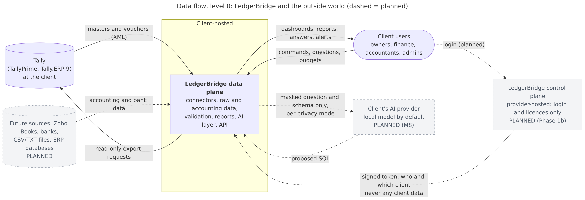
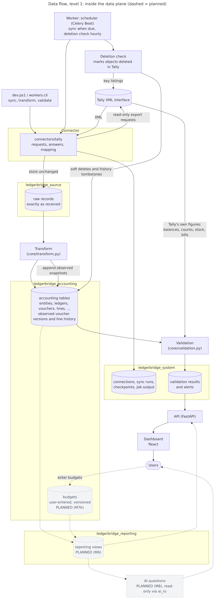
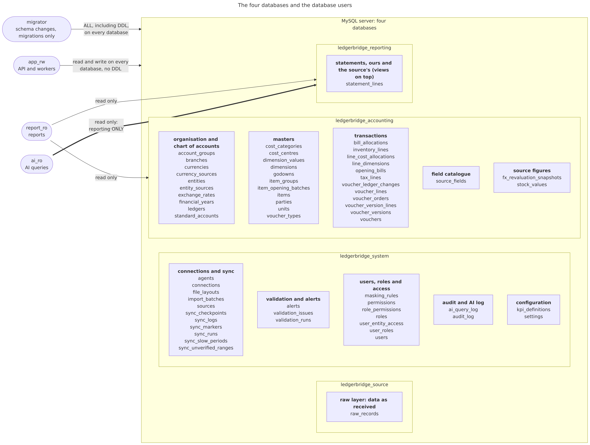
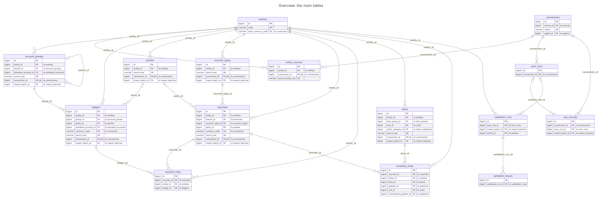

# Codebase guide

| Field | Value |
| --- | --- |
| Version | 0.64 |
| Date | 2026-11-11 |
| For | Anyone who wants to find their way around the repository without being a developer |
| Related | [requirements.md](requirements.md) (what to build), [architecture.md](architecture.md) (how it is built, with the decision log), [schema.md](schema.md) (the database), [roadmap.md](roadmap.md) (milestones), [learning/docker.md](learning/docker.md) (the Docker setup), [pilot-runbook.md](pilot-runbook.md) (running the pilot) |

This guide explains what is where and what each part is for. It doesn't repeat the design: for *why* things are built the way they are, follow the links to the documents above. Section 5 explains the technical words.

---

## 1. Overview

LedgerBridge reads a company's accounting data from its accounting software (Tally first), keeps it in a MySQL database run by the client, checks that it matches the books exactly, and will show it in dashboards and answer questions about it in plain language. The repository has these main parts:

- **`data-plane/`** is the heart of the project, and everything built so far lives here. It runs on the client's side and holds all of the client's data. It contains:
  - the **connectors**, which read from sources such as Tally;
  - the **workers**, which fetch, transform and check data, on demand or on a schedule;
  - the **core**, with the database tables, the transform and the validation checks;
  - the **API**, which the dashboard will call;
  - the **migrations**, which create and change the database tables.
- **`frontend/`** is the dashboard that people use in the browser (React), built in steps from milestone M7 ([roadmap.md](roadmap.md)) to the approved screens ([design/dashboard.md](design/dashboard.md) Sections 0.1 to 0.3): the side bar and the top filter bar (period, companies, facets, Copy link), the Dashboard and the Profit & Loss page.
- **`control-plane/`** will be the service the provider hosts for logins and licences. It must never see client data. For now it is only a README: it comes after the pilot.
- **`agent/`** will be a small program installed next to Tally at a client's office, sending changes to the data plane. Also only a README for now; during the pilot the data plane talks to Tally directly.
- **`deploy/`** holds what runs the system in Docker: the list of containers, the database's first-start script, and helper scripts. [learning/docker.md](learning/docker.md) explains it in detail.
- **`docs/`** holds the project's documents: requirements, architecture, database design, roadmap, dashboard design, the pilot runbook, the Docker guide and this guide.
- **Scripts:** there is no separate scripts folder. The everyday commands are in **`dev.ps1`** at the top of the repository (a PowerShell script); the lower-level Docker scripts are in `deploy/`.

**How they fit together.** A developer types a command such as `./dev.ps1 sync full`. `dev.ps1` asks Docker to run the matching Python command inside the **api** container. That command uses a **connector** to read from Tally, stores what it receives in the database **unchanged** (the raw layer), then **transforms** it into standard accounting tables, then **validates** the result against Tally's own figures. A separate **worker** container does the same on a schedule. Later, the **API** serves the results to the **dashboard**, and the AI answers questions from a read-only reporting layer of the database. The four MySQL databases and why they are separate are described in [schema.md](schema.md) Section 2 and [architecture.md](architecture.md) Section 4.2.

**In pictures** ([diagrams/README.md](diagrams/README.md) explains each one and has the rest: the ER diagrams per area and the planned budget tables). Click an image to open it at full size.

LedgerBridge and the outside world (dashed = planned):

[](diagrams/dataflow-context.svg)

Inside the data plane:

[](diagrams/dataflow-level1.svg)

The four databases and who may read them:

[](diagrams/schema-databases.svg)

The main tables:

[](diagrams/er-overview.svg)

## 2. Folder by folder

### 2.1 The tree

Generated and third-party folders (`.venv`, `node_modules`, `dist`, `__pycache__`, `.pytest_cache`, `.ruff_cache`) are left out.

```text
ledgerbridge/
├── CLAUDE.md, README.md, dev.ps1
├── .github/workflows/checks.yml   automated checks on every pull request
├── .env.test.example, .env.pilot.example, .gitignore, .gitattributes
├── agent/                      README only (Phase 1b)
├── control-plane/              README only (Phase 1b)
├── data-plane/
│   ├── Dockerfile, .dockerignore, pyproject.toml, uv.lock, .python-version, alembic.ini
│   ├── ai/                     placeholder for the AI layer (M8)
│   ├── api/                    the web API
│   │   └── v1/                 the dashboard API (/api/v1, read-only)
│   ├── connectors/
│   │   ├── base.py, registry.py
│   │   └── tally/              everything that knows about Tally
│   ├── core/
│   │   └── models/             the database tables, as Python classes
│   ├── devtools/               developer tools, never in the product
│   │   ├── diagrams.py         generates the diagrams from the models
│   │   ├── error_catalogue.py  generates docs/error-catalogue.md from the problem registry
│   │   ├── tally_full_export.py    records every field of the test company (test only)
│   │   ├── tally_field_inventory.py lists every Tally field from it: docs/data-completeness-fields.md
│   │   └── tally_seed/         fills the test company in TallyPrime (test only)
│   ├── migrations/
│   │   ├── revision_guard.py   refuses upgrades from a revision absent in this checkout
│   │   └── versions/           one file per database change
│   ├── tests/
│   │   ├── connectors/tally/   tests of the Tally connector
│   │   ├── devtools/           tests of the seeder and the diagrams
│   │   └── fixtures/tally/     recorded Tally answers from the test company
│   └── workers/                the commands and background jobs
├── deploy/
│   ├── compose.yaml, stack.ps1, new-env.ps1
│   └── mysql/init/             the database's first-start script
├── docs/
│   ├── data-completeness.md    every Tally object type and field: stored, in extra or not fetched
│   ├── data-completeness-fields.md  every field, generated from the full export
│   ├── error-catalogue.md      every error and warning code (generated)
│   ├── formula-sheet.md        every figure the dashboard shows, by formula ID (F-PL-003; ASD-STE100)
│   ├── dashboard-pages.md      every page: its contents, formula IDs, links and the check in Tally (ASD-STE100)
│   ├── project-history.md      what was built and done so far, PR by PR
│   ├── progress-log.md         dated progress entries
│   ├── rules/                  the rulebook: conversion and validation rules
│   ├── sql/                    ready-to-run SQL for accountants (monthly-sales.sql)
│   ├── database/               the schema reference (generated)
│   ├── export/                 Word and PDF copies of those (./dev.ps1 docs-export)
│   ├── design/                 dashboard design, approved mockups, screenshots per step
│   ├── security/               threat model and security guide
│   ├── diagrams/               ER, database and data flow diagrams (source and images)
│   └── learning/               the Docker guide
├── reports/                    saved health reports, per environment (git-ignored)
└── frontend/
    ├── index.html, package.json, vite.config.ts, tsconfig*.json, .oxlintrc.json
    ├── public/
    └── src/
        ├── api/
        └── components/
            └── loading/
```

### 2.2 Top level

| File | What it is and what it's for |
| --- | --- |
| `README.md` | The front page of the project: what it is, how to start it, and a table of everyday `dev.ps1` commands. |
| `CLAUDE.md` | Instructions for Claude Code (the AI assistant that writes much of the code): project rules, commands, security and client-data rules, the git workflow. Also a good summary of the rules for people. |
| `dev.ps1` | The everyday command script (PowerShell): `up`, `down`, `status`, `sync`, `validate`, `transform`, `summary`, `test` and more. Each command either runs Docker through `deploy/stack.ps1` or a Python command inside a container. `up` backs up pilot databases first, checks that the database's recorded migration revision exists in the checked-out history, then runs the one-off migration container. Small functions at the top hold what commands share: `Invoke-Stack` / `Invoke-Checked` (run in the stack, reporting exit codes plainly), `Start-Followed` (a background job, followed), `Invoke-StackCaptured` (output kept, for files), `Invoke-ToolContainer` (mermaid-cli, pandoc), `Save-Utf8`. Run `./dev.ps1 help` for the list. |
| `.env.test.example`, `.env.pilot.example` | Templates for the settings of each environment (database users and ports, Tally address, timeouts). The real files, `.env.test` and `.env.pilot`, hold passwords and are never committed. |
| `.gitignore` | Which files git must never track (env files, generated folders). |
| `.gitattributes` | Keeps shell scripts with Linux line endings, because they run inside Linux containers. |

### 2.3 `data-plane/`: the client-side system

**Project files**

| File | What it is and what it's for |
| --- | --- |
| `Dockerfile` | The recipe for the container image that runs the API, the worker and the migrations. |
| `.dockerignore` | What stays out of that image (for example `devtools/` and the tests). |
| `pyproject.toml`, `uv.lock`, `.python-version` | The Python version, the libraries the project uses (exact versions in `uv.lock`), and the settings for the code checker (ruff) and the test runner (pytest). |
| `alembic.ini` | Settings for Alembic, the tool that runs the database migrations. |

**`api/`: the web API** (FastAPI). The dashboard and other programs will call it over HTTP.

| File | What it is and what it's for |
| --- | --- |
| `main.py` | Creates the API application and plugs in its parts; CORS for the dashboard on localhost only, GET only; requests addressed to any host name but localhost or 127.0.0.1 refused (DNS rebinding, SR-002); the startup warning when the API is published on another address; one log line per request (method, path, status, time; never the query string) (ADR-049). |
| `health.py` | `/health` and `/health/ready`: is the API up, and can it reach MySQL, Redis and Qdrant? `dev.ps1 up` and `status` use it. |
| `validation.py` | Endpoints that return validation results and alerts. |
| `deps.py` | Shared helpers: a database session per request (`app_rw`), and the read-only one for the dashboard (`report_ro`). |
| `access.py` | Who may see which companies: `current_access`, the one dependency every `/api/v1` endpoint goes through. Until login (M5) it allows every company not on hold; M5 replaces it here (ADR-049). |
| `v1/` | The dashboard API, `/api/v1`, GET only, as `report_ro`: `companies.py` (companies with their original names, configured display labels, data health, financial years and "as at" dates), `company_display.py` (central mapping for display labels, including fixed SQL labels for the table explorer), `datasets.py` (the table explorer's endpoints: catalogue, a page of a result, CSV), `dataset_specs.py` (each dataset's allow-listed dimensions, measures and filters, each a fixed SQL expression), `dataset_query.py` (reading a request against those allow-lists and answering it: groups with subtotals, lists, the CSV rows), `home.py` (the dashboard home's figures: `GET /api/v1/home`), `reports.py` (report pages: `GET /api/v1/reports/profit-loss`), `facets.py` (the facets' choices for the selected companies: `GET /api/v1/facets/{kind}`), `sales.py` (the Sales dashboard and its per-company monthly sales: `GET /api/v1/sales/dashboard`), `registers.py` (the Sales and Purchase registers: `GET /api/v1/registers/{side}`), `monthly.py` (monthly sales and purchases with the closing balance: `GET /api/v1/monthly/{side}`), `parties.py` (customers and vendors: `GET /api/v1/parties/{kind}` and `.../{party_id}`), and in `sales.py` also sales by channel (`GET /api/v1/sales/channels`), `common.py` (the read-only session, the period parser, the comparison (`compare`, `span`: the previous period or last year) and `formula()`, which names each figure field's formula ID in docs/formula-sheet.md). |

**`ai/`**: an empty package that will hold the AI layer (text-to-SQL, model providers, guardrails) in milestone M8 ([architecture.md](architecture.md) Section 5).

**`connectors/`: reading from sources.** Each source gets its own package; everything specific to Tally stays inside `connectors/tally/`.

| File | What it is and what it's for |
| --- | --- |
| `base.py` | The **standard connector interface** every source must offer (list companies, fetch masters and transactions, map to the standard model, and optional extras such as closing balances), plus the shared data types. |
| `registry.py` | The list of available sources ("tally" → the Tally connector), so a new source can be added without touching the others. |
| `tally/client.py` | Sends requests to Tally over HTTP and decodes its answers (UTF-8 or UTF-16). Refuses anything but an Export request. Retries a failed connection twice (after 2 s and 4 s), then raises `TallyUnreachableError`; a request Tally received but didn't answer in time raises `TallySlowError`, and the sync then splits it (ADR-022). |
| `tally/envelopes.py` | Builds the XML requests Tally understands. Each `CollectionSpec` names the Tally objects and the fields to fetch; `collection_request` adds the company, dates and filters; `report_request` asks for one of Tally's own reports (Trial Balance, Ledger Vouchers); `keys_only` and `names_only` make small listings. **Export requests only**: the platform never writes to Tally. |
| `tally/parser.py` | Reads Tally's XML answers: `parse_response` decodes, removes characters that aren't valid XML, makes custom prefixed names such as `UDF:` parseable and raises Tally's own errors; `objects` picks out the objects; `parse_records` makes the records the sync stores unchanged. |
| `tally/connector.py` | The Tally connector itself (the interface in `base.py`). Every request goes through `_export` (one collection for a company) and `_company_post`, which retries once with the company's current name if Tally rejects it. Grouped as: the connection and companies; records for the sync (`fetch_*`, `fetch_plan`, `fetch_chunk`, `list_keys`); Tally's own figures for validation (`closing_balances`, built from `_ledger_figures`, `_item_values` and `_group_balances`, plus foreign-currency book values, voucher counts, stock, bills); and diagnostics for `validate analyse` (`payload_hints`, `unread_postings`, `master_keys`, `master_names`). |
| `tally/mapping.py` | Turns one Tally object into the standard accounting record: groups, ledgers, voucher types, vouchers and their lines, with Tally's signs and reserved names. All Tally knowledge about meaning lives here. `to_canonical` is the entry point the transform calls; small helpers (`_amount`, `quantity`, `_entry_quantity`) read amounts and quantities the same way everywhere. |
| `tally/signs.py` | Reading Tally amounts (`tally_amount`, including foreign-currency amounts) and a voucher's complete ledger lines (`postings`); and the checks behind `sign-check` that confirmed debits are negative in Tally's XML. |
| `tally/fixtures.py` | `FixtureTransport` plays back recorded Tally answers in tests and CI, so they run without Tally. |
| `tally/reports.py` | Reads Tally's own Trial Balance, Balance Sheet and Profit and Loss exports into statement lines (canonical sign), and the opening and closing stock its Profit and Loss uses. |
| `tally/tools.py` | Developer tools for the test company only: record fixtures, run the sign check. |
| `tally/find_field.py`, `tally/voucher_lists.txt` | `./dev.ps1 find-field`: one voucher asked for with every field and sub-list (the sub-lists recorded on the test company, then any nested one), and the paths of the fields holding a text, never the values; also the requests behind the full test-company export. |
| `tally/audit.py` | Read-only count comparison between Tally master/monthly voucher counts and active canonical records; fixture tests mark unrecorded collections as unavailable. |

**`core/`: the source-independent heart.** Nothing here knows about Tally.

| File | What it is and what it's for |
| --- | --- |
| `config.py` | All settings (database users, ports, Tally address, timeouts, tolerances and optional exact-name-to-display-label mapping), read from the environment's `.env` file. |
| `db.py` | Opens database connections, one kind per database user (app, migrator, report, AI), each with only the rights it needs. |
| `models/` | The database tables as Python classes, one file per database: `source.py` (raw layer), `accounting.py` (the standard accounting model, with the source figures `stock_values` and `fx_revaluation_snapshots`), `reporting.py` (statement lines for the reporting views), `system.py` (connections, sync runs, validation, users, alerts, settings); `base.py` (shared column types and the source-tracking columns); `schemas.py` (the four database names). The tables are described for people in [schema.md](schema.md). |
| `statements.py` | The Trial Balance, Profit & Loss and Balance Sheet laid out as the source's, built from our ledgers and the source's own stock and revaluation figures (`build`), compared with the source's line by line (`compare`), both stored in `ledgerbridge_reporting.statement_lines` (`refresh`). |
| `fx.py` | Foreign currency beside the books: voucher-derived rates (`refresh_voucher_rates`) and each ledger's balance in its own currency at a date (`foreign_balances`). |
| `fx_rules.py` | The fx-rules finder in three parts: each rule against the source's per-ledger revalued balances, the layout (rupee ledgers with foreign amounts, forms of the forex line) with the source's own figures, and each rule computed throughout; our statements laid out again under each candidate revaluation rule, counting the dates the groups holding foreign-currency ledgers and the forex line equal the source's (ADR-046). |
| `base_check.py` | Every base amount and balance before and after a `transform rebuild`, compared by the source's keys (counts only). |
| `monthly_sales.py` | Monthly sales proven against the source (RPT-013): the Sales Accounts group by the source's predefined group and its cross-checks, the periods between stored statement dates, the comparison with the views, the refusal when the statements are older than the data. |
| `statement_differences.py` | A pilot-safe summary of the statement lines that differ from the source's: safe labels (standard names; custom groups described by where they sit), missing or different, on how many dates, and which tested amounts each difference equals (Direct Expenses, stock, forex, the last year end's profit and stock). Printed by validation and `statements`. |
| `report_periods.py` | The period a report covers (whole months or a date range), the period it is compared with (`Period.previous`: the same days of the month or quarter before, a year earlier, or as many months or days just before; `last_year`) and the stored statements its figures come from: the one at the end less the one before the start (in Educational mode a 30-day month ends on the 2nd of the next month; a date range runs to the last stored date within it). |
| `home.py` | The dashboard home's figures (`GET /api/v1/home`): Profit & Loss and Balance Sheet cards from the stored statements, balances and stock value, sales and purchases by month, channel and company; groups found by their predefined role. |
| `ratios.py` | Current assets, current liabilities and borrowings in the form of Schedule III, ledger by ledger at a statement date (ADR-052; F-BS-007 to F-BS-011): what the current ratio, quick ratio and debt to equity in `balance_sheet.py` are worked out from, with their parts for the ratio tiles' hover. |
| `stock_godowns.py` | Stock by godown and batch at a date in three sections, counted as Tally counts them: our stock and others' stock held with us in the total (= the Stock page and Tally's Stock Summary), our stock at job workers apart (ADR-053; F-STK-010 to F-STK-013). |
| `vouchers.py` | One voucher for the dashboard's voucher page: header, ledger lines with debit and credit, bill allocations and stock lines (ADR-054; F-VCH-001). |
| `utr.py` | The UTR rule: a value is a bank's transaction reference only when it looks like one (NEFT/RTGS, IMPS/UPI, or labelled UTR); never the source's own codes. |
| `stock.py` | The Stock page (`GET /api/v1/stock` and `.../{item_id}`, `api/v1/stock.py`): every item's opening, inward, outward and closing quantity (ours, by `stock_moving`: the same rule validation proves against the source, VAL-006), the source's own value per item, stock group and godown at the last stored date within the period, the stock value by date, and one item's movements and months. |
| `transactions.py` | The Transactions page (`GET /api/v1/transactions`, `api/v1/transactions.py`): one row per effective ledger line, with its voucher's date, type, number, reference, party and GSTIN, narration, the voucher's other ledgers (particulars), and the line's bills, cost centres, order numbers, GST details and cheque number (the stored UTR is never read). |
| `registers.py` | The Sales and Purchase registers (`GET /api/v1/registers/{side}`): one row per voucher, Day Book style (the first ledger entry as Particulars, Debit or Credit, narration) with its value on the side's ledgers. |
| `parties.py` | Customers and vendors (`GET /api/v1/parties/...`): the lists and one party's page, by name across the companies: balance due, sales or purchases, receipts or payments, the ledger statement with the running balance, the outstanding bills and the average days to pay. Its payment statuses use remaining allocations and due dates; `due_and_overdue` also distinguishes bills not yet due from balances with no bill detail. |
| `sales.py` | The Sales dashboard's figures (`GET /api/v1/sales/dashboard`), written for both sides (sales, purchases): gross, returns, other adjustments and net by month, invoices, the top parties and the largest invoices; the same definition as the monthly sales views, filtered by customer and channel names. |
| `statement_report.py` | A statement as a report page (`GET /api/v1/reports/profit-loss`): the stored lines in the source's order, a column per company, month or quarter, the total and last year, and whether every company and date used matches the source's own. |
| `reporting_views.py` | The reporting views the dashboard reads (`v_group_ancestors`, `v_data_health`) as read-only tables. |
| `canonical.py` | The standard ("canonical") records every connector produces: company, group, ledger, voucher, voucher line and so on. |
| `raw_store.py` | Stores what a source sends, unchanged, in the raw records table, skipping copies that haven't changed. |
| `transform.py` | Turns raw records into the accounting tables: in batches, in the right order (groups before ledgers before vouchers), updating rather than duplicating, replacing a voucher's lines as a whole, and failing only the record at fault. `Transformer.run` drives it per entity; one writer per kind of record (`_groups`, `_ledgers`, `_simple` for the small masters, `_vouchers`), with `_item_rows` fitting a record's rows, `_voucher_refs` resolving a voucher's names, `_prepare` building its rows and `_insert_children` writing lines, bills, cost allocations, tax lines and dimensions. `mark_deleted` soft-deletes rows whose source object is gone. |
| `voucher_history.py` | Stores each distinct transformed voucher snapshot and its ledger postings, compares consecutive captured snapshots without inventing line identities, and records deletion-detection tombstones. |
| `fit.py` | Checks every value against its column before writing (one check per kind of column: text, number, date, choice); a value that doesn't fit is kept in full in the row's `extra` field and reported, never cut short. |
| `names.py` | The rules for finding what a name refers to (exact name, alias, then a normalised comparison), used by the transform. |
| `naming.py` | Describes how two names differ without showing them (used by the company check `entity-check`). |
| `validation.py` | The checks: every voucher balances, the trial balance balances, every ledger matches Tally's closing balance, plus voucher counts, stock quantities, bills and year-end balances; and the "root cause" explanation. `Validator.run` calls one method per check; the closing check is `_closing` (with `_compare_closing` per ledger, `_period_profit` for the profit carrier, and the stock-value and book-value comparisons); `_note` records an information finding. |
| `alerts.py` | Raises and resolves alerts when syncs or checks fail. |
| `errors.py` | Writes errors briefly and safely, never with SQL statements or values from the books. |
| `dates.py` | Which dates a source answers reliably (Tally's Educational mode: the 1st, 2nd and 31st), and how validation moves its dates to them. |
| `problems.py` | Every error and warning the system reports, with its plain name, stable code (LB-SYNC, LB-TRF, LB-VAL, LB-CON, LB-SYS), meaning, causes, how to investigate and fix it, and the next command (or none: an open item, or the source's own data). All output and the error catalogue come from it. |

**`workers/`: commands and background jobs.**

| File | What it is and what it's for |
| --- | --- |
| `cli.py` | The command line behind almost every `dev.ps1` command (`python -m workers.cli ...`): `connect`, `sync`, `validate`, `status`, `summary`, `watch`, `abandon`, `transform-retry`/`-rebuild`/`-explain`, `fields`, `audit-counts`, `promote-field` and more. It also decides what may be printed: outside the test environment, no names or amounts. |
| `sync.py` | Runs a sync: company by company, fetch, store, transform, then hand over to validation; records each run. Also the deletion check and the transform-only runs (retry, rebuild). |
| `fetch.py` | Fetches one company piece by piece ("chunks", usually a month of vouchers), saves progress so an interrupted sync can resume, and copes with a slow or busy Tally. |
| `extract.py` | Finding or creating a connection, and the older "raw records only" extraction. |
| `entities.py` | Which companies a connection works with (found by their key, not their name; those on hold left out unless named: `select_not_on_hold`, SYN-007; which ones the source has loaded, stored by a sync and `entity-check` for the dashboard: `record_loaded`), the shared way to name them in output (`entity <id> (company <n>)`), and the guard every comparing step uses: the expected company loaded, no namesake (`ensure_loaded`, LB-SYNC-011). |
| `validate.py` | Runs validation after syncs and on demand, gathers Tally's own figures through the connector, and raises alerts. |
| `celery_app.py` | The scheduled worker: every minute it checks which connections are due for a sync or a deletion check and starts them. |
| `locks.py` | The connection's run lock (Redis): taken when a run opens, renewed by its heartbeat, released when it ends, cleared when orphaned, so it can't outlive its job. |
| `runs.py` | Keeps track of running syncs (heartbeats), marks interrupted ones, and stores the output of background jobs so `sync watch` can follow them. |
| `failures.py` | Groups the reasons records failed, for `summary`, without values. |
| `fields.py` | The catalogue of extra fields (e.g. Tally custom fields) and turning one into a reporting dimension. |
| `references.py` | The `transform explain` diagnostic: why names didn't resolve, in counts and kinds only. |
| `report.py` | The health report (`./dev.ps1 report`): overall verdict, sections, problems with meaning, likely cause and next step; and the validation layout every command shares, compared with the previous run (orders not found split by cause). Counts and codes only. |
| `style.py` | Colours status words (green, yellow, red) when `dev.ps1` says the terminal supports it; plain text otherwise. |
| `currencies.py` | `./dev.ps1 validate currencies`: each company's ledgers by their own currency, which hold foreign amounts, and the ledgers the source revalues that aren't marked foreign (counts and ISO codes). |
| `monthly_sales.py` | `./dev.ps1 validate monthly-sales`: the proof per company, from the database only, printed as counts and dates. |
| `on_hold.py` | `./dev.ps1 on-hold`: put an entity on hold, take it off, or list them (SYN-007); every change in the audit log. |
| `loans.py` | `./dev.ps1 loans`: a company's Loans (Liability) ledgers with their group and closing balance at a date (on the screen only), and marking one as a short-term borrowing for the ratios (ADR-052); every change in the audit log. |
| `fx_rules.py` | `./dev.ps1 validate fx-rules`: the finder per company (the expected company checked, the netting setting read once), printed as counts. |
| `statements.py` | `./dev.ps1 statements`: the stock values and statements at every month end and year end, read from the source, stored and compared (counts only). |
| `compare.py` | `validate compare-ledger`: one ledger's vouchers in the source against ours, voucher by voucher; counts printed, details only as private lines for a local file. |
| `analyse.py` | The `validate analyse` diagnostic: tests explanations for every validation mismatch (ledgers, year ends, profit carrier, unbalanced vouchers, trial balance, bills, stock) and counts which fit. `Analyser.run` lists the sections in order; everything read once (balances by date, the source's figures, ledger names) is kept in caches set up in `__init__`; each differing ledger gets an anonymous profile (`_profiles`, with `_where`, `_opening_fact`, `_when`). |

**`migrations/`: database changes.**

| File | What it is and what it's for |
| --- | --- |
| `env.py`, `script.py.mako` | Alembic's setup and the template for new migration files. |
| `revision_guard.py` | Reads the recorded Alembic revision and refuses `dev.ps1 up` when the ID is absent from the checked-out history. |
| `versions/0001_...py` to `0012_...py` | One file per change to the database, applied in order: 0001 raw records and sync runs, 0002 the accounting and system tables, 0003 the standard chart of accounts, then later additions (tax types, deletion checks, validation dates and alerts, sync checkpoints, unverified ranges, run liveness and job logs, the `extra` fields and field catalogue, voucher types' standard type and whether they move stock). |
| `versions/0013_...py` onward | Later additions cover validation, sync tracking, source fields, currencies and cost centres/bank details (0026). Migration `0027` stores Tally voucher alteration timestamps; `0028` stores observed voucher versions, line snapshots and comparison rows. An applied migration is never edited; a change is always a new file. [schema.md](schema.md) Section 3 lists them. |

**`devtools/error_catalogue.py`: the error catalogue.** Writes `docs/error-catalogue.md` from `core/problems.py`, so the documented codes always match what the commands print (also run by `./dev.ps1 diagrams`; a test fails when it is stale). Development only.

**`devtools/schema_reference.py`: the schema reference.** Writes `docs/database/schema-reference.md` from the database models: every table and column with types, keys, relationships and meanings (also run by `./dev.ps1 diagrams`; a test fails when it is stale). Development only.

**`devtools/diagrams.py`: the diagrams.** Writes the Mermaid sources of the ER diagrams and the database diagram in `docs/diagrams/` from the database models, so they always match the code (`./dev.ps1 diagrams`, which also draws the images). Development only.

**`devtools/tally_full_export.py`: the full export of the test company.** Asks TallyPrime for everything it has, not the connector's field list: every master as Tally's own export writes it, the company, and every voucher whole with all its sub-lists (found in rounds). Same guards as the seeder (only the test company loaded, `APP_ENV=test`); export requests only. Writes `tests/fixtures/tally/full-export/`. Development only.

**`devtools/tally_field_inventory.py`: every Tally field.** Reads that recording and writes `docs/data-completeness-fields.md`: every field of every object type, how often the test company sets it, and whether the connector stores it as a column, keeps it in `extra`, or never fetches it (worked out from `envelopes.py` and `mapping.USED_FIELDS`). `--check` proves the recording complete against Tally's own Day Book export. A test fails when the file is stale. Development only.

**`migrations/revision_guard.py`: the migration-history check.** Reads the current Alembic revision and compares it with the checked-out migration scripts. `./dev.ps1 up` runs it in the one-off migrate container before applying any migration, and stops with recovery guidance if the database records an unknown revision.

**`devtools/load_test_fixtures.py`: the test company from its recordings.** Development only. `./dev.ps1 load-test-fixtures [-Recording main]` loads LedgerBridge Test Co into the test database from the recorded Tally responses (`tests/fixtures/tally`, default the fullest, `rules/data-completion`) without Tally: every connector it builds replays the files. It refuses anywhere but the test environment and for another company's recording.

**`devtools/tally_seed/`: filling the test company.** Development only, never part of the product, and it may only write to the company "LedgerBridge Test Co" (it checks this before doing anything). `data.py` holds the synthetic ledgers and vouchers, including the cases that reproduce Tally's counting rules (openings, delivery and receipt notes with tracked invoices, optional, memorandum, reversing and post-dated vouchers; schema.md 7.5); `requests.py` builds Tally's import requests; `seed.py` works out what is missing and imports it; `__main__.py` is the command (`./dev.ps1 seed-test-data`).

**`tests/`: automatic checks.**

| Files | What they cover |
| --- | --- |
| `conftest.py` | Shared test setup: an in-memory database standing in for MySQL, the recorded Tally answers, the test company's name. |
| `sim_tally.py` | A simulated Tally for tests: large companies, slow months, timeouts, custom fields, values that don't fit, names written differently. |
| `fixtures/tally/` | Real answers recorded from the test company (`*.xml`) and `manifest.json`, which says which request each file answers. Test company data only. |
| `fixtures/tally/rules/data-completion/` | The seeded test company (2026-11-06) through the connector's requests with every field data-completion parts 1 to 7 fetch: bank details, bills, godowns and batches, orders, GST, settings, other masters. |
| `fixtures/tally/full-export/` | One full export of the test company, every field (`devtools/tally_full_export.py`); read by the field inventory, not replayed. |
| `fixtures/tally/rules/` | Answers recorded from the test company that prove Tally's counting rules: ledger and stock item openings fetched for different periods, and tracked notes and invoices. |
| `test_counting_rules.py` | Tally's counting rules (schema.md 7.5): openings fetched at the books' beginning, stock moved once for tracked invoices, and the seed matching Tally's own figures. |
| `test_dates.py` | Reliable dates in Educational mode: validation as of the latest reliable date, year and month ends moved forward, detection and the connection setting. |
| `test_compare_ledger.py` | `validate compare-ledger`: matching, counts without numbers or amounts, private lines only with `--private`. |
| `test_edit_log.py` | TallyPrime Edit Log: recorded fixture coverage for current voucher data and its source alteration timestamp; it does not establish that prior versions are exported. |
| `test_voucher_history.py` | Append-only observed voucher snapshots and ledger-posting comparisons, including idempotency, ambiguous repeated postings and deletion detection. |
| `test_forex.py` | Foreign-currency ledgers at Tally's book value (its trial balance's Unadjusted Forex Gain/Loss), foreign amounts on lines; on responses recorded from the test company. |
| `test_line_attribution.py` | Which ledger a voucher line belongs to: names as Tally compares them, deleted ledgers with a live twin, ledger lines in lists not read; on fixtures recorded from the test company. |
| `test_stock_ledger_and_dates.py` | Stock ledgers at the source's stock value, Tally's own group totals (stock value, opening difference) and effective dates; on fixtures recorded from the test company. |
| `test_job_work.py` | Job work and godowns as Tally counts them, stock journals read once, Tally's own opening difference; on fixtures recorded from the test company. |
| `test_dev_script_args.py`, `test_migration_guard.py`, `test_run_lock.py` | The docker compose arguments each `dev.ps1` command builds, the migration guard's revision comparison, and the run lock: released however a run ends, lapsing after a shutdown, cleared when orphaned, refusals that say what they found. |
| `connectors/tally/test_*.py` | The Tally connector: requests, parser, mapping, signs, recorded fixtures. |
| `devtools/test_tally_seed.py`, `devtools/test_diagrams.py`, `devtools/test_load_test_fixtures.py` | The seeder and its safety checks; that the diagrams match the models and are drawn; that `load-test-fixtures` refuses outside the test environment and only replays recordings. |
| `devtools/test_tally_full_export.py` | The full export's safety checks and requests; that the recording is complete and the generated field list current. |
| `test_sync.py`, `test_large_sync.py`, `test_extract.py`, `test_raw_store.py`, `test_entity_lookup.py` | Syncing: small and large, resuming, finding companies, storing raw records. |
| `test_validation.py`, `test_standard_accounts.py` | Validation checks and the standard chart of accounts. |
| `test_retransform.py`, `test_references.py`, `test_pilot_robustness.py` | Problems found during the pilot: transform retry and rebuild, safe error messages, values that don't fit, names that differ, custom fields, background jobs and interrupted runs. |
| `test_cli.py`, `test_celery.py`, `test_config.py`, `test_errors.py`, `test_health.py`, `test_naming.py` | The command line (including that pilot output holds no names), the scheduler, settings, error messages, the health endpoints, name comparisons. |
| `test_scripts.py`, `test_text_files.py` | `dev.ps1` and the other scripts, and that every text file is free of invisible characters. |
| `*_integration.py` | Tests that need the test database running (`./dev.ps1 test` runs them): migrations, database users and rights, syncing into MySQL, locks, readiness, the `dev.ps1` safety prompts. |

### 2.4 `deploy/`: running it in Docker

| File | What it is and what it's for |
| --- | --- |
| `compose.yaml` | The list of containers and how they connect: **mysql** (the database), **redis** (the worker's message queue), **qdrant** (the vector store for the AI, M8), **api**, **worker** (the scheduled jobs), and **migrate** (a one-off container that applies database migrations). |
| `stack.ps1` | Runs `docker compose` for one environment (test or pilot), each with its own project name, settings file and data volumes. `dev.ps1` goes through it. |
| `new-env.ps1` | Creates an environment's `.env` file with strong random passwords (`./dev.ps1 init-env`). |
| `mysql/init/01-schemas.sh` | Runs once, when the database starts for the first time: creates the four databases and the database users with their rights. |

The Docker guide, [learning/docker.md](learning/docker.md), explains each of these file by file.

### 2.5 `docs/`: the documents

| File | What it is |
| --- | --- |
| [requirements.md](requirements.md) | What the platform must do, with requirement IDs (e.g. `CON-002`, `VAL-005`, `BUD-001`). |
| [architecture.md](architecture.md) | How it is built, and the decision log (ADR-001 onwards: why each important choice was made). |
| [schema.md](schema.md) | The database design: every table, the Tally mapping, the processing rules, the migrations. |
| [roadmap.md](roadmap.md) | The milestones (M0 to M9, plus M7b), each with "done when" and the prompt that starts it. |
| [error-catalogue.md](error-catalogue.md) | Every error and warning code: what it means, common causes, how to investigate, how to fix (generated from `core/problems.py`). |
| [formula-sheet.md](formula-sheet.md) | The formula sheet (RPT-015), in ASD-STE100 Simplified Technical English: every figure the dashboard shows by ID (e.g. F-PL-003), as an expression and in words, its data, sign rule, date rule (with Educational mode), single and combined companies, and how to check it in Tally; Word and PDF copies in `export/`. `data-plane/tests/test_formulas.py` fails when an API figure has no entry; `frontend/src/App.test.tsx` when a figure on a page has none; `data-plane/tests/test_ste_docs.py` checks the sentence lengths. |
| [dashboard-pages.md](dashboard-pages.md) | Every page of the dashboard in the order of the top tabs (ASD-STE100): its purpose, filters and controls, every card, chart and table with its formula IDs, what each click opens, loading and errors, and how to check it against Tally; Word and PDF copies in `export/`. |
| [rules/validation-and-conversion-rules.md](rules/validation-and-conversion-rules.md) | The rulebook: every rule for converting and validating Tally data, with why, how it was proven, where it lives in the code, its tests and ADR; flowcharts. |
| [database/schema-reference.md](database/schema-reference.md) | Every database, table and column with its type, keys, relationships and meaning, the database users and their rights, ER and data-flow diagrams (generated from the models by `devtools/schema_reference.py`). |
| [project-history.md](project-history.md) | What has been built and done so far: milestones, every PR with what and why, problems and fixes, pilot results, lessons, open items. |
| [progress-log.md](progress-log.md) | Dated progress entries. |
| `export/` | Word and PDF copies of the rulebook, schema reference and history (`./dev.ps1 docs-export`). |
| [pilot-runbook.md](pilot-runbook.md) | Step by step for running the pilot on client data (the developer runs it, never Claude Code), and how to read the output. |
| [design/dashboard.md](design/dashboard.md), `design/dashboard-mockup.png`, `design/mockup-1..6-*.png` | The dashboard design: the approved screens (Section 0.1) and the proposed Budget and Forex pages. |
| `design/screenshots/<step>/` | Screenshots of each dashboard step on the test company, for review (e.g. `d1b`: apps home, Dashboard light, dark and narrow). |
| [learning/docker.md](learning/docker.md) | Docker explained for this project, file by file. |
| [security/threat-model.md](security/threat-model.md), [security/security-guide.md](security/security-guide.md) | What we protect, from whom and what protects it today, with the security roadmap by milestone; and how to work securely, including what the automated checks catch. |
| [diagrams/README.md](diagrams/README.md), `diagrams/*.mmd`, `*.svg`, `*.png` | The diagrams: ER diagrams (generated from the models), the databases and users, the data flow, the planned budget tables; each as Mermaid source and as images. |
| `diagrams/mermaid-config.json` | How the images are drawn. |
| `codebase-guide.md` | This guide. |

### 2.6 `frontend/`: the dashboard

| File | What it is and what it's for |
| --- | --- |
| `package.json`, `package-lock.json` | The JavaScript libraries (React, Ant Design, ECharts, TanStack Query) and the commands `npm run dev`, `lint`, `test`, `build`. |
| `index.html`, `public/favicon.svg` | The page that loads the app, and its icon. |
| `src/main.tsx`, `src/Root.tsx`, `src/App.tsx` | Start the app; `Root.tsx` holds the theme (light or dark, remembered in the browser) and today's date; `App.tsx` picks the page from the URL (`#/<group>/<page>`; `#/` is the Dashboard), holds the selection, and puts the side bar and the top filter bar around the page. |
| `src/router.ts`, `src/selection.ts` | Our small router (pages are `#/<module>/<page>?company=..&p=..`, ADR-050; `updateQuery` changes some keys and keeps the others) and the selection kept in that query: any combination of companies, the period toggle (MTD, QTD, YTD, FY, Custom months or dates), the financial year, the comparison (previous period, last year, none) and the facets. |
| `src/format.ts` | Amounts in rupees with Indian grouping or in lakhs (`formatLakhs`), from the API's decimal strings without floating point; dates DD-MMM-YYYY. |
| `src/amountFormat.ts`, `src/components/Money.tsx` | The Amounts setting (Lakhs or Full, in the top bar, remembered in the browser; F-FMT-001, F-FMT-002): a React context, `useAmountFormat`, and `<Money>`, which shows an amount as set (in lakhs with the exact amount on hover). |
| `src/companyDisplayName.ts` | The frontend's single company-label helper: use the API's configured display name, falling back to its original name. |
| `src/statuses.ts` | Shared business-readable labels, meanings and tones for payment, validation and source-loaded statuses; `statusHint` gives a status as one line for the hover on a row's label (the tables have no Status or Meaning column). |
| `src/theme.ts`, `src/theme.test.ts` | Our colours defined once as tokens, light and dark (charcoal, forest green, crimson, the profit line colours and the key cards' accents; written as `--lb-*` CSS variables by `Root.tsx`), and the test that every text colour meets WCAG AA and chart lines 3:1. |
| `src/shell/` | The frame (ADR-050): `AppShell.tsx` (the top bar, the page header, the page), `TopBar.tsx` (dark: the logo and product name, the module tabs, the period toggles, the financial year, the comparison, light/dark), `PageHeader.tsx` (breadcrumbs, the title with its period, the company chips, the page's facets, "Updated N min ago", Copy link, the module's pages as tabs), `nav.ts` (the modules and pages, which are built, which facets each page applies, older paths that moved), `status.ts`, `SearchBar.tsx` and `search.ts` (for lists), `icons.tsx`. |
| `src/assets/company-logo-wide.png` | The company logo in the top bar: a small copy (432×96) cut from `company-logo.png`, which isn't committed (1.3 MB). |
| `src/apps/dashboard/ProfitLoss.tsx` | The Profit & Loss page (screen 6): the statement in the source's layout, a column per company, month or quarter, total, last year and change; the toolbar (Columns, Group by, Filters, Export CSV) and the options panel. |
| `src/reporting/` | What every report page shares: `OptionsPanel.tsx` (the charcoal side panel: matches Tally, view as, columns, open related, saved views, export, "What is this?"), `reportTable.ts` (options in the URL, the visible columns, ₹ or ₹ lakh, the CSV of exactly the table), `savedViews.ts` (per browser), `download.ts`, `ReportFrame.tsx` (report title and active period), `ReportPeriod.tsx` (From/To dates, reporting period and optional Balance Sheet as-of note), and the table explorer on every table: `ExplorerTable.tsx` (filter, Columns, Group by with subtotals, sorting, saved views, Export CSV; a column's `hint` shows a row's explanation on hover over its cell) with its logic in `explorer.ts`. (Not `reports/`: the root `.gitignore` excludes folders of that name.) |
| `src/apps/registers/Register.tsx` | The Sales register and the Purchase register, Day Book style, grouped by month with subtotals and the grand total, in the table explorer. |
| `src/apps/parties/` | Customers and vendors: `Parties.tsx` (the lists), `PartyPage.tsx` (one party: key figures and tabs, screen 8), `words.ts` (what each kind calls things). |
| `src/apps/registers/Monthly.tsx` | Monthly sales and monthly purchases: each month's figures and the closing balance, a chart, a month opening its register. |
| `src/apps/sales/Channels.tsx` | Sales by channel (voucher type), with a column per month; a channel opens the register filtered to it. |
| `src/apps/sales/SalesDashboard.tsx`, `branchSalesChart.ts` | The Sales dashboard (screen 7): key figures against last year, net sales by month (a month opens its register), a separate monthly net-sales line per selected company with the same gross/returns/adjustments breakdown on hover, top customers and the largest invoices. |
| `src/apps/dashboard/DashboardHome.tsx`, `homeChart.ts` | The Overview (screen 5; rebuilt to the reference pattern in its own PR): the key figures (revenue, gross margin, net profit, net profit %, customers), cash and bank, receivables, payables, stock value, and the charts (sales and purchases by month with each month's gross and net profit marked: `homeChart.ts`, sales by channel, share of sales by company). |
| `src/api/client.ts`, `src/api/queries.ts` | How the dashboard calls the API (`getJson`, the API's own message on a refusal), and one cached query per endpoint. |
| `src/api/types.ts` | The API's response types, generated from its OpenAPI schema by `python -m devtools.api_types` (never edited by hand; a test fails when stale). |
| `src/components/EChart.tsx` | A reusable chart component; a clicked bar or point can open a page. |
| `src/components/KeyCard.tsx` | A key-figure card with the change against the comparison period ("vs previous period"), its page as a link (Overview, Sales dashboard, party pages). |
| `src/components/RatioBasis.tsx` | What a ratio is worked out from, on its tile's hover: current assets and current liabilities (or borrowings and equity) with their parts, the loans marked as short-term, combined companies (ADR-052). |
| `src/components/StatementTable.tsx` | A statement table: current, previous and change columns, section headings, indented lines and totals, each line opening its page (the Overview's Profit & Loss summary, the Balance Sheet). |
| `src/components/loading/` | Loading and errors on every page (dashboard design Section 0.5): `Loading.tsx` (placeholders in each component's shape, pulsing; the page shapes), `delay.ts` (shown only after 150 ms), `ErrorState.tsx` (what failed, why, and Retry); `Loading.test.tsx` checks the delay, the announcement, reduced motion and Retry. |
| `src/apps/books/VoucherPage.tsx` | The voucher page (Books › Voucher, a detail page): header, ledger lines, bills, stock. |
| `src/apps/data/Explore.tsx`, `exploreWords.ts` | Data › Explore: the table explorer's datasets on a screen (columns, group-bys, measures, filters, saved views, CSV) and its note. |
| `src/apps/parties/ageingWords.ts` | The Receivables and Payables pages' words: bucket names, the parts of *Not in bills* and the note *How ageing is worked out*. |
| `src/components/PageNote.tsx` | The note at the top of every page: a collapsible box, open the first time, then as the reader left it on that page (this browser). |
| `src/shell/pageNotes.ts` | Which note each page shows (the text is in each module's `notes.ts`); every built page must have one (tested). |
| `src/apps/*/notes.ts` | Each module's page notes in plain words, next to its labels: what the page shows, where the figures come from, how they are worked out, what could surprise, and the Tally report to compare with. |
| `src/apps/stock/StockGodowns.tsx`, `godownWords.ts` | The Stock module's By godown page and the sections shared with the item page's breakdown; each section's name and meaning in plain words (ADR-053). |
| `src/apps/stock/Stock.tsx` | The Stock module: the stock summary (value, value by date, by stock group and godown, every item with quantities, value and rate) and one item's page (movements with the quantity after each, month by month). |
| `src/apps/books/Transactions.tsx` | The Books module's Transactions page: every ledger line in the table explorer with the fifteen columns (Order Number empty until it is fetched). |
| `src/index.css`, `src/test-setup.ts`, `src/*.test.ts(x)` | Styles, the tests' setup, and the tests (formats, router and selection, search bar, the shell and Overview against a stubbed API). |
| `vite.config.ts`, `tsconfig*.json`, `.oxlintrc.json`, `.env.example`, `.gitignore` | Build, TypeScript and code-check settings, and the API address setting. |

### 2.7 `control-plane/` and `agent/`

Each holds only a `README.md` describing what will be built after the pilot (Phase 1b): the provider's login and licence service, and the agent next to Tally.

## 3. How the main flows move through the code

### (a) Sync: from Tally into raw records

1. `workers/cli.py` (command `sync`) finds the connection and creates the Tally connector through `connectors/registry.py`.
2. `workers/sync.py` (`run_sync`) opens a run in `sync_runs`, works out which companies to sync (`workers/entities.py`), and handles them one by one.
3. `workers/fetch.py` (`ChunkFetcher`) asks the connector for a plan (the company record, each kind of master, then vouchers month by month) and fetches each piece, saving a checkpoint after each so an interrupted sync can resume. It splits or retries slow pieces and checks whether Tally is still answering.
4. `connectors/tally/connector.py` builds each request with `connectors/tally/envelopes.py`, sends it with `connectors/tally/client.py`, and reads the answer with `connectors/tally/parser.py`.
5. `core/raw_store.py` stores each object unchanged in `ledgerbridge_source.raw_records` (table defined in `core/models/source.py`), skipping copies that haven't changed.

### (b) Transform: raw records into the accounting tables

1. Still inside the sync (`workers/sync.py`), or on its own with `transform retry` / `rebuild` (`run_transform`), `core/transform.py` (`Transformer`) reads the waiting raw records in batches, object type by object type.
2. For each record the connector's mapping, `connectors/tally/mapping.py`, produces standard records (`core/canonical.py`).
3. The transform finds what names refer to (`core/names.py`), fits every value to its column (`core/fit.py`), and writes the rows to the tables in `core/models/accounting.py`, updating existing rows rather than duplicating them. A record that can't be written is marked failed with a short reason (`core/errors.py`).

### (c) Validation against Tally

1. After each company's transform, `workers/validate.py` asks the connector for Tally's own figures: closing balances, and in a thorough check also voucher counts, stock quantities, bills and year-end balances (`connectors/tally/connector.py`).
2. `core/validation.py` compares them with the accounting tables and stores the results in `validation_runs` and `validation_issues` (`core/models/system.py`).
3. `core/alerts.py` raises or resolves an alert; `workers/cli.py` prints the outcome; `api/validation.py` serves it to the dashboard.

### (d) The scheduled worker

1. The **worker** container (`deploy/compose.yaml`) runs Celery with its scheduler, set up in `workers/celery_app.py`.
2. Every minute `sync_tick` looks at each active connection and starts a sync or a deletion check when it is due; a lock keeps two runs of one connection from overlapping.
3. The job itself is the same code as the command line: `workers/sync.py`, then `workers/validate.py`.

### (e) A `dev.ps1` command, from the terminal to the code

Take `./dev.ps1 sync full`:

1. `dev.ps1` reads the command, checks the environment file, and builds the Python command `python -m workers.cli sync --full ...`.
2. It runs that command inside the **api** container through `deploy/stack.ps1` (which calls `docker compose` with `deploy/compose.yaml`), in the background (`exec -d`), with a job id.
3. `workers/cli.py` runs the sync (flows a to c) and writes its output to the database (`workers/runs.py`).
4. `dev.ps1` then runs `python -m workers.cli watch` to show that output as it arrives.

Short commands (`status`, `summary`, `report`, `validate`, `fields`, `audit counts`) run the same way, but in the foreground. `audit counts` reads the configured Tally source and stored rows, reporting counts only. `report` runs twice: once as Markdown, which `dev.ps1` saves under `reports/<env>/`, then as text for the screen. When the terminal shows colours, `dev.ps1` adds `-e LB_COLOR=1` and the status words are coloured. `./dev.ps1 test` runs the tests on the computer itself, not in a container.

### (f) Database migrations

1. A change to the tables is written in `core/models/` and as a new file in `migrations/versions/`, and described in [schema.md](schema.md).
2. `./dev.ps1 up` starts the one-off **migrate** container (`deploy/compose.yaml`), which runs `alembic upgrade head` as the `migrator` database user; `migrations/env.py` connects through `core/db.py`.
3. Alembic applies every migration not applied yet, in order, and records the latest in the database.

## 4. Where to look

| Question | Where |
| --- | --- |
| Where is the Tally connection code? | `data-plane/connectors/tally/`: `client.py` (talking to Tally), `envelopes.py` (requests), `parser.py` (answers), `connector.py` (putting it together), `mapping.py` (what Tally's data means). |
| Where are the database tables defined? | `data-plane/core/models/` in code; [schema.md](schema.md) for people; `data-plane/migrations/versions/` for the changes that create them. |
| What does an error or warning code mean? | [error-catalogue.md](error-catalogue.md); the codes live in `data-plane/core/problems.py`. |
| Where is the health report? | `data-plane/workers/report.py` (`./dev.ps1 report`). |
| Where are the validation checks? | `data-plane/core/validation.py`; run by `data-plane/workers/validate.py`; described in [schema.md](schema.md) Section 5.2. Why they differ: `data-plane/workers/analyse.py` (`./dev.ps1 validate analyse`). |
| Where is the Tally completeness audit? | [data-completeness.md](data-completeness.md) (every field: [data-completeness-fields.md](data-completeness-fields.md), from `data-plane/tests/fixtures/tally/full-export/`), `data-plane/connectors/tally/audit.py`, and `data-plane/workers/cli.py` (`./dev.ps1 audit counts`). |
| Where are the environment settings? | `.env.test` / `.env.pilot` (not in git; templates `.env.*.example`), read by `data-plane/core/config.py`. |
| Where are the tests? | `data-plane/tests/` (Python) and `frontend/src/**/*.test.ts(x)`; recorded Tally answers in `data-plane/tests/fixtures/tally/`. |
| Where is a `dev.ps1` command implemented? | The command's block in `dev.ps1`, which calls `python -m workers.cli <command>`, implemented in `data-plane/workers/cli.py`. |
| Where is the scheduled sync? | `data-plane/workers/celery_app.py`. |
| Where is the transform? | `data-plane/core/transform.py`, with `core/names.py` and `core/fit.py`. |
| Where are the Docker containers defined? | `deploy/compose.yaml` and `data-plane/Dockerfile`; explained in [learning/docker.md](learning/docker.md). |
| What may be printed outside the test environment? | `data-plane/workers/cli.py` (`_show_names`) and `data-plane/core/errors.py`. |
| Where is the test company's data? | `data-plane/devtools/tally_seed/data.py`. |
| Is there a picture of the tables or the flow? | [diagrams/README.md](diagrams/README.md); regenerate with `./dev.ps1 diagrams`. |
| What runs on every pull request? | `.github/workflows/checks.yml`; how to read the results: README, "Automated checks". |
| Where is a design decision explained? | [architecture.md](architecture.md) Section 11 (the ADRs). |
| What is planned next? | [roadmap.md](roadmap.md). |

## 5. Glossary

| Term | Meaning |
| --- | --- |
| **Alias** | Another name something is known by, e.g. the original name of a Tally group the user renamed. |
| **Alembic** | The tool that applies migrations to the database. |
| **API** | The part other programs (like the dashboard) call over the web to get data. |
| **Canonical model** | The standard, source-independent way the accounting data is stored, the same whatever the source (Tally, later others). |
| **Checkpoint** | A note that one piece of a sync was fetched and stored, so an interrupted sync can continue from there instead of starting over. |
| **Chunk** | One piece of a sync: the company record, one kind of master, or one month of vouchers. |
| **CLI (command line)** | Commands typed in a terminal; here mostly `python -m workers.cli ...`, usually started through `dev.ps1`. |
| **Connection** | One configured source: which Tally, which companies, and its settings. |
| **Connector** | The code that knows how to read one kind of source, behind a standard interface. |
| **Container** | A small, self-contained running copy of a program with everything it needs, started by Docker. |
| **Control plane / data plane** | The provider-hosted login and licence service (never sees client data) and the client-hosted system that holds and processes all data. |
| **Deletion check** | A run that lists what still exists in Tally and marks as deleted what has gone. |
| **Docker / Docker Compose** | The tool that runs the containers, and its file listing which containers to run together. |
| **ER diagram** | Entity-relationship diagram: a picture of the tables, their keys and how they refer to each other. |
| **Entity** | One company in LedgerBridge (one Tally company), with an id. |
| **Environment** | A separate set of containers, settings and data: `test` (the test company) and `pilot` (client data). |
| **`extra`** | A field on accounting rows holding everything the source sent that has no column of its own, and values that didn't fit their column. |
| **Fixture** | A recorded Tally answer used by tests instead of the real Tally. |
| **Ledger, group, voucher** | Accounting terms: an account; a heading accounts are grouped under; one transaction (with its lines). |
| **Master** | A Tally record that other records refer to: groups, ledgers, voucher types, stock items, cost centres. |
| **Migration** | A file that changes the database's structure in a controlled, recorded step. |
| **Raw record** | One object from the source, stored exactly as received, before any transformation. |
| **Reporting layer** | Database views made for dashboards and the AI; the only part the AI can read. |
| **Sync** | Fetching what changed in the source, storing it and transforming it. A **full** sync fetches everything. |
| **Transform** | Turning raw records into rows of the accounting tables. **Retry** does it again for failed records; **rebuild** for every record. |
| **Validation** | Checking the accounting tables against the books' own figures: balances, counts, stock, bills. |
| **Worker** | The container that runs background jobs on a schedule (Celery, with Redis as its message queue). |

## Change log

| Date | Version | Change |
| --- | --- | --- |
| 2026-11-12 | 0.64 | `statuses.ts` (`statusHint`) and the explorer's `hint` option: the status on hover instead of Status and Meaning columns. |
| 2026-11-12 | 0.63 | `src/shell/pageNotes.ts` and a `notes.ts` in each app folder: a note on every page. |
| 2026-11-12 | 0.62 | `core/vouchers.py`, `api/v1/vouchers.py`, `src/apps/books/VoucherPage.tsx`, `src/apps/data/Explore.tsx`, `exploreWords.ts`, `src/apps/parties/ageingWords.ts`, `src/components/PageNote.tsx`; `core/ageing.py` reworked; tests `test_ageing.py`, `test_vouchers.py`. |
| 2026-11-11 | 0.61 | `core/stock_godowns.py`, `src/apps/stock/StockGodowns.tsx`, `godownWords.ts`, `devtools/load_test_fixtures.py` (`./dev.ps1 load-test-fixtures`); the `inventory_lines` dataset; tests `test_stock_godowns.py`, `tests/devtools/test_load_test_fixtures.py`. |
| 2026-11-11 | 0.60 | `core/ratios.py`, `workers/loans.py`, `ShortTermBorrowing` (migration 0037), `src/components/RatioBasis.tsx`; `docs/formulas.md` moved to `docs/formula-sheet.md`; `docs/dashboard-pages.md`; tests `test_ratios.py`, `test_loans.py`, `test_ste_docs.py`. |
| 2026-11-11 | 0.59 | `src/components/loading/` (pulse loading and the error state with Retry) and `src/components/StatementTable.tsx`; `docs/design/screenshots/reference-layout/`. |
| 2026-11-09 | 0.58 | `core/problems.py`: `Problem.source_data` (warnings about the source's own data leave the verdict at OK WITH WARNINGS); `core/transform.py` `stored_orders`, `orders_named`, `unlinked_orders` shared by `link_orders` and validation; `workers/report.py` `by_cause`. |
| 2026-11-09 | 0.57 | The UTR is no longer shown in the dashboard: `core/transactions.py`, `core/registers.py`, `api/v1/dataset_specs.py` don't read it; `tests/test_utr_not_exposed.py`. |
| 2026-11-09 | 0.56 | Data completion part 7: other masters (`StockCategory`, `ItemPrice`, `SourceBudget`, `SourceBudgetLine`, migration 0036; `envelopes.STOCK_CATEGORIES`, `envelopes.BUDGETS`); `tests/test_other_masters.py`. |
| 2026-11-09 | 0.55 | Data completion part 6: settings and order (`VoucherNumberSeries`, migration 0035; `core/statements.py` orders primary groups by sort position); `tests/test_settings_and_order.py`. |
| 2026-11-09 | 0.54 | Data completion part 5: GST details (`TaxUnit`, `LineGstRate`, migration 0034, `envelopes.TAX_UNITS`), the Transactions page's hidden GST columns and the explorer's `gst` dataset (`api/v1/dataset_specs.py`); `tests/test_gst.py`. |
| 2026-11-09 | 0.53 | Data completion part 4: orders (`VoucherOrder`, migration 0033, `core/transform.py` `link_orders`), the Transactions page's Order Number (`core/transactions.py` `_orders`); `tests/test_orders.py`. |
| 2026-11-09 | 0.52 | Data completion part 3: item openings by godown and batch (`ItemOpeningBatch`, migration 0032) and the other godown of a move (`inventory_lines.counterpart_godown_id`); `tests/test_stock_by_godown.py`. |
| 2026-11-06 | 0.51 | Data completion part 2: opening bills (`core/models/accounting.py` `OpeningBill`, migration 0031, `core/parties.py` `opening_bill_rows`), `tests/test_bill_dates.py`. |
| 2026-11-06 | 0.50 | Data completion part 1: `core/utr.py`, `connectors/tally/find_field.py` (`./dev.ps1 find-field`), `voucher_lists.txt`, the never-fetched list (`envelopes.DENIED`), `tests/fixtures/tally/rules/data-completion/`, `tests/test_bank_details.py`, `tests/test_utr.py`. |
| 2026-11-06 | 0.49 | The Transactions page: `core/transactions.py`, `api/v1/transactions.py`, `src/apps/books/Transactions.tsx`, `tests/test_transactions_integration.py`. |
| 2026-11-06 | 0.48 | The Stock page (`core/stock.py`, `api/v1/stock.py`, `src/apps/stock/`, migration 0029: the source's value per item); the Amounts setting (`src/amountFormat.ts`, `src/components/Money.tsx`); `tests/test_stock.py`, `tests/test_stock_integration.py`. |
| 2026-11-06 | 0.47 | `devtools/tally_full_export.py`, `devtools/tally_field_inventory.py`, `tests/fixtures/tally/full-export/` and `docs/data-completeness-fields.md`: the data-completeness audit from a full test-company export. |
| 2026-11-05 | 0.46 | Tally data-completeness inventory and read-only `audit counts` command (`connectors/tally/audit.py`; recorded-fixture tests). |
| 2026-11-05 | 0.42 | `dev.ps1 up` checks that the recorded Alembic revision exists in the checked-out history before migrating; `migrations/revision_guard.py`, `test_migration_guard.py`. |
| 2026-11-05 | 0.43 | Exact stored-name display labels (`api/v1/company_display.py`, `core/config.py`, `src/companyDisplayName.ts`) and the Sales dashboard's monthly company series (`core/sales.py`, `api/v1/sales.py`, `src/apps/sales/branchSalesChart.ts`). |
| 2026-11-05 | 0.44 | Migration 0027 stores Tally `UPDATEDDATETIME`; migration 0028 stores append-only voucher-version snapshots, ledger-posting comparisons and deletion detection (RPT-017 / ADR-051). |
| 2026-11-05 | 0.45 | Dashboard status wording and Meaning columns use shared payment, validation and source-loaded mappings; `ReportPeriod.tsx` displays active P&L and Balance Sheet dates and the as-of clarification. |
| 2026-11-02 | 0.41 | The frame to the client's reference pattern (ADR-050): `src/shell/PageHeader.tsx` and the dark `TopBar.tsx` replace `SideBar.tsx`; the period toggles and the comparison (`selection.ts`, `core/report_periods.py`, `api/v1/common.py`); `docs/formulas.md` with `tests/test_formulas.py`; `tests/test_report_periods.py`; `src/apps/dashboard/homeChart.ts`; `src/assets/company-logo-wide.png`. |
| 2026-11-02 | 0.40 | Customers and vendors (D2 c4): `core/parties.py`, `api/v1/parties.py`, `src/apps/parties/`, `src/components/KeyCard.tsx`. |
| 2026-11-02 | 0.39 | Monthly sales and purchases, channels (D2 c3): `api/v1/monthly.py`, `src/apps/registers/Monthly.tsx`, `src/apps/sales/Channels.tsx`, `src/reporting/ReportFrame.tsx`. |
| 2026-11-02 | 0.38 | The Sales and Purchase registers (D2 c2): `core/registers.py`, `api/v1/registers.py`, `src/apps/registers/Register.tsx`. |
| 2026-11-02 | 0.37 | The Sales dashboard (D2 c1): `core/sales.py`, `api/v1/sales.py`, `src/apps/sales/SalesDashboard.tsx`; the table explorer `src/reporting/ExplorerTable.tsx` and `explorer.ts`. |
| 2026-10-31 | 0.36 | Navigation (screens 7 and 8): `SideBar.tsx`, `TopBar.tsx`, `nav.ts`, `status.ts` replace `AppsHome.tsx`, `apps.ts`, `greeting.ts`, `FilterBar.tsx`; `api/v1/facets.py`. |
| 2026-10-31 | 0.35 | Dashboard D1 (c1): `core/statement_report.py`, `api/v1/reports.py`, `src/apps/dashboard/ProfitLoss.tsx`, `src/reporting/`; the colour theme (`theme.ts` tokens, `theme.test.ts`); `tests/test_sources_not_ignored.py`. |
| 2026-10-31 | 0.34 | Dashboard D1 (b) to the approved screens: `core/home.py`, `core/report_periods.py`, `api/v1/home.py` replace the Overview's; `FilterBar.tsx`, `apps/dashboard/DashboardHome.tsx`; migration 0025 (`record_loaded` in `workers/entities.py`); `tests/test_loaded_in_source.py`. |
| 2026-10-30 | 0.33 | Dashboard D1 (b): the frontend's shell, router, selection, formats, theme and Overview; `api/v1/overview.py`, `core/overview.py`; `./dev.ps1 dashboard`. |
| 2026-10-30 | 0.32 | Dashboard D1 (a): `api/access.py`, `api/v1/`, `core/reporting_views.py`, `devtools/api_types.py`, `frontend/src/api/types.ts`, migration 0024; tests `test_api_v1.py`, `test_api_types.py`, `test_dashboard_api_integration.py`. |
| 2026-10-30 | 0.31 | `workers/on_hold.py`, migration 0023; `tests/test_on_hold.py`. |
| 2026-10-30 | 0.30 | `workers/currencies.py`, migration 0022; `tests/test_currencies.py`. |
| 2026-10-29 | 0.29 | `core/monthly_sales.py`, `workers/monthly_sales.py`, migration 0021, `docs/sql/`; `tests/test_monthly_sales.py`, `tests/test_monthly_sales_integration.py`. |
| 2026-10-26 | 0.28 | `core/fx_rules.py`: the finder's three parts; `workers/report.py`: a validation older than the data (LB-VAL-027, LB-VAL-028). |
| 2026-10-24 | 0.27 | `core/fx.py`, `core/fx_rules.py`, `core/base_check.py`, `workers/fx_rules.py`, migration 0020; `tests/test_fx_core.py`, `tests/test_fx_rules.py`. |
| 2026-10-24 | 0.26 | Images stamped with their git commit (Dockerfile, compose build args, `stack.ps1`); `dev.ps1` `Assert-CodeCurrent`. |
| 2026-10-24 | 0.25 | Migration 0019 (`alerts.resolution`); `dev.ps1 backup`; `backups/` (git-ignored). |
| 2026-10-24 | 0.24 | Migration 0018 (`v_statement_open_differences`). |
| 2026-10-24 | 0.23 | `workers/entities.py` also guards against comparing another company (`ensure_loaded`); `tests/test_entity_guard.py`; recordings in `tests/fixtures/tally/rules/statement_netting/` and `statement_year_end/`; the seeder creates account groups and switches inventory integration. |
| 2026-10-23 | 0.22 | `core/statement_differences.py` (pilot-safe summary of statement differences); recordings in `tests/fixtures/tally/rules/statement_layout/`. |
| 2026-10-22 | 0.21 | `core/statements.py`, `core/models/reporting.py`, `connectors/tally/reports.py`, `workers/statements.py`, migration 0017; `tests/test_statements.py` with `tests/stock_replay.py`. |
| 2026-10-19 | 0.20 | `dev.ps1`: shared helpers for background jobs, captured output and tool containers. |
| 2026-10-19 | 0.19 | `workers/` lighter review: every module says where it fits. |
| 2026-10-19 | 0.18 | `core/validation.py`, `workers/analyse.py` after the simplicity review. |
| 2026-10-19 | 0.17 | `core/transform.py`, `fit.py` after the simplicity review. |
| 2026-10-19 | 0.16 | `connectors/tally/` after the simplicity review: what each file does and how `connector.py` is grouped. |
| 2026-10-19 | 0.15 | `.github/workflows/checks.yml`; `docs/security/`. |
| 2026-10-19 | 0.14 | `tests/test_edit_log.py`. |
| 2026-10-16 | 0.13 | Knowledge base: `docs/rules/`, `docs/database/`, `docs/project-history.md`, `docs/progress-log.md`, `docs/export/`; `devtools/schema_reference.py`; `./dev.ps1 docs-export`. |
| 2026-10-16 | 0.12 | `workers/compare.py`, `tests/test_compare_ledger.py`. |
| 2026-10-16 | 0.11 | `tests/test_forex.py`. |
| 2026-10-16 | 0.10 | `tests/test_line_attribution.py`. |
| 2026-10-15 | 0.9 | Migration 0016; `tests/test_stock_ledger_and_dates.py`. |
| 2026-10-15 | 0.8 | `core/dates.py`, `tests/test_dates.py`. |
| 2026-10-15 | 0.7 | Migration 0015; job work in the seed; `tests/test_job_work.py`. |
| 2026-10-15 | 0.6 | `workers/locks.py`; `tests/test_dev_script_args.py` (each dev.ps1 command's docker arguments), `tests/test_run_lock.py`. |
| 2026-10-14 | 0.5 | Migration 0014; the seed reproduces Tally's counting rules; `tests/test_counting_rules.py` and `tests/fixtures/tally/rules/`. |
| 2026-10-14 | 0.4 | `core/problems.py`, `workers/report.py`, `workers/style.py`, `devtools/error_catalogue.py`, `docs/error-catalogue.md`, `reports/`; migration 0013. |
| 2026-10-14 | 0.3 | `workers/analyse.py` (`validate analyse`); migration 0012. |
| 2026-10-13 | 0.2 | Diagrams embedded (Section 1); `devtools/diagrams.py`, `docs/diagrams/` and their test. |
| 2026-10-13 | 0.1 | First version, from the repository as of migration 0011. |
