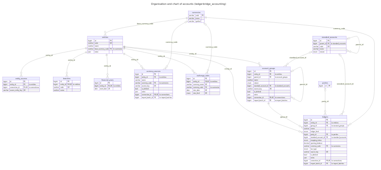
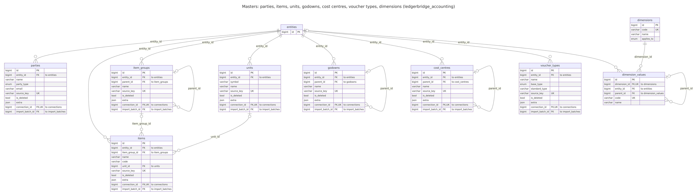
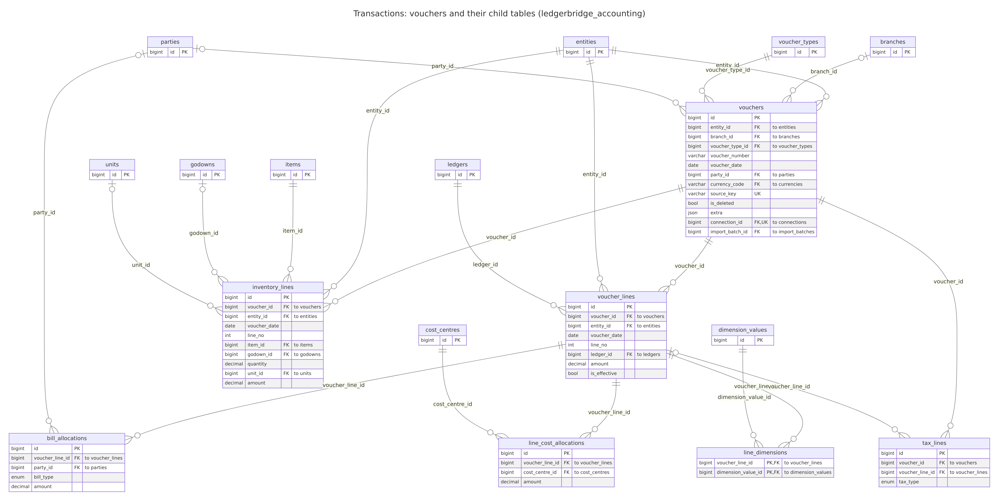
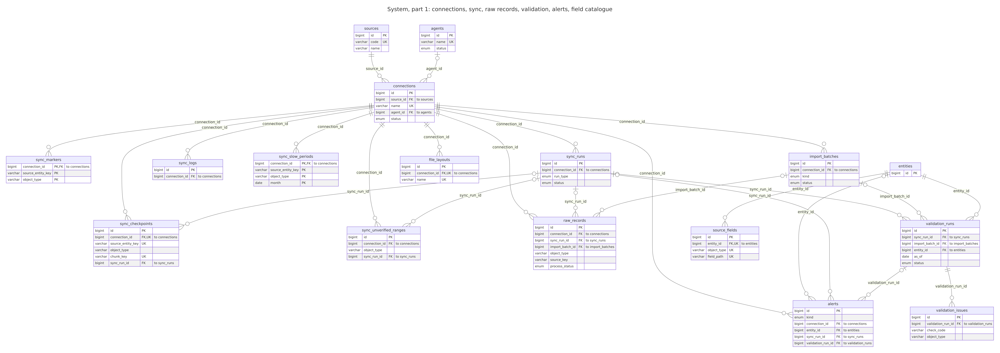
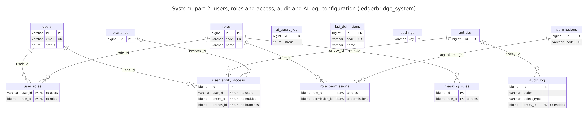
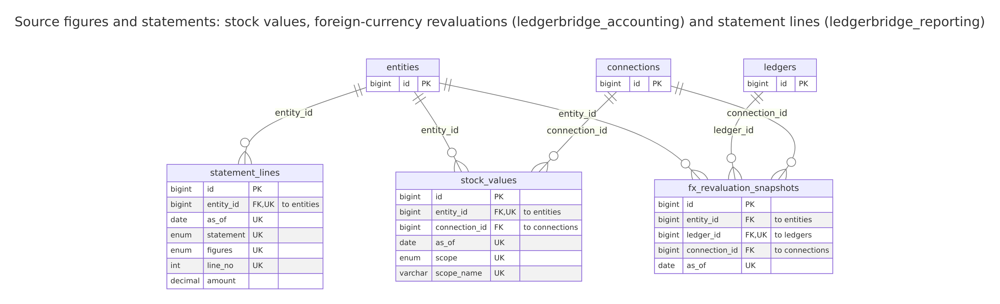

<!-- Generated by `python -m devtools.schema_reference` from core/models (./dev.ps1 diagrams): don't edit by hand. -->

# Database schema reference

Every database, table and column of the client-hosted data plane (MySQL 8), generated from the code. For the design and its reasons see [schema.md](../schema.md) and the decision log in [architecture.md](../architecture.md); for the conversion and validation rules see [the rulebook](../rules/validation-and-conversion-rules.md).

56 tables, 627 columns.

**Conventions.** Amounts are `DECIMAL(20,4)` in the base currency with the **canonical sign**: debit positive, credit negative (schema.md 1, 7.1). Every accounting table carries its source tracking columns (`connection_id`, `source_key`, `source_alter_id`, `origin`, `import_batch_id`, `raw_record_id`). Rows deleted in the source are kept with `is_deleted` (soft delete). `PK` primary key, `FK` foreign key, `UK` part of a unique key.

## 1. The four databases

| Database | What it holds | Tables |
| --- | --- | --- |
| `ledgerbridge_source` | Raw layer: every record exactly as the source sent it (ADR-005). Written only by connectors through the sync; the transform reads it. | 1 |
| `ledgerbridge_accounting` | Canonical model: companies, chart of accounts, masters and transactions in one shape for every source. Written by the transform; read by validation, reports and (later) the reporting layer. | 29 |
| `ledgerbridge_reporting` | Semantic layer for reports and AI (M6): views and aggregate tables. Empty until M6; the only database the AI user can read (AI-003). | 1 |
| `ledgerbridge_system` | Running the platform: connections, sync runs and progress, validation, alerts, users, roles, audit and AI logs, configuration. | 25 |

## 2. Database users and their rights

Created by `deploy/mysql/init/01-schemas.sh` (schema.md 2.1). Each user has only the rights it needs; the AI can read the reporting layer and nothing else.

| User | Used by | Rights | Databases |
| --- | --- | --- | --- |
| `migrator` | schema changes, migrations only | ALL, including DDL, on every database | `ledgerbridge_source`, `ledgerbridge_system`, `ledgerbridge_accounting`, `ledgerbridge_reporting` |
| `app_rw` | API and workers | read and write on every database, no DDL | `ledgerbridge_source`, `ledgerbridge_system`, `ledgerbridge_accounting`, `ledgerbridge_reporting` |
| `report_ro` | reports | read only | `ledgerbridge_accounting`, `ledgerbridge_reporting` |
| `ai_ro` | AI queries | read only: reporting ONLY | `ledgerbridge_reporting` |

## 3. Diagrams

How to read them: [docs/diagrams/README.md](../diagrams/README.md).

**Overview** (keys only)

**Organisation and chart of accounts (ledgerbridge_accounting)**

**Masters: parties, items, units, godowns, cost centres, voucher types, dimensions (ledgerbridge_accounting)**

**Transactions: vouchers and their child tables (ledgerbridge_accounting)**

**System, part 1: connections, sync, raw records, validation, alerts, field catalogue**

**System, part 2: users, roles and access, audit and AI log, configuration (ledgerbridge_system)**

**Source figures and statements: stock values, foreign-currency revaluations (ledgerbridge_accounting) and statement lines (ledgerbridge_reporting)**

**Data flow, level 0** (the platform and what it talks to)

**Data flow, level 1** (inside the data plane)

## 4. Tables

## `ledgerbridge_source`: raw layer: data as received

### `ledgerbridge_source.raw_records`

**Purpose:** Every object fetched from a source, exactly as received (XML for Tally), one row per version.

**Filled by:** Sync (connector -> RawStore): a new row only when the payload changed (hash); `process_status` tracks the transform.

| Column | Type | Null | Key | Meaning |
| --- | --- | --- | --- | --- |
| `id` | BIGINT UNSIGNED | no | PK | Row id. |
| `connection_id` | BIGINT UNSIGNED | no | FK | The connection the row came from. |
| `sync_run_id` | BIGINT UNSIGNED | yes | FK | The sync run it belongs to. |
| `import_batch_id` | BIGINT UNSIGNED | yes | FK | The import it came from, for imported data. |
| `source_entity_key` | VARCHAR(191) | no |  | The source company's key (Tally: company GUID). |
| `object_type` | VARCHAR(64) | no |  | group, ledger, voucher_type, voucher, stock_item, ... |
| `source_key` | VARCHAR(191) | no |  | The source's own key (Tally: GUID); unique per connection. |
| `source_alter_id` | BIGINT | yes |  | The source's change counter (Tally: AlterID) when last stored. |
| `payload_format` | ENUM('xml','json','csv','txt') | no |  | Payload format. |
| `payload` | LONGTEXT | no |  | The record exactly as received (re-serialised XML). |
| `payload_hash` | CHAR(64) | no |  | SHA-256 of the payload: an unchanged record isn't stored again. |
| `received_at` | DATETIME(6) | no |  | When: received. |
| `process_status` | ENUM('pending','processed','failed','skipped') | no |  | pending / processed / failed / skipped (superseded). |
| `process_error` | TEXT | yes |  | Why the transform failed: error type and a short message, never SQL. |
| `process_warning` | TEXT | yes |  | Process warning. |
| `created_at` | DATETIME(6) | no |  | When the row was created (UTC). |
| `updated_at` | DATETIME(6) | no |  | When the row was last changed (UTC). |

**Keys and indexes:** index `ix_raw_records_conn_type_key` (connection_id, object_type, source_key); index `ix_raw_records_status_received` (process_status, received_at).

**Refers to:** `connection_id` → `connections.id`; `sync_run_id` → `sync_runs.id`; `import_batch_id` → `import_batches.id`.

## `ledgerbridge_accounting`: organisation and chart of accounts

### `ledgerbridge_accounting.entities`

**Purpose:** A company in the platform (one per source company).

**Filled by:** Transform, from the source's company record, on the first sync.

| Column | Type | Null | Key | Meaning |
| --- | --- | --- | --- | --- |
| `id` | BIGINT UNSIGNED | no | PK | Row id. |
| `code` | VARCHAR(32) | no | UK | Short code used in reports. |
| `name` | VARCHAR(255) | no |  | Name as the source keeps it. |
| `legal_name` | VARCHAR(255) | yes |  | Legal name. |
| `country_code` | CHAR(2) | no |  | Default `IN`. |
| `state_code` | VARCHAR(8) | yes |  | GST state code. |
| `gstin` | VARCHAR(32) | yes |  | 15 characters when valid; wider so source data that isn't fits (migration `0010`). |
| `pan` | VARCHAR(32) | yes |  | Pan. |
| `base_currency_code` | CHAR(3) | no | FK | Default `INR`. |
| `fy_start_month` | TINYINT | no |  | Default 4 (April) (DAT-006). |
| `books_from` | DATE | yes |  | Company inception / books start (IMP-001). |
| `is_active` | BOOL | no |  | Whether it is in use. |
| `extra` | JSON | yes |  | ADR-025 |
| `created_at` | DATETIME(6) | no |  | When the row was created (UTC). |
| `updated_at` | DATETIME(6) | no |  | When the row was last changed (UTC). |

**Keys and indexes:** unique (code).

**Refers to:** `base_currency_code` → `currencies.code`.

**Referred to by:** `account_groups`, `alerts`, `audit_log`, `branches`, `cost_centres`, `currency_sources`, `dimension_values`, `entity_sources`, `exchange_rates`, `financial_years`, `fx_revaluation_snapshots`, `godowns`, `inventory_lines`, `item_groups`, `items`, `ledgers`, `parties`, `source_fields`, `statement_lines`, `stock_values`, `units`, `user_entity_access`, `validation_runs`, `voucher_lines`, `voucher_types`, `vouchers`.

### `ledgerbridge_accounting.entity_sources`

**Purpose:** Which source company (by its key, Tally's GUID) belongs to which entity, on which connection.

**Filled by:** Transform, with the entity.

| Column | Type | Null | Key | Meaning |
| --- | --- | --- | --- | --- |
| `id` | BIGINT UNSIGNED | no | PK | Row id. |
| `entity_id` | BIGINT UNSIGNED | no | FK | The entity (company) the row belongs to. |
| `connection_id` | BIGINT UNSIGNED | no | FK, UK | The connection the row came from. |
| `source_entity_key` | VARCHAR(191) | no | UK | Tally company GUID or name, Zoho organization ID. |
| `source_entity_name` | VARCHAR(255) | no |  | Source entity name. |
| `precedence` | SMALLINT | no |  | Higher wins on overlap (IMP-005). |
| `active_from` | DATE | yes |  | Active from. |
| `active_to` | DATE | yes |  | Active to. |
| `created_at` | DATETIME(6) | no |  | When the row was created (UTC). |
| `updated_at` | DATETIME(6) | no |  | When the row was last changed (UTC). |

**Keys and indexes:** unique (connection_id, source_entity_key).

**Refers to:** `entity_id` → `entities.id`; `connection_id` → `connections.id`.

### `ledgerbridge_accounting.branches`

**Purpose:** Branches of an entity (planned).

**Filled by:** Not filled yet.

| Column | Type | Null | Key | Meaning |
| --- | --- | --- | --- | --- |
| `id` | BIGINT UNSIGNED | no | PK | Row id. |
| `entity_id` | BIGINT UNSIGNED | no | FK, UK | The entity (company) the row belongs to. |
| `code` | VARCHAR(64) | no | UK | Short stable code. |
| `name` | VARCHAR(255) | no |  | Name as the source keeps it. |
| `state_code` | VARCHAR(8) | yes |  | GST state code. |
| `gstin` | VARCHAR(32) | yes |  | GST registration number. |
| `is_active` | BOOL | no |  | Whether it is in use. |
| `created_at` | DATETIME(6) | no |  | When the row was created (UTC). |
| `updated_at` | DATETIME(6) | no |  | When the row was last changed (UTC). |

**Keys and indexes:** unique (entity_id, code).

**Refers to:** `entity_id` → `entities.id`.

**Referred to by:** `user_entity_access`, `vouchers`.

### `ledgerbridge_accounting.financial_years`

**Purpose:** Financial years of an entity (planned).

**Filled by:** Not filled yet.

| Column | Type | Null | Key | Meaning |
| --- | --- | --- | --- | --- |
| `id` | BIGINT UNSIGNED | no | PK | Row id. |
| `entity_id` | BIGINT UNSIGNED | no | FK, UK | The entity (company) the row belongs to. |
| `label` | VARCHAR(64) | no |  | Label. |
| `start_date` | DATE | no | UK | Start date. |
| `end_date` | DATE | no |  | End date. |
| `is_closed` | BOOL | no |  | Whether closed. |
| `created_at` | DATETIME(6) | no |  | When the row was created (UTC). |
| `updated_at` | DATETIME(6) | no |  | When the row was last changed (UTC). |

**Keys and indexes:** unique (entity_id, start_date).

**Refers to:** `entity_id` → `entities.id`.

### `ledgerbridge_accounting.currencies`

**Purpose:** Currencies by ISO code, with the symbol the source writes.

**Filled by:** Seeded (INR); foreign currencies from the source's currency masters (FX-001).

| Column | Type | Null | Key | Meaning |
| --- | --- | --- | --- | --- |
| `code` | CHAR(3) | no | PK | ISO 4217 |
| `name` | VARCHAR(255) | no |  | Name as the source keeps it. |
| `decimal_places` | TINYINT | no |  | Decimals shown. |
| `symbol` | VARCHAR(16) | yes |  | e.g. "$" |
| `created_at` | DATETIME(6) | no |  | When the row was created (UTC). |
| `updated_at` | DATETIME(6) | no |  | When the row was last changed (UTC). |

**Referred to by:** `currency_sources`, `entities`, `exchange_rates`, `ledgers`, `vouchers`.

### `ledgerbridge_accounting.currency_sources`

**Purpose:** Each entity's currencies as its source names them (e.g. "$"), with the ISO code when the source gives one (FX-001).

**Filled by:** Transform, from currency masters.

| Column | Type | Null | Key | Meaning |
| --- | --- | --- | --- | --- |
| `id` | BIGINT UNSIGNED | no | PK | Row id. |
| `entity_id` | BIGINT UNSIGNED | no | FK | The entity (company) the row belongs to. |
| `name` | VARCHAR(255) | no |  | as the source writes it in amounts ("$") |
| `currency_code` | CHAR(3) | yes | FK | Currency (ISO code). |
| `formal_name` | VARCHAR(255) | yes |  | Formal name. |
| `decimal_places` | TINYINT | yes |  | Decimals shown. |
| `source_key` | VARCHAR(191) | no | UK | The source's own key (Tally: GUID); unique per connection. |
| `source_alter_id` | BIGINT | yes |  | The source's change counter (Tally: AlterID) when last stored. |
| `origin` | ENUM('live','backup','file','manual') | no |  | live or backup (IMP-004). |
| `raw_record_id` | BIGINT UNSIGNED | yes |  | The raw record it was transformed from. |
| `is_deleted` | BOOL | no |  | Deleted in the source (soft delete; kept for history). |
| `extra` | JSON | yes |  | Source fields with no column, as JSON (ADR-025). |
| `connection_id` | BIGINT UNSIGNED | no | FK, UK | The connection the row came from. |
| `import_batch_id` | BIGINT UNSIGNED | yes | FK | The import it came from, for imported data. |
| `created_at` | DATETIME(6) | no |  | When the row was created (UTC). |
| `updated_at` | DATETIME(6) | no |  | When the row was last changed (UTC). |

**Keys and indexes:** unique (connection_id, source_key); index `ix_currency_sources_raw_record` (raw_record_id).

**Refers to:** `entity_id` → `entities.id`; `currency_code` → `currencies.code`; `connection_id` → `connections.id`; `import_batch_id` → `import_batches.id`.

### `ledgerbridge_accounting.exchange_rates`

**Purpose:** Rates per entity, currency and date, each with its kind and source: the source's own rate list, or the day's voucher lines weighted by foreign amount (FX-003).

**Filled by:** Transform: currency masters' rate lists and voucher rates.

| Column | Type | Null | Key | Meaning |
| --- | --- | --- | --- | --- |
| `id` | BIGINT UNSIGNED | no | PK | Row id. |
| `entity_id` | BIGINT UNSIGNED | no | FK, UK | The entity (company) the row belongs to. |
| `currency_name` | VARCHAR(64) | no | UK | Currency name. |
| `currency_code` | CHAR(3) | yes | FK | Currency (ISO code). |
| `rate_date` | DATE | no | UK | Rate date. |
| `rate` | NUMERIC(20, 8) | no |  | Rate. |
| `rate_kind` | ENUM('standard','buying','selling','vouchers') | no | UK | Rate kind. |
| `source` | ENUM('source_rate_list','vouchers') | no |  | Source. |
| `voucher_count` | INTEGER | yes |  | Voucher count. |
| `created_at` | DATETIME(6) | no |  | When the row was created (UTC). |
| `updated_at` | DATETIME(6) | no |  | When the row was last changed (UTC). |

**Keys and indexes:** unique (entity_id, currency_name, rate_date, rate_kind).

**Refers to:** `entity_id` → `entities.id`; `currency_code` → `currencies.code`.

### `ledgerbridge_accounting.standard_accounts`

**Purpose:** The standard chart of accounts used to compare and combine companies (RPT-006).

**Filled by:** Seeded by a migration.

| Column | Type | Null | Key | Meaning |
| --- | --- | --- | --- | --- |
| `id` | BIGINT UNSIGNED | no | PK | Row id. |
| `parent_id` | BIGINT UNSIGNED | yes | FK | Hierarchy. |
| `code` | VARCHAR(32) | no | UK | Short stable code. |
| `name` | VARCHAR(255) | no |  | Name as the source keeps it. |
| `nature` | ENUM('asset','liability','equity','income','expense') | no |  | Nature. |
| `statement` | ENUM('balance_sheet','profit_loss') | no |  | Statement. |
| `statement_line` | VARCHAR(64) | no |  | e.g. `revenue`, `cogs`, `current_assets`. |
| `cash_flow_class` | ENUM('operating','investing','financing','cash','none') | no |  | For cash flow statement. |
| `sort_order` | INTEGER | no |  | Sort order. |
| `created_at` | DATETIME(6) | no |  | When the row was created (UTC). |
| `updated_at` | DATETIME(6) | no |  | When the row was last changed (UTC). |

**Keys and indexes:** unique (code).

**Refers to:** `parent_id` → `standard_accounts.id`.

**Referred to by:** `account_groups`, `ledgers`, `standard_accounts`.

### `ledgerbridge_accounting.account_groups`

**Purpose:** The source's group tree (Tally groups), per entity, as kept there.

**Filled by:** Transform, from group masters; renamed reserved groups keep their reserved name as an alias.

| Column | Type | Null | Key | Meaning |
| --- | --- | --- | --- | --- |
| `id` | BIGINT UNSIGNED | no | PK | Row id. |
| `entity_id` | BIGINT UNSIGNED | no | FK | The entity (company) the row belongs to. |
| `parent_id` | BIGINT UNSIGNED | yes | FK | The parent row in the same table (a tree). |
| `name` | VARCHAR(255) | no |  | Name as the source keeps it. |
| `nature` | ENUM('asset','liability','equity','income','expense') | yes |  | Derived from primary group. |
| `is_primary` | BOOL | no |  | Tally's 28 predefined primary groups. |
| `affects_gross_profit` | BOOL | no |  | Tally flag for P&L layout. |
| `standard_account_id` | BIGINT UNSIGNED | yes | FK | Default mapping for ledgers under this group. |
| `source_key` | VARCHAR(191) | no | UK | The source's own key (Tally: GUID); unique per connection. |
| `source_alter_id` | BIGINT | yes |  | The source's change counter (Tally: AlterID) when last stored. |
| `origin` | ENUM('live','backup','file','manual') | no |  | live or backup (IMP-004). |
| `raw_record_id` | BIGINT UNSIGNED | yes |  | The raw record it was transformed from. |
| `is_deleted` | BOOL | no |  | Deleted in the source (soft delete; kept for history). |
| `extra` | JSON | yes |  | Source fields with no column, as JSON (ADR-025). |
| `connection_id` | BIGINT UNSIGNED | no | FK, UK | The connection the row came from. |
| `import_batch_id` | BIGINT UNSIGNED | yes | FK | The import it came from, for imported data. |
| `created_at` | DATETIME(6) | no |  | When the row was created (UTC). |
| `updated_at` | DATETIME(6) | no |  | When the row was last changed (UTC). |

**Keys and indexes:** unique (connection_id, source_key); index `ix_account_groups_raw_record` (raw_record_id).

**Refers to:** `entity_id` → `entities.id`; `parent_id` → `account_groups.id`; `standard_account_id` → `standard_accounts.id`; `connection_id` → `connections.id`; `import_batch_id` → `import_batches.id`.

**Referred to by:** `account_groups`, `ledgers`.

### `ledgerbridge_accounting.ledgers`

**Purpose:** The source's ledgers, per entity, with their group, kind, standard account, opening balance as at the books' beginning and tax type.

**Filled by:** Transform, from ledger masters fetched for a period starting on the books' beginning.

| Column | Type | Null | Key | Meaning |
| --- | --- | --- | --- | --- |
| `id` | BIGINT UNSIGNED | no | PK | Row id. |
| `entity_id` | BIGINT UNSIGNED | no | FK | The entity (company) the row belongs to. |
| `group_id` | BIGINT UNSIGNED | no | FK | Refers to `account_groups`. |
| `name` | VARCHAR(255) | no |  | Name as the source keeps it. |
| `alias` | VARCHAR(255) | yes |  | Alias. |
| `ledger_kind` | ENUM('party','bank','cash','tax','stock','income','expense','asset','liability','equity','other') | no |  | party, bank, cash, tax, stock, ... (from the reserved group). |
| `party_id` | BIGINT UNSIGNED | yes | FK | Set for customer/vendor ledgers. |
| `standard_account_id` | BIGINT UNSIGNED | yes | FK | Overrides group mapping. |
| `mapping_status` | ENUM('auto','suggested','confirmed','unmapped') | no |  | auto (a standard account was found) or unmapped. |
| `opening_balance` | NUMERIC(20, 4) | no |  | Signed; as at `opening_balance_date`. |
| `opening_balance_date` | DATE | yes |  | Opening balance date. |
| `currency_code` | CHAR(3) | no | FK | Currency (ISO code). |
| `currency_name` | VARCHAR(64) | yes |  | Currency name. |
| `opening_balance_fc` | NUMERIC(20, 4) | yes |  | Opening balance fc. |
| `is_bill_wise` | BOOL | no |  | Whether bill wise. |
| `is_cost_centre_applicable` | BOOL | no |  | Whether cost centre applicable. |
| `gstin` | VARCHAR(32) | yes |  | GST registration number. |
| `tax_type` | ENUM('cgst','sgst','igst','cess','tds','tcs','vat','other') | yes |  | cgst, sgst, igst, cess, tds, tcs, vat for tax ledgers. |
| `source_key` | VARCHAR(191) | no | UK | The source's own key (Tally: GUID); unique per connection. |
| `source_alter_id` | BIGINT | yes |  | The source's change counter (Tally: AlterID) when last stored. |
| `origin` | ENUM('live','backup','file','manual') | no |  | live or backup (IMP-004). |
| `raw_record_id` | BIGINT UNSIGNED | yes |  | The raw record it was transformed from. |
| `is_deleted` | BOOL | no |  | Deleted in the source (soft delete; kept for history). |
| `extra` | JSON | yes |  | Source fields with no column, as JSON (ADR-025). |
| `connection_id` | BIGINT UNSIGNED | no | FK, UK | The connection the row came from. |
| `import_batch_id` | BIGINT UNSIGNED | yes | FK | The import it came from, for imported data. |
| `created_at` | DATETIME(6) | no |  | When the row was created (UTC). |
| `updated_at` | DATETIME(6) | no |  | When the row was last changed (UTC). |

**Keys and indexes:** unique (connection_id, source_key); index `ix_ledgers_entity_group` (entity_id, group_id); index `ix_ledgers_entity_name` (entity_id, name); index `ix_ledgers_raw_record` (raw_record_id).

**Refers to:** `entity_id` → `entities.id`; `group_id` → `account_groups.id`; `party_id` → `parties.id`; `standard_account_id` → `standard_accounts.id`; `currency_code` → `currencies.code`; `connection_id` → `connections.id`; `import_batch_id` → `import_batches.id`.

**Referred to by:** `fx_revaluation_snapshots`, `voucher_lines`.

## `ledgerbridge_accounting`: masters

### `ledgerbridge_accounting.parties`

**Purpose:** Customers and vendors (the ledgers under Sundry Debtors / Creditors), with GST, PAN and contact details (sensitive: AI-015).

**Filled by:** Transform, with their ledgers.

| Column | Type | Null | Key | Meaning |
| --- | --- | --- | --- | --- |
| `id` | BIGINT UNSIGNED | no | PK | Row id. |
| `entity_id` | BIGINT UNSIGNED | no | FK | The entity (company) the row belongs to. |
| `name` | VARCHAR(255) | no |  | **Sensitive** (masking candidate). |
| `party_type` | ENUM('customer','vendor','both','other') | no |  | Tally: Sundry Debtors → customer, Sundry Creditors → vendor. |
| `gstin` | VARCHAR(32) | yes |  | GST registration number. |
| `pan` | VARCHAR(32) | yes |  | **Sensitive.** |
| `state_code` | VARCHAR(8) | yes |  | GST state code. |
| `country_code` | CHAR(2) | yes |  | Country code. |
| `credit_days` | INTEGER | yes |  | Used for ageing and overdue flags. |
| `credit_limit` | NUMERIC(20, 4) | yes |  | Credit limit. |
| `email` | VARCHAR(255) | yes |  | E-mail address. |
| `phone` | VARCHAR(255) | yes |  | Phone. |
| `source_key` | VARCHAR(191) | no | UK | The source's own key (Tally: GUID); unique per connection. |
| `source_alter_id` | BIGINT | yes |  | The source's change counter (Tally: AlterID) when last stored. |
| `origin` | ENUM('live','backup','file','manual') | no |  | live or backup (IMP-004). |
| `raw_record_id` | BIGINT UNSIGNED | yes |  | The raw record it was transformed from. |
| `is_deleted` | BOOL | no |  | Deleted in the source (soft delete; kept for history). |
| `extra` | JSON | yes |  | Source fields with no column, as JSON (ADR-025). |
| `connection_id` | BIGINT UNSIGNED | no | FK, UK | The connection the row came from. |
| `import_batch_id` | BIGINT UNSIGNED | yes | FK | The import it came from, for imported data. |
| `created_at` | DATETIME(6) | no |  | When the row was created (UTC). |
| `updated_at` | DATETIME(6) | no |  | When the row was last changed (UTC). |

**Keys and indexes:** unique (connection_id, source_key); index `ix_parties_raw_record` (raw_record_id).

**Refers to:** `entity_id` → `entities.id`; `connection_id` → `connections.id`; `import_batch_id` → `import_batches.id`.

**Referred to by:** `bill_allocations`, `ledgers`, `vouchers`.

### `ledgerbridge_accounting.items`

**Purpose:** Stock items with their opening quantity and value.

**Filled by:** Transform, from stock item masters (as at the books' beginning).

| Column | Type | Null | Key | Meaning |
| --- | --- | --- | --- | --- |
| `id` | BIGINT UNSIGNED | no | PK | Row id. |
| `entity_id` | BIGINT UNSIGNED | no | FK | The entity (company) the row belongs to. |
| `item_group_id` | BIGINT UNSIGNED | yes | FK | Refers to `item_groups`. |
| `name` | VARCHAR(255) | no |  | Name as the source keeps it. |
| `code` | VARCHAR(255) | yes |  | Short stable code. |
| `unit_id` | BIGINT UNSIGNED | yes | FK | Refers to `units`. |
| `hsn_code` | VARCHAR(32) | yes |  | Hsn code. |
| `gst_rate` | NUMERIC(20, 6) | yes |  | Gst rate. |
| `opening_qty` | NUMERIC(20, 6) | no |  | Opening qty. |
| `opening_value` | NUMERIC(20, 4) | no |  | Opening value. |
| `source_key` | VARCHAR(191) | no | UK | The source's own key (Tally: GUID); unique per connection. |
| `source_alter_id` | BIGINT | yes |  | The source's change counter (Tally: AlterID) when last stored. |
| `origin` | ENUM('live','backup','file','manual') | no |  | live or backup (IMP-004). |
| `raw_record_id` | BIGINT UNSIGNED | yes |  | The raw record it was transformed from. |
| `is_deleted` | BOOL | no |  | Deleted in the source (soft delete; kept for history). |
| `extra` | JSON | yes |  | Source fields with no column, as JSON (ADR-025). |
| `connection_id` | BIGINT UNSIGNED | no | FK, UK | The connection the row came from. |
| `import_batch_id` | BIGINT UNSIGNED | yes | FK | The import it came from, for imported data. |
| `created_at` | DATETIME(6) | no |  | When the row was created (UTC). |
| `updated_at` | DATETIME(6) | no |  | When the row was last changed (UTC). |

**Keys and indexes:** unique (connection_id, source_key); index `ix_items_raw_record` (raw_record_id).

**Refers to:** `entity_id` → `entities.id`; `item_group_id` → `item_groups.id`; `unit_id` → `units.id`; `connection_id` → `connections.id`; `import_batch_id` → `import_batches.id`.

**Referred to by:** `inventory_lines`.

### `ledgerbridge_accounting.item_groups`

**Purpose:** Stock groups.

**Filled by:** Transform, from stock group masters.

| Column | Type | Null | Key | Meaning |
| --- | --- | --- | --- | --- |
| `id` | BIGINT UNSIGNED | no | PK | Row id. |
| `entity_id` | BIGINT UNSIGNED | no | FK | The entity (company) the row belongs to. |
| `parent_id` | BIGINT UNSIGNED | yes | FK | The parent row in the same table (a tree). |
| `name` | VARCHAR(255) | no |  | Name as the source keeps it. |
| `source_key` | VARCHAR(191) | no | UK | The source's own key (Tally: GUID); unique per connection. |
| `source_alter_id` | BIGINT | yes |  | The source's change counter (Tally: AlterID) when last stored. |
| `origin` | ENUM('live','backup','file','manual') | no |  | live or backup (IMP-004). |
| `raw_record_id` | BIGINT UNSIGNED | yes |  | The raw record it was transformed from. |
| `is_deleted` | BOOL | no |  | Deleted in the source (soft delete; kept for history). |
| `extra` | JSON | yes |  | Source fields with no column, as JSON (ADR-025). |
| `connection_id` | BIGINT UNSIGNED | no | FK, UK | The connection the row came from. |
| `import_batch_id` | BIGINT UNSIGNED | yes | FK | The import it came from, for imported data. |
| `created_at` | DATETIME(6) | no |  | When the row was created (UTC). |
| `updated_at` | DATETIME(6) | no |  | When the row was last changed (UTC). |

**Keys and indexes:** unique (connection_id, source_key); index `ix_item_groups_raw_record` (raw_record_id).

**Refers to:** `entity_id` → `entities.id`; `parent_id` → `item_groups.id`; `connection_id` → `connections.id`; `import_batch_id` → `import_batches.id`.

**Referred to by:** `item_groups`, `items`.

### `ledgerbridge_accounting.units`

**Purpose:** Units of measure.

**Filled by:** Transform, from unit masters.

| Column | Type | Null | Key | Meaning |
| --- | --- | --- | --- | --- |
| `id` | BIGINT UNSIGNED | no | PK | Row id. |
| `entity_id` | BIGINT UNSIGNED | no | FK | The entity (company) the row belongs to. |
| `symbol` | VARCHAR(255) | no |  | Symbol. |
| `name` | VARCHAR(255) | no |  | Name as the source keeps it. |
| `decimal_places` | TINYINT | no |  | Decimals shown. |
| `source_key` | VARCHAR(191) | no | UK | The source's own key (Tally: GUID); unique per connection. |
| `source_alter_id` | BIGINT | yes |  | The source's change counter (Tally: AlterID) when last stored. |
| `origin` | ENUM('live','backup','file','manual') | no |  | live or backup (IMP-004). |
| `raw_record_id` | BIGINT UNSIGNED | yes |  | The raw record it was transformed from. |
| `is_deleted` | BOOL | no |  | Deleted in the source (soft delete; kept for history). |
| `extra` | JSON | yes |  | Source fields with no column, as JSON (ADR-025). |
| `connection_id` | BIGINT UNSIGNED | no | FK, UK | The connection the row came from. |
| `import_batch_id` | BIGINT UNSIGNED | yes | FK | The import it came from, for imported data. |
| `created_at` | DATETIME(6) | no |  | When the row was created (UTC). |
| `updated_at` | DATETIME(6) | no |  | When the row was last changed (UTC). |

**Keys and indexes:** unique (connection_id, source_key); index `ix_units_raw_record` (raw_record_id).

**Refers to:** `entity_id` → `entities.id`; `connection_id` → `connections.id`; `import_batch_id` → `import_batches.id`.

**Referred to by:** `inventory_lines`, `items`.

### `ledgerbridge_accounting.godowns`

**Purpose:** Godowns (locations) and whose stock they hold (`holding`, ADR-031).

**Filled by:** Transform, from godown masters.

| Column | Type | Null | Key | Meaning |
| --- | --- | --- | --- | --- |
| `id` | BIGINT UNSIGNED | no | PK | Row id. |
| `entity_id` | BIGINT UNSIGNED | no | FK | The entity (company) the row belongs to. |
| `parent_id` | BIGINT UNSIGNED | yes | FK | The parent row in the same table (a tree). |
| `name` | VARCHAR(255) | no |  | Name as the source keeps it. |
| `holding` | ENUM('own','ours_with_third_party','third_party_with_us') | no |  | own / ours_with_third_party (a job worker's) / third_party_with_us. |
| `source_key` | VARCHAR(191) | no | UK | The source's own key (Tally: GUID); unique per connection. |
| `source_alter_id` | BIGINT | yes |  | The source's change counter (Tally: AlterID) when last stored. |
| `origin` | ENUM('live','backup','file','manual') | no |  | live or backup (IMP-004). |
| `raw_record_id` | BIGINT UNSIGNED | yes |  | The raw record it was transformed from. |
| `is_deleted` | BOOL | no |  | Deleted in the source (soft delete; kept for history). |
| `extra` | JSON | yes |  | Source fields with no column, as JSON (ADR-025). |
| `connection_id` | BIGINT UNSIGNED | no | FK, UK | The connection the row came from. |
| `import_batch_id` | BIGINT UNSIGNED | yes | FK | The import it came from, for imported data. |
| `created_at` | DATETIME(6) | no |  | When the row was created (UTC). |
| `updated_at` | DATETIME(6) | no |  | When the row was last changed (UTC). |

**Keys and indexes:** unique (connection_id, source_key); index `ix_godowns_raw_record` (raw_record_id).

**Refers to:** `entity_id` → `entities.id`; `parent_id` → `godowns.id`; `connection_id` → `connections.id`; `import_batch_id` → `import_batches.id`.

**Referred to by:** `godowns`, `inventory_lines`.

### `ledgerbridge_accounting.cost_centres`

**Purpose:** Cost centres and their categories.

**Filled by:** Transform, from cost centre masters.

| Column | Type | Null | Key | Meaning |
| --- | --- | --- | --- | --- |
| `id` | BIGINT UNSIGNED | no | PK | Row id. |
| `entity_id` | BIGINT UNSIGNED | no | FK | The entity (company) the row belongs to. |
| `parent_id` | BIGINT UNSIGNED | yes | FK | The parent row in the same table (a tree). |
| `category` | VARCHAR(255) | yes |  | Category. |
| `name` | VARCHAR(255) | no |  | Name as the source keeps it. |
| `source_key` | VARCHAR(191) | no | UK | The source's own key (Tally: GUID); unique per connection. |
| `source_alter_id` | BIGINT | yes |  | The source's change counter (Tally: AlterID) when last stored. |
| `origin` | ENUM('live','backup','file','manual') | no |  | live or backup (IMP-004). |
| `raw_record_id` | BIGINT UNSIGNED | yes |  | The raw record it was transformed from. |
| `is_deleted` | BOOL | no |  | Deleted in the source (soft delete; kept for history). |
| `extra` | JSON | yes |  | Source fields with no column, as JSON (ADR-025). |
| `connection_id` | BIGINT UNSIGNED | no | FK, UK | The connection the row came from. |
| `import_batch_id` | BIGINT UNSIGNED | yes | FK | The import it came from, for imported data. |
| `created_at` | DATETIME(6) | no |  | When the row was created (UTC). |
| `updated_at` | DATETIME(6) | no |  | When the row was last changed (UTC). |

**Keys and indexes:** unique (connection_id, source_key); index `ix_cost_centres_raw_record` (raw_record_id).

**Refers to:** `entity_id` → `entities.id`; `parent_id` → `cost_centres.id`; `connection_id` → `connections.id`; `import_batch_id` → `import_batches.id`.

**Referred to by:** `cost_centres`, `line_cost_allocations`.

### `ledgerbridge_accounting.voucher_types`

**Purpose:** The source's voucher types and the standard type each derives from; whether its vouchers post to the books and move stock.

**Filled by:** Transform, from voucher type masters (type tree resolved, ADR-027).

| Column | Type | Null | Key | Meaning |
| --- | --- | --- | --- | --- |
| `id` | BIGINT UNSIGNED | no | PK | Row id. |
| `entity_id` | BIGINT UNSIGNED | no | FK | The entity (company) the row belongs to. |
| `name` | VARCHAR(255) | no |  | Name as the source keeps it. |
| `base_type` | ENUM('sales','purchase','payment','receipt','journal','contra','debit_note','credit_note','stock_journal','delivery_note','receipt_note','other') | no |  | Base type. |
| `is_accounting` | BOOL | no |  | Whether accounting. |
| `is_inventory` | BOOL | no |  | Whether inventory. |
| `standard_type` | VARCHAR(64) | yes |  | Standard type. |
| `moves_stock` | BOOL | no |  | Moves stock. |
| `source_key` | VARCHAR(191) | no | UK | The source's own key (Tally: GUID); unique per connection. |
| `source_alter_id` | BIGINT | yes |  | The source's change counter (Tally: AlterID) when last stored. |
| `origin` | ENUM('live','backup','file','manual') | no |  | live or backup (IMP-004). |
| `raw_record_id` | BIGINT UNSIGNED | yes |  | The raw record it was transformed from. |
| `is_deleted` | BOOL | no |  | Deleted in the source (soft delete; kept for history). |
| `extra` | JSON | yes |  | Source fields with no column, as JSON (ADR-025). |
| `connection_id` | BIGINT UNSIGNED | no | FK, UK | The connection the row came from. |
| `import_batch_id` | BIGINT UNSIGNED | yes | FK | The import it came from, for imported data. |
| `created_at` | DATETIME(6) | no |  | When the row was created (UTC). |
| `updated_at` | DATETIME(6) | no |  | When the row was last changed (UTC). |

**Keys and indexes:** unique (connection_id, source_key); index `ix_voucher_types_raw_record` (raw_record_id).

**Refers to:** `entity_id` → `entities.id`; `connection_id` → `connections.id`; `import_batch_id` → `import_batches.id`.

**Referred to by:** `vouchers`.

### `ledgerbridge_accounting.dimensions`

**Purpose:** User-defined reporting dimensions (DAT-005), e.g. a promoted UDF.

**Filled by:** `promote-field`, from the field catalogue.

| Column | Type | Null | Key | Meaning |
| --- | --- | --- | --- | --- |
| `id` | BIGINT UNSIGNED | no | PK | Row id. |
| `code` | VARCHAR(64) | no | UK | Short stable code. |
| `name` | VARCHAR(255) | no |  | Name as the source keeps it. |
| `applies_to` | ENUM('voucher','line') | no |  | Applies to. |
| `is_active` | BOOL | no |  | Whether it is in use. |
| `source_object_type` | VARCHAR(64) | yes |  | Source object type. |
| `source_field` | VARCHAR(255) | yes |  | Source field. |
| `created_at` | DATETIME(6) | no |  | When the row was created (UTC). |
| `updated_at` | DATETIME(6) | no |  | When the row was last changed (UTC). |

**Keys and indexes:** unique (code).

**Referred to by:** `dimension_values`.

### `ledgerbridge_accounting.dimension_values`

**Purpose:** The values of a dimension.

**Filled by:** Transform, for promoted fields.

| Column | Type | Null | Key | Meaning |
| --- | --- | --- | --- | --- |
| `id` | BIGINT UNSIGNED | no | PK | Row id. |
| `dimension_id` | BIGINT UNSIGNED | no | FK, UK | Refers to `dimensions`. |
| `entity_id` | BIGINT UNSIGNED | yes | FK | The entity (company) the row belongs to. |
| `parent_id` | BIGINT UNSIGNED | yes | FK | The parent row in the same table (a tree). |
| `code` | VARCHAR(64) | no | UK | Short stable code. |
| `name` | VARCHAR(255) | no |  | Name as the source keeps it. |
| `created_at` | DATETIME(6) | no |  | When the row was created (UTC). |
| `updated_at` | DATETIME(6) | no |  | When the row was last changed (UTC). |

**Keys and indexes:** unique (dimension_id, code).

**Refers to:** `dimension_id` → `dimensions.id`; `entity_id` → `entities.id`; `parent_id` → `dimension_values.id`.

**Referred to by:** `dimension_values`, `line_dimensions`.

## `ledgerbridge_accounting`: transactions

### `ledgerbridge_accounting.vouchers`

**Purpose:** Vouchers (transactions) with their type, number, date, party and flags.

**Filled by:** Transform, from voucher records; replaced as a whole with their child rows (schema.md 8 rule 7).

| Column | Type | Null | Key | Meaning |
| --- | --- | --- | --- | --- |
| `id` | BIGINT UNSIGNED | no | PK | Row id. |
| `entity_id` | BIGINT UNSIGNED | no | FK | The entity (company) the row belongs to. |
| `branch_id` | BIGINT UNSIGNED | yes | FK | Refers to `branches`. |
| `voucher_type_id` | BIGINT UNSIGNED | no | FK | Refers to `voucher_types`. |
| `voucher_number` | VARCHAR(255) | no |  | The source's voucher number (up to 255 characters). |
| `voucher_date` | DATE | no |  | The voucher's date (denormalised for fast period queries). |
| `reference_number` | VARCHAR(255) | yes |  | The source's reference (e.g. the supplier's invoice number). |
| `reference_date` | DATE | yes |  | Reference date. |
| `effective_date` | DATE | yes |  | The source's effective date (Tally `EFFECTIVEDATE`); balances count by `voucher_date`, as Tally does. Migration `0016`. |
| `party_id` | BIGINT UNSIGNED | yes | FK | Main party, if any. |
| `narration` | TEXT | yes |  | Searchable via RAG later (AI-010). |
| `currency_code` | CHAR(3) | no | FK | Currency (ISO code). |
| `exchange_rate` | NUMERIC(20, 8) | no |  | Exchange rate. |
| `is_cancelled` | BOOL | no |  | Whether cancelled. |
| `is_optional` | BOOL | no |  | Tally optional/memo vouchers, excluded from books. |
| `is_post_dated` | BOOL | no |  | The source marks it post-dated; it counts from its date. |
| `source_key` | VARCHAR(191) | no | UK | The source's own key (Tally: GUID); unique per connection. |
| `source_alter_id` | BIGINT | yes |  | The source's change counter (Tally: AlterID) when last stored. |
| `origin` | ENUM('live','backup','file','manual') | no |  | live or backup (IMP-004). |
| `raw_record_id` | BIGINT UNSIGNED | yes |  | The raw record it was transformed from. |
| `is_deleted` | BOOL | no |  | Deleted in the source (soft delete; kept for history). |
| `extra` | JSON | yes |  | Source fields with no column, as JSON (ADR-025). |
| `connection_id` | BIGINT UNSIGNED | no | FK, UK | The connection the row came from. |
| `import_batch_id` | BIGINT UNSIGNED | yes | FK | The import it came from, for imported data. |
| `created_at` | DATETIME(6) | no |  | When the row was created (UTC). |
| `updated_at` | DATETIME(6) | no |  | When the row was last changed (UTC). |

**Keys and indexes:** unique (connection_id, source_key); index `ix_vouchers_entity_date` (entity_id, voucher_date); index `ix_vouchers_entity_type_date` (entity_id, voucher_type_id, voucher_date); index `ix_vouchers_party_date` (party_id, voucher_date); index `ix_vouchers_raw_record` (raw_record_id).

**Refers to:** `entity_id` → `entities.id`; `branch_id` → `branches.id`; `voucher_type_id` → `voucher_types.id`; `party_id` → `parties.id`; `currency_code` → `currencies.code`; `connection_id` → `connections.id`; `import_batch_id` → `import_batches.id`.

**Referred to by:** `inventory_lines`, `tax_lines`, `voucher_lines`.

### `ledgerbridge_accounting.voucher_lines`

**Purpose:** The double-entry lines of each voucher (debit +, credit −); `is_effective` says whether a line counts in the books.

**Filled by:** Transform, with the voucher.

| Column | Type | Null | Key | Meaning |
| --- | --- | --- | --- | --- |
| `id` | BIGINT UNSIGNED | no | PK | Row id. |
| `voucher_id` | BIGINT UNSIGNED | no | FK | Refers to `vouchers`. |
| `entity_id` | BIGINT UNSIGNED | no | FK | Denormalized for fast filtering. |
| `voucher_date` | DATE | no |  | Denormalized for fast period queries. |
| `line_no` | INTEGER | no |  | Position of the line in its voucher. |
| `ledger_id` | BIGINT UNSIGNED | no | FK | Refers to `ledgers`. |
| `amount` | NUMERIC(20, 4) | no |  | Base currency, debit +, credit −. |
| `amount_fc` | NUMERIC(20, 4) | yes |  | Foreign-currency amount (Tally: the part before `@` of `-$100.00 @ Rs82.00/$ = -Rs8200.00`); its rate is `amount / amount_fc`. NULL in the base currency. |
| `currency_name` | VARCHAR(64) | yes |  | Currency name. |
| `exchange_rate` | NUMERIC(20, 8) | yes |  | Exchange rate. |
| `is_party_line` | BOOL | no |  | Whether party line. |
| `is_effective` | BOOL | no |  | Counts in the books: not cancelled, optional or deleted, and of a type that posts. |
| `created_at` | DATETIME(6) | no |  | When the row was created (UTC). |
| `updated_at` | DATETIME(6) | no |  | When the row was last changed (UTC). |

**Keys and indexes:** index `ix_voucher_lines_entity_ledger_date` (entity_id, ledger_id, voucher_date); index `ix_voucher_lines_voucher` (voucher_id).

**Refers to:** `voucher_id` → `vouchers.id`, on delete cascade; `entity_id` → `entities.id`; `ledger_id` → `ledgers.id`.

**Referred to by:** `bill_allocations`, `line_cost_allocations`, `line_dimensions`, `tax_lines`.

### `ledgerbridge_accounting.bill_allocations`

**Purpose:** Bill-wise allocations of a line (receivables and payables ageing).

**Filled by:** Transform, with the voucher.

| Column | Type | Null | Key | Meaning |
| --- | --- | --- | --- | --- |
| `id` | BIGINT UNSIGNED | no | PK | Row id. |
| `voucher_line_id` | BIGINT UNSIGNED | no | FK | Refers to `voucher_lines`. |
| `party_id` | BIGINT UNSIGNED | yes | FK | Refers to `parties`. |
| `bill_type` | ENUM('new_ref','against_ref','advance','on_account') | no |  | Bill type. |
| `bill_name` | VARCHAR(255) | yes |  | Bill name. |
| `bill_date` | DATE | yes |  | Bill date. |
| `due_date` | DATE | yes |  | Due date. |
| `amount` | NUMERIC(20, 4) | no |  | Amount in the base currency, canonical sign (debit +, credit −). |
| `created_at` | DATETIME(6) | no |  | When the row was created (UTC). |
| `updated_at` | DATETIME(6) | no |  | When the row was last changed (UTC). |

**Refers to:** `voucher_line_id` → `voucher_lines.id`, on delete cascade; `party_id` → `parties.id`.

### `ledgerbridge_accounting.line_cost_allocations`

**Purpose:** Cost centre allocations of a line.

**Filled by:** Transform, with the voucher.

| Column | Type | Null | Key | Meaning |
| --- | --- | --- | --- | --- |
| `id` | BIGINT UNSIGNED | no | PK | Row id. |
| `voucher_line_id` | BIGINT UNSIGNED | no | FK | Refers to `voucher_lines`. |
| `cost_centre_id` | BIGINT UNSIGNED | no | FK | Refers to `cost_centres`. |
| `amount` | NUMERIC(20, 4) | no |  | Amount in the base currency, canonical sign (debit +, credit −). |
| `created_at` | DATETIME(6) | no |  | When the row was created (UTC). |
| `updated_at` | DATETIME(6) | no |  | When the row was last changed (UTC). |

**Refers to:** `voucher_line_id` → `voucher_lines.id`, on delete cascade; `cost_centre_id` → `cost_centres.id`.

### `ledgerbridge_accounting.line_dimensions`

**Purpose:** A voucher line's value for each dimension.

**Filled by:** Transform, with the voucher.

| Column | Type | Null | Key | Meaning |
| --- | --- | --- | --- | --- |
| `voucher_line_id` | BIGINT UNSIGNED | no | PK, FK | Refers to `voucher_lines`. |
| `dimension_value_id` | BIGINT UNSIGNED | no | PK, FK | Refers to `dimension_values`. |
| `created_at` | DATETIME(6) | no |  | When the row was created (UTC). |
| `updated_at` | DATETIME(6) | no |  | When the row was last changed (UTC). |

**Refers to:** `voucher_line_id` → `voucher_lines.id`, on delete cascade; `dimension_value_id` → `dimension_values.id`.

### `ledgerbridge_accounting.inventory_lines`

**Purpose:** Stock movements of a voucher (in +, out −) by item, godown and batch; `stock_quantity` is what moves stock (tracked lines move nothing).

**Filled by:** Transform, with the voucher.

| Column | Type | Null | Key | Meaning |
| --- | --- | --- | --- | --- |
| `id` | BIGINT UNSIGNED | no | PK | Row id. |
| `voucher_id` | BIGINT UNSIGNED | no | FK | Refers to `vouchers`. |
| `entity_id` | BIGINT UNSIGNED | no | FK | The entity (company) the row belongs to. |
| `voucher_date` | DATE | no |  | The voucher's date (denormalised for fast period queries). |
| `line_no` | INTEGER | no |  | Position of the line in its voucher. |
| `item_id` | BIGINT UNSIGNED | no | FK | Refers to `items`. |
| `godown_id` | BIGINT UNSIGNED | yes | FK | Refers to `godowns`. |
| `quantity` | NUMERIC(20, 6) | no |  | Quantity. |
| `stock_quantity` | NUMERIC(20, 6) | no |  | What the line moves in stock: the quantity less the part tracked to a note. |
| `unit_id` | BIGINT UNSIGNED | yes | FK | Refers to `units`. |
| `rate` | NUMERIC(20, 6) | yes |  | Rate. |
| `amount` | NUMERIC(20, 4) | no |  | Amount in the base currency, canonical sign (debit +, credit −). |
| `discount_pct` | NUMERIC(20, 6) | yes |  | Discount pct. |
| `batch_name` | VARCHAR(255) | yes |  | Batch name. |
| `created_at` | DATETIME(6) | no |  | When the row was created (UTC). |
| `updated_at` | DATETIME(6) | no |  | When the row was last changed (UTC). |

**Refers to:** `voucher_id` → `vouchers.id`, on delete cascade; `entity_id` → `entities.id`; `item_id` → `items.id`; `godown_id` → `godowns.id`; `unit_id` → `units.id`.

### `ledgerbridge_accounting.tax_lines`

**Purpose:** Tax amounts of a voucher (GST, TDS, ...) from lines posted to tax ledgers.

**Filled by:** Transform, with the voucher.

| Column | Type | Null | Key | Meaning |
| --- | --- | --- | --- | --- |
| `id` | BIGINT UNSIGNED | no | PK | Row id. |
| `voucher_id` | BIGINT UNSIGNED | no | FK | Refers to `vouchers`. |
| `voucher_line_id` | BIGINT UNSIGNED | yes | FK | Refers to `voucher_lines`. |
| `tax_type` | ENUM('cgst','sgst','igst','cess','tds','tcs','vat','other') | no |  | Tax type. |
| `rate` | NUMERIC(20, 6) | yes |  | Rate. |
| `taxable_amount` | NUMERIC(20, 4) | yes |  | Taxable amount. |
| `tax_amount` | NUMERIC(20, 4) | no |  | Tax amount. |
| `hsn_code` | VARCHAR(32) | yes |  | Hsn code. |
| `created_at` | DATETIME(6) | no |  | When the row was created (UTC). |
| `updated_at` | DATETIME(6) | no |  | When the row was last changed (UTC). |

**Refers to:** `voucher_id` → `vouchers.id`, on delete cascade; `voucher_line_id` → `voucher_lines.id`, on delete cascade.

## `ledgerbridge_accounting`: field catalogue

### `ledgerbridge_accounting.source_fields`

**Purpose:** Field catalogue (ADR-025): every source field that has no column, kept in `extra`, with counts and an inferred type.

**Filled by:** Transform.

| Column | Type | Null | Key | Meaning |
| --- | --- | --- | --- | --- |
| `id` | BIGINT UNSIGNED | no | PK | Row id. |
| `entity_id` | BIGINT UNSIGNED | no | FK, UK | The entity (company) the row belongs to. |
| `object_type` | VARCHAR(64) | no | UK | Kind of source object. |
| `field_path` | VARCHAR(255) | no | UK | Field path. |
| `prefix` | VARCHAR(64) | yes |  | Prefix. |
| `inferred_type` | ENUM('text','number','date','flag','mixed') | no |  | Inferred type. |
| `record_count` | BIGINT | no |  | Record count. |
| `first_seen_at` | DATETIME(6) | no |  | When: first seen. |
| `last_seen_at` | DATETIME(6) | no |  | When: last seen. |

**Keys and indexes:** unique (entity_id, object_type, field_path).

**Refers to:** `entity_id` → `entities.id`.

## `ledgerbridge_accounting`: source figures

### `ledgerbridge_accounting.stock_values`

**Purpose:** The source's own stock value as of a date (DAT-013, ADR-040): the total its Profit and Loss uses, and by stock group and godown.

**Filled by:** Validation (as-of date, year ends) and `./dev.ps1 statements` (every month end and year end).

| Column | Type | Null | Key | Meaning |
| --- | --- | --- | --- | --- |
| `id` | BIGINT UNSIGNED | no | PK | Row id. |
| `entity_id` | BIGINT UNSIGNED | no | FK, UK | The entity (company) the row belongs to. |
| `connection_id` | BIGINT UNSIGNED | no | FK | The connection the row came from. |
| `origin` | ENUM('live','backup','file','manual') | no |  | live or backup (IMP-004). |
| `as_of` | DATE | no | UK | As of. |
| `scope` | ENUM('total','stock_group','godown') | no | UK | total (what the source's profit uses), stock_group or godown. |
| `scope_name` | VARCHAR(255) | no | UK | Scope name. |
| `opening_value` | NUMERIC(20, 4) | yes |  | Opening value. |
| `closing_value` | NUMERIC(20, 4) | yes |  | Closing value. |
| `integrated` | BOOL | yes |  | Whether the source integrates accounts with inventory (total rows). |
| `read_at` | DATETIME(6) | no |  | When: read. |
| `created_at` | DATETIME(6) | no |  | When the row was created (UTC). |
| `updated_at` | DATETIME(6) | no |  | When the row was last changed (UTC). |

**Keys and indexes:** unique (entity_id, as_of, scope, scope_name).

**Refers to:** `entity_id` → `entities.id`; `connection_id` → `connections.id`.

### `ledgerbridge_accounting.fx_revaluation_snapshots`

**Purpose:** Each foreign-currency ledger's balance as the source reports it (revalued at current rates) against its book value (FX-004, ADR-037, ADR-040).

**Filled by:** Validation and `./dev.ps1 statements`, for each date.

| Column | Type | Null | Key | Meaning |
| --- | --- | --- | --- | --- |
| `id` | BIGINT UNSIGNED | no | PK | Row id. |
| `entity_id` | BIGINT UNSIGNED | no | FK | The entity (company) the row belongs to. |
| `ledger_id` | BIGINT UNSIGNED | no | FK, UK | Refers to `ledgers`. |
| `connection_id` | BIGINT UNSIGNED | no | FK | The connection the row came from. |
| `origin` | ENUM('live','backup','file','manual') | no |  | live or backup (IMP-004). |
| `as_of` | DATE | no | UK | Month end, financial year end or validation date (a reliable date in Educational mode, core/dates.py). |
| `currency_code` | CHAR(3) | yes |  | Currency (ISO code). |
| `balance_fc` | NUMERIC(20, 4) | yes |  | The source's own balance in the currency (the foreign part of its closing balance). |
| `book_value` | NUMERIC(20, 4) | no |  | The source's base-currency value of its vouchers (closing balance less the calculated line). |
| `revalued_value` | NUMERIC(20, 4) | no |  | The source's closing balance at current rates. |
| `unrealised_gain_loss` | NUMERIC(20, 4) | no |  | Book value less revalued value (a debit is an unrealised loss). |
| `read_at` | DATETIME(6) | no |  | When: read. |
| `created_at` | DATETIME(6) | no |  | When the row was created (UTC). |
| `updated_at` | DATETIME(6) | no |  | When the row was last changed (UTC). |

**Keys and indexes:** unique (ledger_id, as_of); index `ix_fx_revaluation_entity_date` (entity_id, as_of).

**Refers to:** `entity_id` → `entities.id`; `ledger_id` → `ledgers.id`; `connection_id` → `connections.id`.

## `ledgerbridge_reporting`: statements, ours and the source's (views on top)

### `ledgerbridge_reporting.statement_lines`

**Purpose:** Trial Balance, Profit & Loss and Balance Sheet lines, ours and the source's, as of each stored date (RPT-012, ADR-040); the views v_trial_balance, v_profit_loss, v_balance_sheet, v_statement_check and v_statement_open_differences read them.

**Filled by:** Validation and `./dev.ps1 statements` (core/statements.py).

| Column | Type | Null | Key | Meaning |
| --- | --- | --- | --- | --- |
| `id` | BIGINT UNSIGNED | no | PK | Row id. |
| `entity_id` | BIGINT UNSIGNED | no | FK, UK | The entity (company) the row belongs to. |
| `as_of` | DATE | no | UK | As of. |
| `statement` | ENUM('trial_balance','profit_loss','balance_sheet') | no | UK | Statement. |
| `figures` | ENUM('ours','source') | no | UK | ours (built here) or source (the source's own report). |
| `line_no` | INTEGER | no | UK | Position of the line in its voucher. |
| `section` | VARCHAR(32) | yes |  | Section. |
| `label` | VARCHAR(255) | no |  | Label. |
| `match_key` | VARCHAR(255) | no |  | The label as both sides are compared. |
| `level` | ENUM('main','sub','detail') | no |  | main, sub (inside a block) or detail (ours only, never compared). |
| `amount` | NUMERIC(20, 4) | no |  | Amount in the base currency, canonical sign (debit +, credit −). |
| `debit` | NUMERIC(20, 4) | yes |  | Debit. |
| `credit` | NUMERIC(20, 4) | yes |  | Credit. |
| `refreshed_at` | DATETIME(6) | no |  | When: refreshed. |
| `created_at` | DATETIME(6) | no |  | When the row was created (UTC). |
| `updated_at` | DATETIME(6) | no |  | When the row was last changed (UTC). |

**Keys and indexes:** unique (entity_id, as_of, statement, figures, line_no); index `ix_statement_lines_match` (entity_id, as_of, statement, match_key).

**Refers to:** `entity_id` → `entities.id`.

## `ledgerbridge_system`: connections and sync

### `ledgerbridge_system.sources`

**Purpose:** Registered connector types (e.g. `tally`).

**Filled by:** Seeded on first use.

| Column | Type | Null | Key | Meaning |
| --- | --- | --- | --- | --- |
| `id` | BIGINT UNSIGNED | no | PK | Row id. |
| `code` | VARCHAR(32) | no | UK | Short stable code. |
| `name` | VARCHAR(255) | no |  | Name as the source keeps it. |
| `connector_version` | VARCHAR(32) | no |  | Connector version. |
| `created_at` | DATETIME(6) | no |  | When the row was created (UTC). |
| `updated_at` | DATETIME(6) | no |  | When the row was last changed (UTC). |

**Keys and indexes:** unique (code).

**Referred to by:** `connections`.

### `ledgerbridge_system.agents`

**Purpose:** Connector agents near on-premise sources (Phase 1b).

**Filled by:** Not filled yet.

| Column | Type | Null | Key | Meaning |
| --- | --- | --- | --- | --- |
| `id` | BIGINT UNSIGNED | no | PK | Row id. |
| `name` | VARCHAR(255) | no | UK | Name as the source keeps it. |
| `cert_fingerprint` | VARCHAR(128) | yes |  | Cert fingerprint. |
| `version` | VARCHAR(32) | yes |  | Version. |
| `last_seen_at` | DATETIME(6) | yes |  | When: last seen. |
| `status` | ENUM('active','disabled') | no |  | Current state. |
| `created_at` | DATETIME(6) | no |  | When the row was created (UTC). |
| `updated_at` | DATETIME(6) | no |  | When the row was last changed (UTC). |

**Keys and indexes:** unique (name).

**Referred to by:** `connections`.

### `ledgerbridge_system.connections`

**Purpose:** Each configured connection: source, origin, companies, settings, status.

**Filled by:** `connect`; status by `connect -Activate / -Paused`.

| Column | Type | Null | Key | Meaning |
| --- | --- | --- | --- | --- |
| `id` | BIGINT UNSIGNED | no | PK | Row id. |
| `source_id` | BIGINT UNSIGNED | no | FK | Refers to `sources`. |
| `name` | VARCHAR(255) | no | UK | Name as the source keeps it. |
| `config` | JSON | no |  | Config. |
| `credentials_enc` | VARBINARY(4096) | yes |  | Credentials enc. |
| `agent_id` | BIGINT UNSIGNED | yes | FK | Refers to `agents`. |
| `sync_interval_sec` | INTEGER | no |  | Sync interval sec. |
| `status` | ENUM('active','paused','error') | no |  | Current state. |
| `created_by` | VARCHAR(36) | yes |  | Created by. |
| `created_at` | DATETIME(6) | no |  | When the row was created (UTC). |
| `updated_at` | DATETIME(6) | no |  | When the row was last changed (UTC). |

**Keys and indexes:** unique (name).

**Refers to:** `source_id` → `sources.id`; `agent_id` → `agents.id`.

**Referred to by:** `account_groups`, `alerts`, `cost_centres`, `currency_sources`, `entity_sources`, `file_layouts`, `fx_revaluation_snapshots`, `godowns`, `import_batches`, `item_groups`, `items`, `ledgers`, `parties`, `raw_records`, `stock_values`, `sync_checkpoints`, `sync_logs`, `sync_markers`, `sync_runs`, `sync_slow_periods`, `sync_unverified_ranges`, `units`, `voucher_types`, `vouchers`.

### `ledgerbridge_system.sync_markers`

**Purpose:** The last AlterID stored per connection, company and object type (incremental syncs).

**Filled by:** Sync.

| Column | Type | Null | Key | Meaning |
| --- | --- | --- | --- | --- |
| `connection_id` | BIGINT UNSIGNED | no | PK, FK | The connection the row came from. |
| `source_entity_key` | VARCHAR(191) | no | PK | The source company's key (Tally: company GUID). |
| `object_type` | VARCHAR(64) | no | PK | Kind of source object. |
| `marker_value` | VARCHAR(191) | no |  | Marker value. |
| `created_at` | DATETIME(6) | no |  | When the row was created (UTC). |
| `updated_at` | DATETIME(6) | no |  | When the row was last changed (UTC). |

**Refers to:** `connection_id` → `connections.id`.

### `ledgerbridge_system.sync_runs`

**Purpose:** Every sync, deletion check and transform run with its status and counts (SYN-005).

**Filled by:** Sync, deletion check, transform.

| Column | Type | Null | Key | Meaning |
| --- | --- | --- | --- | --- |
| `id` | BIGINT UNSIGNED | no | PK | Row id. |
| `connection_id` | BIGINT UNSIGNED | no | FK | The connection the row came from. |
| `run_type` | ENUM('incremental','full','import','deletion_check','transform') | no |  | Run type. |
| `status` | ENUM('running','succeeded','failed','interrupted') | no |  | Current state. |
| `started_at` | DATETIME(6) | no |  | When it started. |
| `finished_at` | DATETIME(6) | yes |  | When it finished. |
| `records_received` | INTEGER | no |  | Records received. |
| `records_failed` | INTEGER | no |  | Records failed. |
| `error_summary` | TEXT | yes |  | Error summary. |
| `heartbeat_at` | DATETIME(6) | yes |  | When: heartbeat. |
| `pid` | INTEGER | yes |  | Pid. |
| `host` | VARCHAR(64) | yes |  | Host. |
| `created_at` | DATETIME(6) | no |  | When the row was created (UTC). |
| `updated_at` | DATETIME(6) | no |  | When the row was last changed (UTC). |

**Refers to:** `connection_id` → `connections.id`.

**Referred to by:** `alerts`, `raw_records`, `sync_checkpoints`, `sync_unverified_ranges`, `validation_runs`.

### `ledgerbridge_system.sync_logs`

**Purpose:** Output lines of a background job, for `sync watch` (ADR-024).

**Filled by:** Background jobs.

| Column | Type | Null | Key | Meaning |
| --- | --- | --- | --- | --- |
| `id` | BIGINT UNSIGNED | no | PK | Row id. |
| `connection_id` | BIGINT UNSIGNED | no | FK | The connection the row came from. |
| `job_id` | CHAR(36) | no |  | Job id. |
| `logged_at` | DATETIME(6) | no |  | When: logged. |
| `line` | TEXT | no |  | Line. |

**Keys and indexes:** index `ix_sync_logs_job` (job_id, id).

**Refers to:** `connection_id` → `connections.id`.

### `ledgerbridge_system.sync_checkpoints`

**Purpose:** Chunks of a full sync fetched and stored, so an interrupted one resumes (ADR-022).

**Filled by:** Sync.

| Column | Type | Null | Key | Meaning |
| --- | --- | --- | --- | --- |
| `id` | BIGINT UNSIGNED | no | PK | Row id. |
| `connection_id` | BIGINT UNSIGNED | no | FK, UK | The connection the row came from. |
| `source_entity_key` | VARCHAR(191) | no | UK | The source company's key (Tally: company GUID). |
| `object_type` | VARCHAR(64) | no |  | Kind of source object. |
| `chunk_key` | VARCHAR(128) | no | UK | e.g. voucher:2023-04-01..2023-04-30 |
| `records` | INTEGER | no |  | Records. |
| `sync_run_id` | BIGINT UNSIGNED | yes | FK | The sync run it belongs to. |
| `created_at` | DATETIME(6) | no |  | When the row was created (UTC). |
| `updated_at` | DATETIME(6) | no |  | When the row was last changed (UTC). |

**Keys and indexes:** unique (connection_id, source_entity_key, chunk_key).

**Refers to:** `connection_id` → `connections.id`; `sync_run_id` → `sync_runs.id`.

### `ledgerbridge_system.sync_slow_periods`

**Purpose:** Months the source couldn't deliver in one request; later runs split them directly.

**Filled by:** Sync.

| Column | Type | Null | Key | Meaning |
| --- | --- | --- | --- | --- |
| `connection_id` | BIGINT UNSIGNED | no | PK, FK | The connection the row came from. |
| `source_entity_key` | VARCHAR(191) | no | PK | The source company's key (Tally: company GUID). |
| `object_type` | VARCHAR(64) | no | PK | Kind of source object. |
| `month` | DATE | no | PK | first day of the month |
| `piece_days` | INTEGER | no |  | Piece days. |
| `created_at` | DATETIME(6) | no |  | When the row was created (UTC). |
| `updated_at` | DATETIME(6) | no |  | When the row was last changed (UTC). |

**Refers to:** `connection_id` → `connections.id`.

### `ledgerbridge_system.sync_unverified_ranges`

**Purpose:** Date ranges whose records couldn't be proven complete (ADR-023).

**Filled by:** Sync.

| Column | Type | Null | Key | Meaning |
| --- | --- | --- | --- | --- |
| `id` | BIGINT UNSIGNED | no | PK | Row id. |
| `connection_id` | BIGINT UNSIGNED | no | FK | The connection the row came from. |
| `source_entity_key` | VARCHAR(191) | no |  | The source company's key (Tally: company GUID). |
| `object_type` | VARCHAR(64) | no |  | Kind of source object. |
| `period_from` | DATE | no |  | Period from. |
| `period_to` | DATE | no |  | Period to. |
| `reason` | VARCHAR(255) | no |  | counts and kinds only, never names |
| `sync_run_id` | BIGINT UNSIGNED | yes | FK | The sync run it belongs to. |
| `resolved_at` | DATETIME(6) | yes |  | When it was resolved (NULL while open). |
| `created_at` | DATETIME(6) | no |  | When the row was created (UTC). |
| `updated_at` | DATETIME(6) | no |  | When the row was last changed (UTC). |

**Keys and indexes:** index `ix_sync_unverified_open` (connection_id, source_entity_key, resolved_at).

**Refers to:** `connection_id` → `connections.id`; `sync_run_id` → `sync_runs.id`.

### `ledgerbridge_system.import_batches`

**Purpose:** Backup or file imports (IMP-003, IMP-004).

**Filled by:** Imports (later).

| Column | Type | Null | Key | Meaning |
| --- | --- | --- | --- | --- |
| `id` | BIGINT UNSIGNED | no | PK | Row id. |
| `connection_id` | BIGINT UNSIGNED | no | FK | The connection the row came from. |
| `kind` | ENUM('backup','file') | no |  | Kind. |
| `file_name` | VARCHAR(255) | yes |  | File name. |
| `file_sha256` | CHAR(64) | yes |  | File sha256. |
| `period_from` | DATE | yes |  | Period from. |
| `period_to` | DATE | yes |  | Period to. |
| `status` | ENUM('pending','running','succeeded','failed') | no |  | Current state. |
| `created_by` | VARCHAR(36) | yes |  | Created by. |
| `created_at` | DATETIME(6) | no |  | When the row was created (UTC). |
| `updated_at` | DATETIME(6) | no |  | When the row was last changed (UTC). |

**Refers to:** `connection_id` → `connections.id`.

**Referred to by:** `account_groups`, `cost_centres`, `currency_sources`, `godowns`, `item_groups`, `items`, `ledgers`, `parties`, `raw_records`, `units`, `validation_runs`, `voucher_types`, `vouchers`.

### `ledgerbridge_system.file_layouts`

**Purpose:** Saved CSV/TXT column mappings (CON-003).

**Filled by:** Not filled yet.

| Column | Type | Null | Key | Meaning |
| --- | --- | --- | --- | --- |
| `id` | BIGINT UNSIGNED | no | PK | Row id. |
| `connection_id` | BIGINT UNSIGNED | no | FK, UK | The connection the row came from. |
| `name` | VARCHAR(255) | no | UK | Name as the source keeps it. |
| `column_mapping` | JSON | no |  | Column mapping. |
| `created_at` | DATETIME(6) | no |  | When the row was created (UTC). |
| `updated_at` | DATETIME(6) | no |  | When the row was last changed (UTC). |

**Keys and indexes:** unique (connection_id, name).

**Refers to:** `connection_id` → `connections.id`.

## `ledgerbridge_system`: validation and alerts

### `ledgerbridge_system.validation_runs`

**Purpose:** Each validation of an entity as of a date, with counts (VAL-001).

**Filled by:** Validation after every sync and on `validate`.

| Column | Type | Null | Key | Meaning |
| --- | --- | --- | --- | --- |
| `id` | BIGINT UNSIGNED | no | PK | Row id. |
| `sync_run_id` | BIGINT UNSIGNED | yes | FK | The sync run it belongs to. |
| `import_batch_id` | BIGINT UNSIGNED | yes | FK | The import it came from, for imported data. |
| `entity_id` | BIGINT UNSIGNED | no | FK | The entity (company) the row belongs to. |
| `as_of` | DATE | no |  | As of. |
| `started_at` | DATETIME(6) | no |  | When it started. |
| `status` | ENUM('running','passed','failed') | no |  | Current state. |
| `checks_passed` | INTEGER | no |  | Checks passed. |
| `checks_failed` | INTEGER | no |  | Checks failed. |
| `thorough` | BOOL | yes |  | Whether the source's controls (counts, stock, bills, year ends) were compared. |
| `created_at` | DATETIME(6) | no |  | When the row was created (UTC). |
| `updated_at` | DATETIME(6) | no |  | When the row was last changed (UTC). |

**Refers to:** `sync_run_id` → `sync_runs.id`; `import_batch_id` → `import_batches.id`; `entity_id` → `entities.id`.

**Referred to by:** `alerts`, `validation_issues`.

### `ledgerbridge_system.validation_issues`

**Purpose:** Each failed check of a run, with its code and the two figures; resolved when a later run no longer finds it.

**Filled by:** Validation.

| Column | Type | Null | Key | Meaning |
| --- | --- | --- | --- | --- |
| `id` | BIGINT UNSIGNED | no | PK | Row id. |
| `validation_run_id` | BIGINT UNSIGNED | no | FK | Refers to `validation_runs`. |
| `check_code` | VARCHAR(64) | no |  | The check (see the error catalogue, LB-VAL-xxx). |
| `severity` | ENUM('error','warning','info') | no |  | Severity. |
| `object_type` | VARCHAR(64) | yes |  | Kind of source object. |
| `object_id` | VARCHAR(64) | yes |  | Object id. |
| `expected_value` | NUMERIC(20, 4) | yes |  | Expected value. |
| `actual_value` | NUMERIC(20, 4) | yes |  | Actual value. |
| `message` | TEXT | no |  | Message. |
| `resolved_at` | DATETIME(6) | yes |  | When it was resolved (NULL while open). |
| `created_at` | DATETIME(6) | no |  | When the row was created (UTC). |
| `updated_at` | DATETIME(6) | no |  | When the row was last changed (UTC). |

**Refers to:** `validation_run_id` → `validation_runs.id`.

### `ledgerbridge_system.alerts`

**Purpose:** In-app alerts: one open per connection and kind (SYN-006, ADR-019).

**Filled by:** Sync and validation.

| Column | Type | Null | Key | Meaning |
| --- | --- | --- | --- | --- |
| `id` | BIGINT UNSIGNED | no | PK | Row id. |
| `kind` | ENUM('sync_failed','deletion_check_failed','validation_failed') | no |  | Kind. |
| `severity` | ENUM('error','warning') | no |  | Severity. |
| `connection_id` | BIGINT UNSIGNED | no | FK | The connection the row came from. |
| `entity_id` | BIGINT UNSIGNED | yes | FK | The entity (company) the row belongs to. |
| `sync_run_id` | BIGINT UNSIGNED | yes | FK | The sync run it belongs to. |
| `validation_run_id` | BIGINT UNSIGNED | yes | FK | Refers to `validation_runs`. |
| `message` | TEXT | no |  | Message. |
| `resolved_at` | DATETIME(6) | yes |  | When it was resolved (NULL while open). |
| `resolution` | VARCHAR(255) | yes |  | why resolved |
| `acknowledged_at` | DATETIME(6) | yes |  | When: acknowledged. |
| `acknowledged_by` | VARCHAR(36) | yes |  | Acknowledged by. |
| `created_at` | DATETIME(6) | no |  | When the row was created (UTC). |
| `updated_at` | DATETIME(6) | no |  | When the row was last changed (UTC). |

**Keys and indexes:** index `ix_alerts_open` (connection_id, kind, resolved_at).

**Refers to:** `connection_id` → `connections.id`; `entity_id` → `entities.id`; `sync_run_id` → `sync_runs.id`; `validation_run_id` → `validation_runs.id`.

## `ledgerbridge_system`: users, roles and access

### `ledgerbridge_system.users`

**Purpose:** Users (same id as the control plane); local password only with AUTH_MODE=local.

**Filled by:** M5.

| Column | Type | Null | Key | Meaning |
| --- | --- | --- | --- | --- |
| `id` | CHAR(36) | no | PK | same ID as the control plane |
| `email` | VARCHAR(255) | no | UK | E-mail address. |
| `display_name` | VARCHAR(255) | no |  | Display name. |
| `status` | ENUM('active','disabled','locked') | no |  | Current state. |
| `password_hash` | VARCHAR(255) | yes |  | Password hash. |
| `created_at` | DATETIME(6) | no |  | When the row was created (UTC). |
| `updated_at` | DATETIME(6) | no |  | When the row was last changed (UTC). |

**Keys and indexes:** unique (email).

**Referred to by:** `user_entity_access`, `user_roles`.

### `ledgerbridge_system.roles`

**Purpose:** Roles.

**Filled by:** M5 (seeded defaults).

| Column | Type | Null | Key | Meaning |
| --- | --- | --- | --- | --- |
| `id` | BIGINT UNSIGNED | no | PK | Row id. |
| `code` | VARCHAR(64) | no | UK | Short stable code. |
| `name` | VARCHAR(255) | no |  | Name as the source keeps it. |
| `is_system` | BOOL | no |  | Whether system. |
| `created_at` | DATETIME(6) | no |  | When the row was created (UTC). |
| `updated_at` | DATETIME(6) | no |  | When the row was last changed (UTC). |

**Keys and indexes:** unique (code).

**Referred to by:** `masking_rules`, `role_permissions`, `user_roles`.

### `ledgerbridge_system.permissions`

**Purpose:** Permission codes, e.g. `validation.view`.

**Filled by:** M5 (seeded).

| Column | Type | Null | Key | Meaning |
| --- | --- | --- | --- | --- |
| `id` | BIGINT UNSIGNED | no | PK | Row id. |
| `code` | VARCHAR(64) | no | UK | Short stable code. |
| `created_at` | DATETIME(6) | no |  | When the row was created (UTC). |
| `updated_at` | DATETIME(6) | no |  | When the row was last changed (UTC). |

**Keys and indexes:** unique (code).

**Referred to by:** `role_permissions`.

### `ledgerbridge_system.role_permissions`

**Purpose:** Which role has which permission.

**Filled by:** M5.

| Column | Type | Null | Key | Meaning |
| --- | --- | --- | --- | --- |
| `role_id` | BIGINT UNSIGNED | no | PK, FK | Refers to `roles`. |
| `permission_id` | BIGINT UNSIGNED | no | PK, FK | Refers to `permissions`. |
| `created_at` | DATETIME(6) | no |  | When the row was created (UTC). |
| `updated_at` | DATETIME(6) | no |  | When the row was last changed (UTC). |

**Refers to:** `role_id` → `roles.id`; `permission_id` → `permissions.id`.

### `ledgerbridge_system.user_roles`

**Purpose:** Which user has which role.

**Filled by:** M5.

| Column | Type | Null | Key | Meaning |
| --- | --- | --- | --- | --- |
| `user_id` | CHAR(36) | no | PK, FK | Refers to `users`. |
| `role_id` | BIGINT UNSIGNED | no | PK, FK | Refers to `roles`. |
| `created_at` | DATETIME(6) | no |  | When the row was created (UTC). |
| `updated_at` | DATETIME(6) | no |  | When the row was last changed (UTC). |

**Refers to:** `user_id` → `users.id`; `role_id` → `roles.id`.

### `ledgerbridge_system.user_entity_access`

**Purpose:** Which entities (and branches) a user may see (ACC-002).

**Filled by:** M5.

| Column | Type | Null | Key | Meaning |
| --- | --- | --- | --- | --- |
| `id` | BIGINT UNSIGNED | no | PK | Row id. |
| `user_id` | CHAR(36) | no | FK, UK | Refers to `users`. |
| `entity_id` | BIGINT UNSIGNED | no | FK, UK | The entity (company) the row belongs to. |
| `branch_id` | BIGINT UNSIGNED | yes | FK, UK | Refers to `branches`. |
| `created_at` | DATETIME(6) | no |  | When the row was created (UTC). |
| `updated_at` | DATETIME(6) | no |  | When the row was last changed (UTC). |

**Keys and indexes:** unique (user_id, entity_id, branch_id).

**Refers to:** `user_id` → `users.id`; `entity_id` → `entities.id`; `branch_id` → `branches.id`.

### `ledgerbridge_system.masking_rules`

**Purpose:** Masking per role for sensitive fields (ACC-003, AI-015).

**Filled by:** M5 / M8.

| Column | Type | Null | Key | Meaning |
| --- | --- | --- | --- | --- |
| `id` | BIGINT UNSIGNED | no | PK | Row id. |
| `role_id` | BIGINT UNSIGNED | no | FK | Refers to `roles`. |
| `target` | VARCHAR(64) | no |  | e.g. party.name, party.pan |
| `mask_type` | ENUM('hide','partial','hash') | no |  | Mask type. |
| `created_at` | DATETIME(6) | no |  | When the row was created (UTC). |
| `updated_at` | DATETIME(6) | no |  | When the row was last changed (UTC). |

**Refers to:** `role_id` → `roles.id`.

## `ledgerbridge_system`: audit and AI log

### `ledgerbridge_system.audit_log`

**Purpose:** Append-only audit trail (AUD-001).

**Filled by:** API and workers (M5).

| Column | Type | Null | Key | Meaning |
| --- | --- | --- | --- | --- |
| `id` | BIGINT UNSIGNED | no | PK | Row id. |
| `occurred_at` | DATETIME(6) | no |  | When: occurred. |
| `user_id` | CHAR(36) | yes |  | User id. |
| `action` | VARCHAR(64) | no |  | Action. |
| `object_type` | VARCHAR(64) | yes |  | Kind of source object. |
| `object_id` | VARCHAR(64) | yes |  | Object id. |
| `entity_id` | BIGINT UNSIGNED | yes | FK | The entity (company) the row belongs to. |
| `details` | JSON | yes |  | Details. |
| `ip_address` | VARCHAR(45) | yes |  | Ip address. |
| `created_at` | DATETIME(6) | no |  | When the row was created (UTC). |
| `updated_at` | DATETIME(6) | no |  | When the row was last changed (UTC). |

**Keys and indexes:** index `ix_audit_log_occurred_at` (occurred_at); index `ix_audit_log_user_id` (user_id).

**Refers to:** `entity_id` → `entities.id`.

### `ledgerbridge_system.ai_query_log`

**Purpose:** One row per AI question (AI-007).

**Filled by:** M8.

| Column | Type | Null | Key | Meaning |
| --- | --- | --- | --- | --- |
| `id` | BIGINT UNSIGNED | no | PK | Row id. |
| `user_id` | CHAR(36) | yes |  | User id. |
| `question` | TEXT | no |  | Question. |
| `generated_sql` | TEXT | yes |  | Generated sql. |
| `status` | ENUM('succeeded','failed','refused') | no |  | Current state. |
| `row_count` | INTEGER | yes |  | Row count. |
| `duration_ms` | INTEGER | yes |  | Duration ms. |
| `provider` | VARCHAR(64) | yes |  | Provider. |
| `model` | VARCHAR(128) | yes |  | Model. |
| `created_at` | DATETIME(6) | no |  | When the row was created (UTC). |
| `updated_at` | DATETIME(6) | no |  | When the row was last changed (UTC). |

**Keys and indexes:** index `ix_ai_query_log_user_created` (user_id, created_at).

## `ledgerbridge_system`: configuration

### `ledgerbridge_system.kpi_definitions`

**Purpose:** Business health indicators and thresholds (RPT-002).

**Filled by:** M6.

| Column | Type | Null | Key | Meaning |
| --- | --- | --- | --- | --- |
| `id` | BIGINT UNSIGNED | no | PK | Row id. |
| `code` | VARCHAR(64) | no | UK | Short stable code. |
| `name` | VARCHAR(255) | no |  | Name as the source keeps it. |
| `formula_view` | VARCHAR(128) | no |  | Formula view. |
| `good_threshold` | NUMERIC(20, 4) | yes |  | Good threshold. |
| `bad_threshold` | NUMERIC(20, 4) | yes |  | Bad threshold. |
| `direction` | ENUM('higher_better','lower_better') | no |  | Direction. |
| `created_at` | DATETIME(6) | no |  | When the row was created (UTC). |
| `updated_at` | DATETIME(6) | no |  | When the row was last changed (UTC). |

**Keys and indexes:** unique (code).

### `ledgerbridge_system.settings`

**Purpose:** Key-value settings.

**Filled by:** Configuration.

| Column | Type | Null | Key | Meaning |
| --- | --- | --- | --- | --- |
| `key` | VARCHAR(128) | no | PK | Key. |
| `value` | JSON | no |  | Value. |
| `created_at` | DATETIME(6) | no |  | When the row was created (UTC). |
| `updated_at` | DATETIME(6) | no |  | When the row was last changed (UTC). |

## `ledgerbridge_reporting`

No tables yet: the reporting views and aggregate tables are built in M6 (designed in schema.md Section 6).
