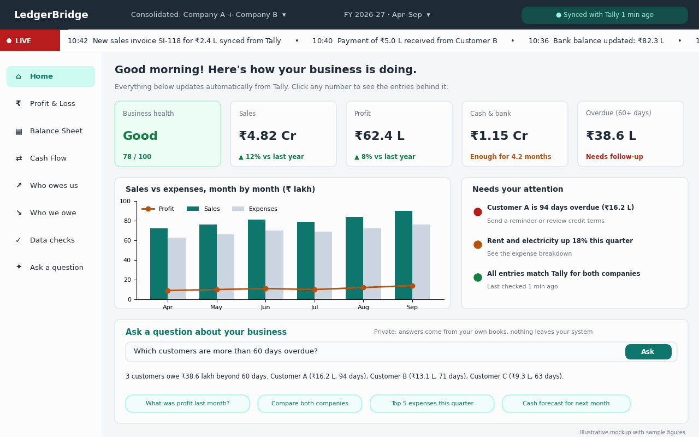

# Dashboard design: home page

| Field | Value |
| --- | --- |
| Version | 0.12 |
| Date | 2026-11-02 |
| Status | Home page: approved design for M7. Budget page (Section 7): proposed design for M7b, no mockup yet |
| Mockup | [dashboard-mockup.png](dashboard-mockup.png) (2026-10-12); the six approved screens of 2026-10-31 (Section 0.1); the client's reference screenshots of 2026-11-02 (Section 0.4: layout and information design only; kept on the developer's computer in `docs/design/client-reference/`, not in git, as they show other products and a desktop) |

The mockup is the approved design for the dashboard home page. M7 must match its **layout, wording and visual style**. The figures, company names, party names and voucher numbers in it are illustrative sample data; the built page shows real values from the reporting API (M6). The footer text "Illustrative mockup with sample figures" belongs to the mockup only and is not part of the product.

Requirements covered: RPT-001 (MIS dashboard), RPT-002 (health indicators with good/bad flags), RPT-006 (entity and consolidated), RPT-007 (drill-down), RPT-008 (period filters), AI-001 (questions in plain language, M8), VAL-* (data checks, M4), BUD-007 to BUD-014 (Budget page, Section 7, M7b).



## 0. How the dashboard is organised (ADR-048, from D1)

The dashboard works the way business users know from Odoo, on our own stack and visual identity (no Odoo name, logo, colours or screen designs):

- **Apps home:** tiles, one per app (screen 1; D1: Reports, with its Dashboard and reports; later Overview, Accounting, Budgets, Data Quality, AI Assistant, Settings).
- **Top bar:** product name, the apps menu, the current app's own menu, then the company switcher, the period controls and light/dark mode.
- **Breadcrumbs** under the top bar for every drill-down (for example Statements / Profit & Loss / Indirect Expenses / Rent).
- **Search bar** on every list: free text, filter facets and group-by facets, with saved favourites (per browser until login).
- **Views:** D1 has list (the table explorer) and graph views; kanban, form and pivot views come later.

This replaces the mockup's left sidebar: its items become app tiles and app menus, with the same plain-language wording. The mockup's greeting, KPI cards, chart and panels stay the target for the Overview app; the business health score, the LIVE ticker and "Needs your attention" need the M6 data (Section 4) and come after D1. The company switcher shows each company and **"All companies (combined)"**, labelled "combined, without inter-company eliminations"; companies on hold (SYN-007) are not shown. Amounts are in rupees with lakh and crore units, exact amounts in Indian grouping on hover; dates are written DD-MMM-YYYY (for example 02-Oct-2026). Light and dark mode come from the same theme tokens (Section 5).

Until login (M5) the dashboard runs on this computer only (ADR-049).

The voucher and voucher-line table-explorer datasets include an **Entry Altered Date** column
from Tally's `UPDATEDDATETIME`. It is optional and displayed as Tally's source wall-clock
value; because the source field has no timezone offset, LedgerBridge does not convert it to UTC.

## 0.1 The approved screens (2026-10-31)

Six screens, approved by the developer on 2026-10-31. Build to them: their **layout, wording and visual style**. Every figure, name and voucher number in them is illustrative (company labels are state codes, channels are public marketplace names); the built pages show the data. Where a screen shows something whose data doesn't exist yet, it is left out until it does (decision 2026-10-31): ageing ("over 60 days", "due this week"), cash cover in months, the business health score, the LIVE ticker, "Needs your attention" and the AI question panel.

| Screen | What it shows | Built in |
| --- | --- | --- |
| [1 · Apps home](mockup-1-apps-home.png) | Greeting, sync status pill, a tile per app with an icon and a one-line description (Overview, Accounting, Reports, Budgets, Data Quality, AI Assistant, Settings). Only apps that work are shown. | D1 (b) |
| [2 · Overview app](mockup-2-overview-app.png) | Health score, ticker, attention panel, questions. | Later (M6, M8) |
| [3 · Accounting: Ledgers](mockup-3-accounting-ledgers.png) | A list with the search bar (group-by and filter facets, Filters, Group By, Favourites), view switcher (list, kanban, pivot, graph), groups with counts and subtotals, "Matches Tally" per row, paging. | D2 |
| [4 · Voucher](mockup-4-voucher.png) | One voucher: header fields, accounting, stock, GST and bill lines, debit and credit totals, "Synced → Converted → Validated", activity. | D2 |
| [5 · Dashboard home](mockup-5-dashboard-home.png) | The Reports app's **Dashboard** (below). | D1 (b) |
| [7 · Sales dashboard](mockup-7-sales-dashboard.png) | The side bar and the top filter bar (Section 0.2); the Sales dashboard: KPI cards (net sales, invoices, average invoice, sales returns, each against the previous period), monthly net sales as a line chart (a month opens its sales register), top customers and the largest invoices, every name and number a link. | D2 (c) |
| [8 · Customer](mockup-8-customer.png) | The detail-page pattern (Section 0.3) for a customer: header with key facts and actions, KPI cards (balance due, overdue, net sales this year, average days to pay), tabs (invoices and credit notes, receipts, ledger statement, outstanding bills, monthly trend), each voucher a link. | D2 (c) |
| [6 · Profit & Loss](mockup-6-profit-and-loss.png) | A report page with the options side panel (below). Built in D1 (c1): the panel is charcoal (Section 5); "Matches Tally" holds only when every company and statement date used was compared with the source's own and nothing differs. | D1 (c1) |

**Dashboard home (screen 5).** Top menu of the Reports app: Dashboard, Profit & Loss, Balance Sheet, Trial Balance, Sales, Purchases, Books, Parties (each shown once it is built). Under it a filter bar:
- **Companies:** "All combined" or any combination of chips, one per company, each marked **loaded** or **not loaded** in Tally as recorded at the last sync or `entity-check` (`entity_sources.source_loaded`, migration 0025; the dashboard never contacts Tally). Several companies are added together: combined, without inter-company eliminations.
- The company API retains the stored entity name and ID. A deployment may set `COMPANY_DISPLAY_NAMES` to a JSON object keyed by each exact stored name to supply shorter dashboard labels; an unmapped company keeps its original name. These labels affect presentation only, not accounting, source matching, or entity identity.
- **Period:** the financial year, month chips (one or several, adjacent or not), or a from/to date range ("or dates"), and **Compare: last year** (the same period a year earlier) or no comparison.
- **Status pill:** how many selected companies were loaded in Tally, the last sync, and whether every latest validation passed.

Cards, each following the selection (from 2026-11-02 the Overview module, Section 0.4, replaces these cards with its key figures; every formula: [formulas.md](../formulas.md)):
- **Profit & Loss:** net sales, cost of sales, gross profit, net profit, each with the change against last year. From the stored statements (`v_profit_loss`, validated against Tally's): a period's figure is the statement at its end less the one before its start. Whole months use the stored month ends; where the source's statements exist only for some days of the month (Tally's Educational mode: the 1st, 2nd and 31st), a 30-day month runs to the 2nd of the next month and the card says so. Other from/to ranges show "—" with the reason. "Open" leads to the Profit & Loss report (D1 c1).
- **Balance Sheet:** total assets, current assets, current liabilities, "capital and reserves (incl. profit to date)": the capital account and the Profit & Loss A/c, at the period's end, from the stored statement for that date.
- **Cash & bank, Receivables, Payables:** balances at the period's end (ledgers under Cash-in-Hand and Bank Accounts, Sundry Debtors, Sundry Creditors, by the source's predefined groups).
- **Stock value:** the source's closing stock at that date ("from Tally"), stored with the statements.

Charts: **sales and purchases by month** (₹ lakh, ECharts), **sales by channel** (net sales by voucher type, the four largest and "Others"), **share of sales by company**. These come from the entries themselves, so they are exact for any months or dates.

**Report pages (screen 6), starting with Profit & Loss.** Title with the selected companies, the period and "combined, without inter-company eliminations"; the table explorer's **Columns, Group by, Filters, Export CSV** above the table; a column per selected company plus **Total**, **Last year** and **Change**; click a line for its ledgers, a ledger for its vouchers. The **options side panel**:
- "Matches Tally" for the selection (every selected company and stored date in it without open statement differences; otherwise how many differ, as counts);
- **View as:** Tally layout, company by company, month by month, quarter by quarter, % of sales;
- **Columns:** each company, total, last year, change %, % of sales (budget later);
- **Open related** reports, **Saved views** (per browser until login), **Export:** CSV now (Excel and PDF later).

## 0.1a Build order (2026-10-31), one PR each, reviewed with screenshots

1. Navigation (Section 0.2) and the pattern (Section 0.3).
2. B (c2): Balance Sheet and Trial Balance; the ledger group and ledger detail pages; drill-down from a line to its ledgers and from a ledger to its vouchers.
3. D2 (a): Day Book, the vouchers list, the voucher detail page (screen 4: items with quantities and rates, ledger, GST and bill lines, totals, narration, its history: synced, converted, validated).
4. D2 (b): Ledgers list and the ledger statement with a running balance.
5. D2 (c), the Sales and Purchases pages, brought forward (2026-11-01), one PR per area: (c1) the Sales dashboard (screen 7); (c2) the Sales and Purchase registers (Day Book style, with narration); (c3) monthly sales and purchases and sales by channel; (c4) Customers and Vendors with their pages (screen 8).
6. D2 (d): Cash & Bank, Receivables and Payables with ageing.
7. D2 (e): Data health and Companies.

Every page gets the side panel, the table explorer, "matches Tally" where it applies and a short "What is this?" help: what the figures mean, where they come from, how to compare them with Tally.

## 0.2 Navigation (screens 7 and 8, decision 2026-10-31)

**Superseded on 2026-11-02 by Section 0.4** (the top bar with module tabs replaces the side bar and the top filter bar; ADR-050). Kept as the record of what was built in D2 (c1) to (c4); the pages below keep their definitions.

A **collapsible side bar** on charcoal replaces the top menu and the apps home (screen 1 and ADR-048's apps home are superseded; the logo and `#/` open the Dashboard). Its groups and items, in this order; an item appears once its page is built, a group once it has an item:

| Group | Items |
| --- | --- |
| Overview | Dashboard |
| Sales | Sales dashboard, Sales register, Monthly sales, Customers, Channels |
| Purchases | Purchase register, Monthly purchases, Vendors |
| Statements | Profit & Loss, Balance Sheet, Trial Balance |
| Books | Day Book, Vouchers, Ledgers, Cash & Bank |
| Parties | Receivables, Payables |
| Data | Data health, Companies |

At its foot: "This computer only · synced HH:MM" and light/dark mode. On narrow screens it starts collapsed.

A **top filter bar** on every page: the breadcrumbs (group / page / deeper levels, each a link back), then the **period** (financial year, months, from/to dates, compare with last year), the **company** (all combined or any combination, each marked loaded or not loaded in Tally), the **facets** customer, channel, ledger group and voucher type, and **Copy link** (the page's address, which holds the whole selection). A page applies the facets its figures can be filtered by; the others are shown but disabled, saying why (a whole statement can't be filtered by customer).

### The Sales dashboard (D2 c1, screen 7)

The same definition as the monthly sales views (proven day by day against Tally's statements, RPT-013), for any companies, period, customers and channels (voucher types): the effective entries of vouchers not deleted on the ledgers under the Sales Accounts group (by its predefined role, at any depth).

- **Key figures**, each against the same months (or dates) last year: **net sales** (gross + returns + other adjustments), **invoices** (sales vouchers with an entry on those ledgers), **average invoice** (gross ÷ invoices), **sales returns** (credit notes, shown positive; rising returns are neutral, not crimson).
- **Net sales by month**, a line chart; a month opens its sales register (until that page is built, this page for that month). Below it every month's gross, returns, other adjustments, net and invoices, with the total.
- **Monthly net sales by company**, as separate ECharts lines using each company's dashboard display label. It follows the selected companies, period and sales filters; hover shows gross, returns, other adjustments and net, using the same calculation as the monthly sales views. It groups by entity ID and does not rely on records in the separate `branches` table.
- **Top customers** (ten, by the voucher's party) with their share, and the rest and sales without a party as one figure; **largest invoices** (ten, by their entries on the sales ledgers, before taxes).
- A customer opens their page (until built, this page filtered to them); an invoice its voucher page once built.
- Written for both sides (`core/sales.py`), so the Purchases pages use the same definitions with Purchase Accounts, purchases and debit notes.

### The Sales and Purchase registers (D2 c2)

Day Book style, one row per voucher: **Date, Particulars, Vch Type, Vch No., Debit, Credit, Narration**, grouped by month with a subtotal per month and the grand total (Group by changes it to voucher type, party or company). The Sales register lists sales vouchers and credit notes; the Purchase register purchases and debit notes; not deleted, cancelled or optional ones.

- **Particulars** is the voucher's first ledger entry, as Tally's Day Book shows it (for an invoice, the party); its amount is the Debit or the Credit.
- **Sales value** (Purchase value), under Columns: the voucher's entries on the Sales (Purchase) Accounts ledgers, returns negative. A month's total of it is that month's gross less returns of the monthly sales views.
- Facets: the Sales register takes customer and channel; the Purchase register voucher type. At most 20,000 vouchers are loaded, with a warning to choose fewer months.
- The Sales dashboard's months open the register for that month; a party opens their page once built (until then the Sales register filtered to that customer); a voucher its page once built.

### Monthly sales, monthly purchases and channels (D2 c3)

- **Monthly sales** and **Monthly purchases:** each month's gross, returns, other adjustments, net and invoices, and the **closing balance**: the net from the start of the financial year to the month's end, as Tally's monthly summary of the Sales (Purchase) Accounts group shows it (each company its own financial year). A chart of net by month with the closing balance; a month opens its register. The closing balance has no total.
- **Channels:** each sales voucher type with its net sales, share, returns, invoices and a column per month (shown up to six months, the rest under Columns); a channel opens the Sales register filtered to it, a month that month's register. All channels together are the Sales dashboard's net sales.

### Customers and vendors (D2 c4, screen 8)

A party is known by its **name** across the selected companies (as the facets are): the same customer in two companies is one row and one page, their figures added together.

- **Lists** (Customers under Sales, Vendors under Purchases): each party with its net sales (purchases) and invoices in the period, the last invoice and the balance due at the period's end; the name opens the party's page.
- **The party's page** (`#/sales/customers/<id>`, `#/purchases/vendors/<id>`), the detail-page pattern: where it sits (its ledger's groups), its name and key facts (main channel, companies, credit period); key figures: **balance due** (payable), **overdue**, **net sales** (purchases) against last year, **average days to pay**; tabs: **invoices and credit (debit) notes** with each one's status (paid, due in N days, overdue N days), **receipts** (payments), the **ledger statement** with the opening and running balance (Dr/Cr), the **outstanding bills**, and the **monthly trend**.
- **Bills** come from the bill allocations of the vouchers in the books (on account excluded), due on their due date or else their date plus the party's credit period. **Opening bills** (from before the books' beginning) count as bills raised on their bill date (stored since data completion part 2). Where the bills add up to less than the balance (amounts on account), the page says how much they cover.
- Every customer and vendor name on the Sales and Purchases pages now opens this page.

### The table explorer

Every table: a filter (any part of a text or date cell), **Columns**, **Group by** (subtotals per group), sorting by any header, **saved views** (in this browser until login, M5) and **Export CSV** of exactly what is shown (exact rupees, subtotals and total; text guarded against formulas). Long lists show the first rows and "Show more".

### Planned after the data-completion re-fetch (requested 2026-11-09)

Built once the full re-fetch after data completion part 7 has filled the new stock columns, one PR:

- **Stock page, "by godown" view:** quantity and value per item, godown and batch at the period's end (the openings by godown and batch, `item_opening_batches`, plus the inventory lines' movements per godown). Stock at a job worker's godown (`godowns.holding` = `ours_with_third_party`, which Tally leaves out of its stock balances) is shown in a section of its own, apart from the stock on hand; third-party stock held with us likewise. The totals match the Stock page's own figures for the stock Tally counts.
- **Table explorer, an inventory dataset:** one row per inventory line (date, voucher type and number, item, godown, batch, the other godown of a move, order number and due date, quantity, rate, amount), grouped and filtered like the voucher-line dataset (`api/v1/dataset_specs.py`).

## 0.3 Everything clickable, and one detail page per entity

**Everything clickable, all the way down.** Every figure, row, name and chart point opens a deeper page, with breadcrumbs back: for example Dashboard → Profit & Loss → a group → a ledger → its vouchers → a voucher → its lines. A chart point opens the same figure's register (screen 7: a month opens that month's sales register).

**One detail-page pattern for every entity** (company, ledger group, ledger, customer, vendor, channel, voucher type, voucher), as screen 8 shows for a customer:
- **Header:** where it sits (e.g. "Customer · Sundry Debtors › Online customers"), its name, key facts (companies, channel, credit period), actions (ledger statement, outstanding bills, Export CSV).
- **KPI cards** with the change against the previous period (crimson only when bad for the business).
- **A trend chart** (monthly), each point clickable.
- **Tabs** with the related lists (e.g. invoices and credit notes, receipts, ledger statement, outstanding bills), each using the table explorer (columns, group by, filters, CSV of exactly the list).
- **"Matches Tally"** where it applies (statements, ledger balances, voucher counts), with the side panel's "What is this?" help.

## 0.4 The client's reference pattern (decision 2026-11-02, ADR-050)

The client asked for the dashboard to follow the design pattern of their reference screenshots (`docs/design/client-reference/`, kept out of git: sample dashboards of other products with illustrative figures). They are used for **layout and information design only**: our own name, our charcoal, forest green and crimson theme, and our data. Requirements: RPT-014 (layout and modules), RPT-015 (formula sheet), RPT-016 (period toggles and the previous period).

**The frame** (replaces Section 0.2):

- **Dark top bar** (charcoal in both modes): the company logo on a small white plate and the product name "LedgerBridge" (opens the Overview); the **module tabs** Overview, Sales, Purchases, P&L & KPIs, Balance Sheet, Cash Flow, Parties, Data (a module shows once it has a built page); on the right the **period toggles** MTD · QTD · YTD · FY · Custom, the financial year, **what to compare with** (previous period, last year, no comparison) and light/dark mode.
- **Page header**: breadcrumbs, the page's title with its period and comparison ("01-Apr-2026 to 02-Nov-2026 · vs previous period"), the **segment chips** ("All companies" or any combination, each with its loaded / not loaded dot; on the Sales pages also the channels, as chips when there are up to eight, else a picker; the customer and voucher type facets as pickers where the page applies them), **"Updated N min ago"** from the last sync (green; crimson when a company wasn't loaded or a check failed, with the status on hover) and Copy link; under it the module's pages as tabs.
- Everything stays clickable all the way down, with the breadcrumbs back; older links ("#/statements/profit-loss") open the page in its module.

**Periods** (formula F-CMP-002): MTD, QTD and YTD run from the start of today's month, quarter (of the financial year) or financial year to today; FY is the twelve months of the year chosen; Custom keeps the month chips and the from/to dates. The default is YTD compared with the previous period. **The previous period** of MTD is the same days of the month before, of QTD the same days of the quarter before; YTD and FY are compared with the same dates a year earlier; Custom months with as many months just before, Custom dates with as many days just before. Profit (from the stored month-end statements) runs to the **last stored date within the period** and the page says "to 31-Oct-2026"; figures from the entries run to today.

**Components**, used the same way on every module: **KPI cards** (coloured top border, small-capitals label, big value, change vs the comparison, sparkline); **monthly bar or line charts**; a **donut** for mixes; **horizontal bars** for cost structure (as % of net sales); **statement tables** with current, previous and change % columns and subtotals; **2×2 ratio tiles**; **detail tables** with status pills; a **waterfall** for cash. **Goal trackers** need targets: until budgets (M7b) a placeholder says so.

**Status labels and meanings.** A payment status is calculated per remaining bill-wise allocation and that bill's due date, not the original invoice amount. Customer receivables use debit-positive ledger balances; supplier payables reverse the canonical debit-positive sign so an amount owed is positive for both. Positive overdue amounts are **Payment Overdue** for customers and **Payment to Supplier Overdue** for suppliers; positive amounts not yet due are **Payment Pending** or **Payment to Supplier Pending**; negative balances are **Customer Advance** or **Supplier Advance**; zero is **Fully Settled**. A party summary with overdue and other open bill states is **Multiple bill statuses**, so one overdue bill does not characterize every bill for that party. Summaries use the normalized balance, and a legacy overdue label cannot override a negative or zero balance. When bill allocation or due-date evidence is unavailable, the status is **No bill details**, not a guessed pending/overdue state. Negative bill allocations do not inflate overdue totals. Status columns have an adjacent plain-English **Meaning** column; validation and source-loaded statuses keep their own wording and meanings.

**Statement dates.** Profit & Loss and Balance Sheet show the active filters as From Date, To Date and a readable reporting period. The Balance Sheet also says that balances are calculated as of the To Date; this is display metadata and does not change statement calculations.

**Modules** (one PR each, in this order; what each shows comes from our data):

| Module | Shows | PR |
| --- | --- | --- |
| Frame | top bar, page header, period toggles and comparison, formula sheet (`docs/formulas.md`) | 1 |
| Overview | key cards: net sales · gross profit (gross margin %) · net profit (net profit %) · cash & bank · customers; monthly sales and purchases with gross and net profit marked; sales by channel (donut); P&L summary vs last year; top customers | 2 |
| Sales | the Sales dashboard, register, monthly and channels in the pattern, channel chips | 3 |
| Purchases | the same for purchases | 4 |
| Parties | customers and vendors; receivables and payables with ageing (not due, 1–30, 31–60, 61–90, over 90 days past due; opening bills included) | 5 |
| P&L & KPIs | the full Profit & Loss with change %, margin tiles, expense structure as % of net sales, monthly trend, goal tracker placeholder | 6 |
| Balance Sheet | the Balance Sheet with change %; current ratio, quick ratio, debt to equity, receivable, payable and inventory days, working-capital days | 7 |
| Cash Flow | a simple cash movement: in and out of cash and bank by category, as a waterfall (the full operating / investing / financing statement is planned separately: it needs every ledger classified) | 8 |
| Data | data health and companies | 9 |

## 1. Principles

- **Plain language for business owners.** Labels say what the user cares about ("Who owes us", "Needs your attention"), not accounting jargon ("Receivables ageing", "Exceptions"). Use the wording below exactly.
- **Every number is clickable** and opens the entries behind it (RPT-007).
- **Status at a glance.** Each figure carries a coloured status line: green good, amber watch, red act.
- **Generic, not Tally-specific (PIL-003).** Where the mockup says "Tally", the page shows the connection's source name (for example "Synced with Tally", later "Synced with Zoho Books"). Company names, the number of companies and the financial year all come from data.
- **Indian number format.** Amounts in rupees with lakh (L) and crore (Cr) units: `₹4.82 Cr`, `₹62.4 L`. Chart axes in ₹ lakh. Exact amounts in full Indian grouping (`₹16,20,000.00`) on hover and in drill-down.

## 2. Layout

```text
┌──────────────────────────────────────────────────────────────────────────────┐
│ Top bar: LedgerBridge · company switcher · period switcher · sync status pill │
├──────┬───────────────────────────────────────────────────────────────────────┤
│ LIVE │ scrolling ticker of recent sync events                                │
├──────┴──────┬────────────────────────────────────────────────────────────────┤
│ Sidebar     │ Greeting line                                                  │
│             │ Hint line                                                      │
│ Home        │ [Health] [Sales] [Profit] [Cash & bank] [Overdue 60+]          │
│ Profit &    │ ┌ Sales vs expenses chart (≈60%) ┐ ┌ Needs your attention ┐     │
│ Loss  ...   │ └────────────────────────────────┘ └──────────────────────┘     │
│             │ ┌ Ask a question about your business (full width) ──────────┐  │
│             │ └────────────────────────────────────────────────────────────┘  │
└─────────────┴────────────────────────────────────────────────────────────────┘
```

- Fixed top bar and LIVE strip; fixed sidebar; the content area scrolls.
- Content order top to bottom: greeting, hint, five KPI cards in one row, then the chart and the attention panel side by side (chart about 60% of the width), then the full-width question panel.
- On narrow screens (tablet and phone) the sidebar collapses to a menu button, KPI cards wrap, and the chart and attention panel stack.

## 3. Elements

### 3.1 Top bar

Dark navy bar across the full width.

| Element | Content and behaviour |
| --- | --- |
| Product name | "LedgerBridge", bold white, left. |
| Company switcher | Dropdown showing the current selection: **"Consolidated: Company A + Company B"** or a single company name. Options: Consolidated (all companies the user may see) and each company. Lists only entities the user has access to (ACC-002). Consolidated appears only when the user has two or more. |
| Period switcher | Dropdown showing financial year and range, for example **"FY 2026-27 · Apr–Sep"**. Offers the current and previous financial years, quarters and months, and year to date. Defaults to the current financial year to date. |
| Sync status pill | Rounded dark-green pill on the right: green dot and **"Synced with Tally 1 min ago"** (source name and relative time from the last successful sync of the selected companies). If the last sync failed or is overdue the pill turns amber ("Last synced with Tally 2 h ago"); if a sync is running it says "Syncing with Tally…". Clicking it opens the sync detail (last runs, from `sync_runs`). |

### 3.2 LIVE strip

Thin full-width strip directly below the top bar.

- Left: a red block with a white dot and **"LIVE"**.
- Right: a continuously scrolling ticker of recent sync events, separated by "•", each starting with a time:
  - "10:42 New sales invoice SI-118 for ₹2.4 L synced from Tally"
  - "10:40 Payment of ₹5.0 L received from Customer B"
  - "10:36 Bank balance updated: ₹82.3 L"
  - GST payable changes, for example "GST payable now ₹3.1 L"
  - data checks passed, for example "Data checks passed for Company A"
- Event types: new vouchers (sales, purchases), payments received and made, bank balance updates, GST payable changes, data checks passed or failed.
- Events come from the recent-events feed (M6), filtered to the selected companies and the user's entity access. Clicking an event opens its voucher or check.
- The ticker pauses on hover and honours the "reduce motion" system setting (static list instead of scrolling).

### 3.3 Sidebar

Light background, icon plus label, in this order and with this wording:

| Item | Opens | Milestone |
| --- | --- | --- |
| Home | This page | M7 |
| Profit & Loss | P&L statement | M6/M7 |
| Balance Sheet | Balance sheet | M6/M7 |
| Cash Flow | Cash flow statement | M6/M7 |
| Who owes us | Receivables with ageing | M6/M7 |
| Who we owe | Payables with ageing | M6/M7 |
| Budget | Budget vs actual, and budget planning (Section 7) | M7b |
| Data checks | Validation results (data-quality page) | M4/M7 |
| Ask a question | Full-page AI questions | M8 |

The active item has a pale teal background with teal bold text. The Trial Balance page (RPT-003) is not in the mockup's sidebar; it is reached from Data checks and from the Balance Sheet page (see Section 6).

### 3.4 Greeting and hint

- Greeting, large bold: **"Good morning! Here's how your business is doing."** "Good morning", "Good afternoon" or "Good evening" by the user's local time.
- Hint, grey below it: **"Everything below updates automatically from Tally. Click any number to see the entries behind it."** ("Tally" replaced by the source name.)

### 3.5 KPI cards

Five equal white cards in one row. Each has a small grey label, a large value and a coloured status line.

| Card | Value | Status line (examples) |
| --- | --- | --- |
| **Business health** | A label (**Good**, in green) and **"78 / 100"** below it. The card has a pale green background and green border when Good; amber or red equivalents for the other bands. | The score out of 100. |
| **Sales** | Sales for the selected period, for example **₹4.82 Cr**. | **"▲ 12% vs last year"** (green when up, red when down). |
| **Profit** | Net profit for the period, for example **₹62.4 L**. | **"▲ 8% vs last year"**. |
| **Cash & bank** | Total cash and bank balance at the period end, for example **₹1.15 Cr**. | **"Enough for 4.2 months"** (months of cash cover), coloured by threshold (amber in the mockup). |
| **Overdue (60+ days)** | Customer bills overdue more than 60 days, for example **₹38.6 L**. | **"Needs follow-up"** in red when above threshold, green "All on time" otherwise. |

- Status colours come from `kpi_definitions` thresholds (RPT-002), not from the frontend.
- Clicking a value opens the drill-down (for example, Overdue opens "Who owes us" filtered to 60+ days).
- The business health score, its label bands and cash cover are computed in M6 (Section 4).

### 3.6 Sales vs expenses chart

White card titled **"Sales vs expenses, month by month (₹ lakh)"**.

- ECharts grouped bar chart, one group per month of the selected period (Apr … Sep): **Sales** dark teal bars, **Expenses** light grey-blue bars.
- **Profit** as an orange line with round markers over the bars.
- Legend at the top left in the order Profit, Sales, Expenses. Y axis in ₹ lakh from 0.
- Clicking a bar or point opens the entries for that month and measure.

### 3.7 "Needs your attention" panel

White card titled **"Needs your attention"**, beside the chart. A short list (up to five) of plain-language alerts, most severe first. Each alert has:

- a coloured dot: red (act now), amber (watch), green (all good);
- a bold one-line message, for example **"Customer A is 94 days overdue (₹16.2 L)"**, **"Rent and electricity up 18% this quarter"**, **"All entries match Tally for both companies"**;
- a grey suggested action or detail, for example "Send a reminder or review credit terms", "See the expense breakdown", "Last checked 1 min ago".

Alerts come from simple rules computed in M6 (Section 4), and from M7b budget variance rules, for example **"Marketing is 24% over budget this quarter (₹3.1 L)"** with "See budget vs actual" (BUD-011). Clicking an alert opens the related page or entries. When nothing needs attention, the panel shows the green data-check line only.

### 3.8 "Ask a question" panel

Full-width white card.

- Title in teal: **"Ask a question about your business"**.
- Privacy note at the top right, grey: **"Private: answers come from your own books, nothing leaves your system"**. This text must match the client's actual AI privacy mode (AI-011): it is shown as written only in `private` mode; `schema-only` and `full` show their own accurate note.
- A text input (placeholder or last question, for example "Which customers are more than 60 days overdue?") with a teal **Ask** button.
- The answer below the input in plain text, for example "3 customers owe ₹38.6 lakh beyond 60 days. Customer A (₹16.2 L, 94 days), …", with a link to show the SQL and source records (M8).
- Suggested question chips, pale teal with teal text:
  - "What was profit last month?"
  - "Compare both companies" (shown only when two or more companies are selected; wording "Compare companies" when more than two)
  - "Top 5 expenses this quarter"
  - **"Who do we owe the most?"**: replaces the mockup's "Cash forecast for next month" chip, because forecasting (AI-009) is phase 3. Restore the forecast chip only when forecasting exists.
- M7 builds the panel; M8 connects it to the AI (see Section 6 for what it shows before M8).

## 4. Data the home page needs (M6)

| Element | Source in M6 |
| --- | --- |
| Sales, Profit, comparison with last year | P&L and sales views, current period vs same period last year. |
| Cash & bank | Balances of ledgers mapped to cash and bank standard accounts. |
| Cash cover in months | Cash & bank ÷ average monthly cash outflow; the exact definition (which outflows, how many months averaged) is documented in M6. |
| Overdue 60+ days | Receivables ageing, buckets above 60 days. |
| Business health score | A documented formula giving a score from 0 to 100 and a label (for example Good / Fair / Needs attention), built from KPIs with thresholds in `kpi_definitions`. The components, weights and bands are proposed in M6 and approved by the developer before they are built. |
| Monthly sales, expenses, profit | Monthly P&L views. |
| Needs your attention | Simple rule-based alerts (for example customers overdue beyond a threshold, an expense group up more than a threshold on the previous period, the latest validation result), each with severity, message and suggested action. Rules and thresholds are configurable. |
| LIVE ticker | Recent-events feed written after each sync (new vouchers, payments, bank balance and GST payable changes, data-check results). |
| Sync status pill | Last successful sync per connection (`sync_runs`). |

All of it respects the user's entity access and the selected companies and period.

## 5. Visual style

Three colours carry meaning (decision 2026-10-31; they replace the teal, navy and amber of the first mockups). They are defined once, as tokens in `frontend/src/theme.ts`, for light and dark mode; the stylesheet, Ant Design and the charts all read them. Every text colour meets **WCAG AA** (4.5:1) on the surface it is used on, measured by `frontend/src/theme.test.ts`.

| Colour | Used for | Light mode | Dark mode |
| --- | --- | --- | --- |
| **Charcoal black** | The top bar, the options panel, dark surfaces, the gross profit line on charts | `#1C1F23` | `#1C1F23` (page `#141619`, cards `#202327`; the gross profit line `#E6E8EA`) |
| **Forest green** | Primary buttons, the active menu item, links, selections (chips), positive figures and good changes, the main chart series | `#1E6B3A` (on white 6.5:1); selected chips `#DCEFE2` | text `#6FCF97` (8.3:1 on cards); buttons `#1E6B3A` with white text |
| **Crimson red** | Negative figures, losses, bad changes (sales or profit down), alerts and warnings | `#B0102D` (7.1:1) | `#FF7A8A` (6.3:1) |

- **Red is used sparingly**, so it keeps its meaning: a cost going up is shown neutral (grey), not red; there is no amber.
- **Chart lines** need 3:1 against the card (WCAG 1.4.11), measured by `theme.test.ts`: gross profit solid charcoal, net profit dashed lighter green (`#3F8F5F`; dark `#6FCF97`).
- **The company logo** is drawn on white, so it sits on a small white plate in the charcoal top bar.
- Neutral greys for text (`#16181B`, secondary `#5F6368`; dark `#E6E8EA`, `#9AA1A9`), borders and the second chart series (purchases).
- Cards are white (dark: `#202327`) with a light border and 8 px rounded corners on a light grey page (`#F4F5F6`).

Typography: IBM Plex Sans where installed, else the system's sans-serif; bold for card values and titles; small grey labels.

## 6. Open points for M7 planning

- Where the Trial Balance page lives (proposed: linked from Data checks and from Balance Sheet, not in the sidebar).
- Login, user menu and sign-out are not in the mockup; proposed in the top bar's right corner after the sync pill.
- What the "Ask a question" panel shows between M7 and M8: proposed hidden, so the page never offers something that does not work yet; the alternative is showing it with Ask disabled.

## 7. Budget page (M7b, proposed)

Requirements: BUD-001 to BUD-014. Same top bar, LIVE strip, sidebar, visual style and number format as the home page; the sidebar item **"Budget"** is active. No mockup yet: one is to be approved before M7b is built, like the home page's.

### 7.1 Filters

A filter bar under the page title **"Budget vs actual"**, driving every figure and graph on the page:

| Filter | Options | Default |
| --- | --- | --- |
| Financial year | Years with a budget, plus the current year | Current financial year |
| Months | A month range within the year, plus shortcuts: This month, This quarter, Year to date, Full year | Year to date |
| Company | Consolidated or one company (from the top bar's company switcher; entity access applies) | As in the top bar |
| Cost centre | All, or one or more | All |
| Account | All, or a standard account, account group or ledger (searchable tree) | All |
| Version | Current (latest approved or locked), or any version including drafts (drafts only with `budget.edit`) | Current |

The selection is kept in the page URL, so a view can be bookmarked or shared with someone who has access.

### 7.2 Summary cards

Four cards in one row, for the filtered period:

| Card | Value | Status line |
| --- | --- | --- |
| **Budget** | Budgeted profit (or the selected account's budget) | Version and state, e.g. "Revised 2 · Approved" |
| **Actual** | Actual for the same period | "▲ 9% vs last year" |
| **Variance** | Actual − budget, in amount and % | **"Favourable"** in green or **"Unfavourable"** in red, by account nature |
| **Full-year projection** | Actual YTD + remaining budget | "₹1.2 Cr above the full-year budget", coloured like Variance |

### 7.3 Graphs (ECharts)

1. **Monthly budget vs actual:** grouped bars per month, **Budget** in light grey-blue and **Actual** in dark teal, with **Last year** as an orange line with markers. Title: "Budget vs actual, month by month (₹ lakh)".
2. **Year to date, cumulative:** three lines (Budget, Actual, Last year) accumulating month by month; future months show the projection as a dashed actual line.
3. **Variance waterfall:** from budgeted profit to actual profit, one bar per account group (largest variances first, the rest grouped as "Other"), green for favourable and red for unfavourable.
4. **Variance heatmap:** accounts as rows, months as columns, each cell the variance % (green favourable, red unfavourable, grey for no budget), with the amount on hover.

Every bar, point and cell opens the drill-down: the actual's vouchers (RPT-007) and the budget's lines and change history (BUD-010).

### 7.4 Budget vs actual table

Below the graphs: one row per account at the budget's level, expandable down the tree (standard account → group → ledger), with columns **Budget, Actual, Variance, Variance %, Last year, Full-year budget, Projection**. Favourable or unfavourable as a coloured dot. Sorting by any column; a toggle for month, quarter, YTD or full year. Exact amounts in full Indian grouping on hover.

### 7.5 Planning (with `budget.edit`)

A **"Plan budget"** button opens the planning view for the selected company and year:

- **Version bar:** version name and state (Draft, Approved, Locked) with **Approve** and **Lock** buttons for users with `budget.approve`, and **"Create revision"** on approved versions. Locked versions show a padlock and are read-only.
- **Create a budget:** four choices, in plain words: **"Import from Tally"** (shows the source name), **"Start from last year's actuals"** (with a growth % for all accounts and per account), **"Upload Excel"** (with **"Download template"**), **"Enter in the grid"**.
- **Grid:** accounts as rows, months as columns, plus **Year total**. Editing the year total offers **"Spread equally"** or **"Spread like last year"**; editing a month updates the total. Last year's actual is shown in grey under each cell. Unsaved changes are highlighted; **Save** writes them as one change set.
- **History:** a side panel listing every change (who, when, what, old and new amount), filterable by account and month.
- **Upload errors:** listed by row and column in plain language, for example "Row 14, Aug: not a number", "Row 22: account not found"; nothing is saved until the file has no errors.

### 7.6 Ask about the budget

The "Ask a question" panel from the home page (Section 3.8), with budget chips: **"Which expenses are over budget this quarter?"**, **"Projected profit for the full year vs budget"**, **"Biggest variances this month"** (M8, BUD-014). Same privacy note as on the home page.

## 8. Forex page (M7, proposed)

Requirements: FX-008 to FX-012. Same top bar, LIVE strip, sidebar, visual style and number format as the home page; the sidebar item **"Foreign currency"** is shown only with `forex.view` and is active here. No mockup yet: one is to be approved before it is built, like the home page's. Base-currency figures are the books; every figure the source calculated (its revaluation, its rates) is marked with a small "from Tally" note and the date it applies to.

### 8.1 Filters

| Filter | Options | Default |
| --- | --- | --- |
| As of | Any date (reports calculate as of a date) | Today |
| Company | Consolidated or one company (top bar; entity access applies) | As in the top bar |
| Currency | All, or one currency | All |
| Party | All, customers, suppliers, or one party (searchable) | All |

### 8.2 Summary cards

| Card | Value | Status line |
| --- | --- | --- |
| Net exposure | Net position per currency (receivables − payables), in the currency, one line per currency | Base equivalent at the latest rate, with its date and source |
| Receivables in foreign currency | Total in base at book value | Number of parties and currencies |
| Unrealised gain / loss | The source's latest calculated figure (FX-004) | "from Tally, as of <date>" |
| Realised gain / loss | This financial year to date (FX-005) | Split: adjustment journals / settlements |

### 8.3 Tables

- **Party balances in their own currency:** party, currency, balance in the currency, ageing buckets in the currency, base book value, value at the latest rate. Each figure drills down to the party's foreign-currency vouchers.
- **Gains and losses:** by month (or quarter), currency and party: realised, unrealised, total. Realised drills down to vouchers, unrealised to the snapshot (which ledger, date, the source's figures).

### 8.4 Graphs (ECharts)

- Exposure by currency: receivables and payables as bars, net as a marker, in base at the latest rate.
- Realised vs unrealised gains by month: stacked bars, total as a line.
- Exchange-rate history: one line per currency; points from the source's rate lists solid, rates from vouchers hollow (FX-003 source shown in the tooltip).

### 8.5 Ask about currencies

The "Ask a question" panel offers currency chips, e.g. "What is our net USD exposure today?", "Which customers owe us in euros?", "Exchange gains last quarter?" (FX-013, M8).

## Change log

| Date | Version | Change |
| --- | --- | --- |
| 2026-11-09 | 0.16 | Planned after the data-completion re-fetch: the Stock page's "by godown" view (job workers' stock apart) and an inventory dataset in the table explorer. Opening bills are now stored and counted in ageing (data completion part 2). |
| 2026-11-04 | 0.15 | Shared status labels and adjacent meanings across payment, validation and source-loaded tables; bill-wise payment states avoid treating advances as overdue. P&L and Balance Sheet display the active date range, with the Balance Sheet as-of clarification. |
| 2026-11-04 | 0.14 | Voucher and voucher-line transaction exports include Tally's optional `UPDATEDDATETIME` as Entry Altered Date; the source timezone is unspecified, so the timestamp is preserved without UTC conversion. |
| 2026-11-02 | 0.13 | Deployment-local company display labels, preserving stored names and IDs; monthly net sales by company using the validated sales definition. |
| 2026-11-02 | 0.12 | Section 0.4: the client's reference pattern (ADR-050): the dark top bar with the logo, module tabs and period toggles (MTD, QTD, YTD, FY, Custom) and the comparison with the previous period; the page header with segment chips and "Updated N min ago"; the components and the modules, one PR each; Section 0.2 superseded; the formula sheet; chart line colours. |
| 2026-11-02 | 0.11 | Customers and vendors: the lists and the party's page (screen 8); opening bills not yet stored. |
| 2026-11-02 | 0.10 | Monthly sales and purchases with the closing balance; sales by channel; the side bar's new items. |
| 2026-11-02 | 0.9 | The Sales and Purchase registers (Day Book style, monthly subtotals). |
| 2026-11-02 | 0.8 | Build order: the Sales and Purchases pages brought forward, one PR per area; the Sales dashboard's definitions; the table explorer on every table. |
| 2026-10-31 | 0.7 | Screens 7 and 8; Section 0.2: the side bar and the top filter bar replace the top menu and the apps home; Section 0.3: everything clickable, one detail-page pattern; the build order with the Sales dashboard and the Customer and Vendor pages. |
| 2026-10-31 | 0.6 | Section 5: charcoal black, forest green and crimson as the theme's tokens, light and dark, WCAG AA; no amber, red used sparingly. |
| 2026-10-31 | 0.5 | Section 0.1: the six approved screens (apps home, Overview, Accounting ledgers, voucher, dashboard home, Profit & Loss with its options panel); the dashboard home's filter bar (company chips with "loaded in Tally", months, dates, compare), cards and charts; what is left for later. |
| 2026-10-30 | 0.4 | Section 0: the Odoo way of working on our own identity (ADR-048): apps home, app menus, breadcrumbs, search with facets and favourites replace the sidebar; combined companies; companies on hold hidden; D1 scope. |
| 2026-10-16 | 0.3 | Forex page (Section 8, proposed for M7): filters, summary cards, own-currency balances and ageing, gains and losses, exposure and rate graphs; source-calculated figures marked (FX-008 to FX-013, ADR-037). |
| 2026-10-13 | 0.2 | Budget page (Section 7, proposed for M7b): filters, summary cards, four graphs, budget vs actual table, planning view, budget questions; sidebar item "Budget"; budget variance alerts in "Needs your attention". |
| 2026-10-12 | 0.1 | Home page design described from the approved mockup. "Cash forecast for next month" chip replaced by "Who do we owe the most?" until forecasting (AI-009, phase 3). |
