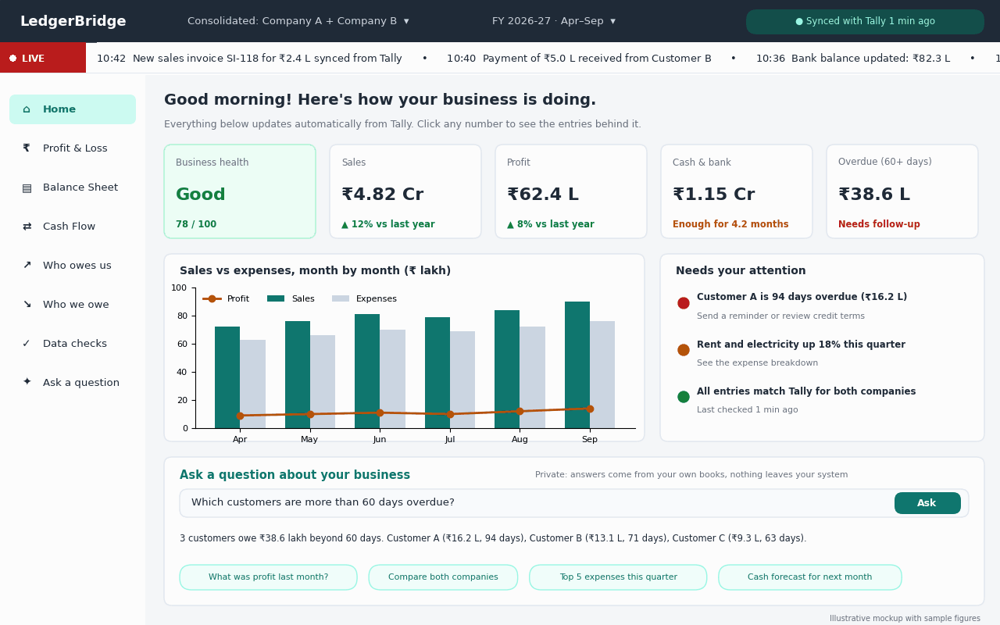

# Dashboard design: home page

| Field | Value |
| --- | --- |
| Version | 0.4 |
| Date | 2026-10-30 |
| Status | Home page: approved design for M7. Budget page (Section 7): proposed design for M7b, no mockup yet |
| Mockup | [dashboard-mockup.png](dashboard-mockup.png) |

The mockup is the approved design for the dashboard home page. M7 must match its **layout, wording and visual style**. The figures, company names, party names and voucher numbers in it are illustrative sample data; the built page shows real values from the reporting API (M6). The footer text "Illustrative mockup with sample figures" belongs to the mockup only and is not part of the product.

Requirements covered: RPT-001 (MIS dashboard), RPT-002 (health indicators with good/bad flags), RPT-006 (entity and consolidated), RPT-007 (drill-down), RPT-008 (period filters), AI-001 (questions in plain language, M8), VAL-* (data checks, M4), BUD-007 to BUD-014 (Budget page, Section 7, M7b).



## 0. How the dashboard is organised (ADR-048, from D1)

The dashboard works the way business users know from Odoo, on our own stack and visual identity (no Odoo name, logo, colours or screen designs):

- **Apps home:** tiles, one per app (D1: Overview, Statements, Explore; later Sales and purchases, Day Book, Ledgers, Cash and bank, Receivables and payables, Data health, Budget, Foreign currency, Ask a question).
- **Top bar:** product name, the apps menu, the current app's own menu, then the company switcher, the period controls and light/dark mode.
- **Breadcrumbs** under the top bar for every drill-down (for example Statements / Profit & Loss / Indirect Expenses / Rent).
- **Search bar** on every list: free text, filter facets and group-by facets, with saved favourites (per browser until login).
- **Views:** D1 has list (the table explorer) and graph views; kanban, form and pivot views come later.

This replaces the mockup's left sidebar: its items become app tiles and app menus, with the same plain-language wording. The mockup's greeting, KPI cards, chart and panels stay the target for the Overview app; the business health score, the LIVE ticker and "Needs your attention" need the M6 data (Section 4) and come after D1. The company switcher shows each company and **"All companies (combined)"**, labelled "combined, without inter-company eliminations"; companies on hold (SYN-007) are not shown. Amounts are in rupees with lakh and crore units, exact amounts in Indian grouping on hover; dates are written DD-MMM-YYYY (for example 02-Oct-2026). Light and dark mode come from the same theme tokens (Section 5).

Until login (M5) the dashboard runs on this computer only (ADR-049).

## 1. Principles

- **Plain language for business owners.** Labels say what the user cares about ("Who owes us", "Needs your attention"), not accounting jargon ("Receivables ageing", "Exceptions"). Use the wording below exactly.
- **Every number is clickable** and opens the entries behind it (RPT-007).
- **Status at a glance.** Each figure carries a coloured status line: green good, amber watch, red act.
- **Generic, not Tally-specific (PIL-003).** Where the mockup says "Tally", the page shows the connection's source name (for example "Synced with Tally", later "Synced with Zoho Books"). Company names, the number of companies and the financial year all come from data.
- **Indian number format.** Amounts in rupees with lakh (L) and crore (Cr) units: `₹4.82 Cr`, `₹62.4 L`. Chart axes in ₹ lakh. Exact amounts in full Indian grouping (`₹16,20,000.00`) on hover and in drill-down.

## 2. Layout

```text
┌──────────────────────────────────────────────────────────────────────────────┐
│ Top bar: LedgerBridge · company switcher · period switcher · sync status pill │
├──────┬───────────────────────────────────────────────────────────────────────┤
│ LIVE │ scrolling ticker of recent sync events                                │
├──────┴──────┬────────────────────────────────────────────────────────────────┤
│ Sidebar     │ Greeting line                                                  │
│             │ Hint line                                                      │
│ Home        │ [Health] [Sales] [Profit] [Cash & bank] [Overdue 60+]          │
│ Profit &    │ ┌ Sales vs expenses chart (≈60%) ┐ ┌ Needs your attention ┐     │
│ Loss  ...   │ └────────────────────────────────┘ └──────────────────────┘     │
│             │ ┌ Ask a question about your business (full width) ──────────┐  │
│             │ └────────────────────────────────────────────────────────────┘  │
└─────────────┴────────────────────────────────────────────────────────────────┘
```

- Fixed top bar and LIVE strip; fixed sidebar; the content area scrolls.
- Content order top to bottom: greeting, hint, five KPI cards in one row, then the chart and the attention panel side by side (chart about 60% of the width), then the full-width question panel.
- On narrow screens (tablet and phone) the sidebar collapses to a menu button, KPI cards wrap, and the chart and attention panel stack.

## 3. Elements

### 3.1 Top bar

Dark navy bar across the full width.

| Element | Content and behaviour |
| --- | --- |
| Product name | "LedgerBridge", bold white, left. |
| Company switcher | Dropdown showing the current selection: **"Consolidated: Company A + Company B"** or a single company name. Options: Consolidated (all companies the user may see) and each company. Lists only entities the user has access to (ACC-002). Consolidated appears only when the user has two or more. |
| Period switcher | Dropdown showing financial year and range, for example **"FY 2026-27 · Apr–Sep"**. Offers the current and previous financial years, quarters and months, and year to date. Defaults to the current financial year to date. |
| Sync status pill | Rounded dark-green pill on the right: green dot and **"Synced with Tally 1 min ago"** (source name and relative time from the last successful sync of the selected companies). If the last sync failed or is overdue the pill turns amber ("Last synced with Tally 2 h ago"); if a sync is running it says "Syncing with Tally…". Clicking it opens the sync detail (last runs, from `sync_runs`). |

### 3.2 LIVE strip

Thin full-width strip directly below the top bar.

- Left: a red block with a white dot and **"LIVE"**.
- Right: a continuously scrolling ticker of recent sync events, separated by "•", each starting with a time:
  - "10:42 New sales invoice SI-118 for ₹2.4 L synced from Tally"
  - "10:40 Payment of ₹5.0 L received from Customer B"
  - "10:36 Bank balance updated: ₹82.3 L"
  - GST payable changes, for example "GST payable now ₹3.1 L"
  - data checks passed, for example "Data checks passed for Company A"
- Event types: new vouchers (sales, purchases), payments received and made, bank balance updates, GST payable changes, data checks passed or failed.
- Events come from the recent-events feed (M6), filtered to the selected companies and the user's entity access. Clicking an event opens its voucher or check.
- The ticker pauses on hover and honours the "reduce motion" system setting (static list instead of scrolling).

### 3.3 Sidebar

Light background, icon plus label, in this order and with this wording:

| Item | Opens | Milestone |
| --- | --- | --- |
| Home | This page | M7 |
| Profit & Loss | P&L statement | M6/M7 |
| Balance Sheet | Balance sheet | M6/M7 |
| Cash Flow | Cash flow statement | M6/M7 |
| Who owes us | Receivables with ageing | M6/M7 |
| Who we owe | Payables with ageing | M6/M7 |
| Budget | Budget vs actual, and budget planning (Section 7) | M7b |
| Data checks | Validation results (data-quality page) | M4/M7 |
| Ask a question | Full-page AI questions | M8 |

The active item has a pale teal background with teal bold text. The Trial Balance page (RPT-003) is not in the mockup's sidebar; it is reached from Data checks and from the Balance Sheet page (see Section 6).

### 3.4 Greeting and hint

- Greeting, large bold: **"Good morning! Here's how your business is doing."** "Good morning", "Good afternoon" or "Good evening" by the user's local time.
- Hint, grey below it: **"Everything below updates automatically from Tally. Click any number to see the entries behind it."** ("Tally" replaced by the source name.)

### 3.5 KPI cards

Five equal white cards in one row. Each has a small grey label, a large value and a coloured status line.

| Card | Value | Status line (examples) |
| --- | --- | --- |
| **Business health** | A label (**Good**, in green) and **"78 / 100"** below it. The card has a pale green background and green border when Good; amber or red equivalents for the other bands. | The score out of 100. |
| **Sales** | Sales for the selected period, for example **₹4.82 Cr**. | **"▲ 12% vs last year"** (green when up, red when down). |
| **Profit** | Net profit for the period, for example **₹62.4 L**. | **"▲ 8% vs last year"**. |
| **Cash & bank** | Total cash and bank balance at the period end, for example **₹1.15 Cr**. | **"Enough for 4.2 months"** (months of cash cover), coloured by threshold (amber in the mockup). |
| **Overdue (60+ days)** | Customer bills overdue more than 60 days, for example **₹38.6 L**. | **"Needs follow-up"** in red when above threshold, green "All on time" otherwise. |

- Status colours come from `kpi_definitions` thresholds (RPT-002), not from the frontend.
- Clicking a value opens the drill-down (for example, Overdue opens "Who owes us" filtered to 60+ days).
- The business health score, its label bands and cash cover are computed in M6 (Section 4).

### 3.6 Sales vs expenses chart

White card titled **"Sales vs expenses, month by month (₹ lakh)"**.

- ECharts grouped bar chart, one group per month of the selected period (Apr … Sep): **Sales** dark teal bars, **Expenses** light grey-blue bars.
- **Profit** as an orange line with round markers over the bars.
- Legend at the top left in the order Profit, Sales, Expenses. Y axis in ₹ lakh from 0.
- Clicking a bar or point opens the entries for that month and measure.

### 3.7 "Needs your attention" panel

White card titled **"Needs your attention"**, beside the chart. A short list (up to five) of plain-language alerts, most severe first. Each alert has:

- a coloured dot: red (act now), amber (watch), green (all good);
- a bold one-line message, for example **"Customer A is 94 days overdue (₹16.2 L)"**, **"Rent and electricity up 18% this quarter"**, **"All entries match Tally for both companies"**;
- a grey suggested action or detail, for example "Send a reminder or review credit terms", "See the expense breakdown", "Last checked 1 min ago".

Alerts come from simple rules computed in M6 (Section 4), and from M7b budget variance rules, for example **"Marketing is 24% over budget this quarter (₹3.1 L)"** with "See budget vs actual" (BUD-011). Clicking an alert opens the related page or entries. When nothing needs attention, the panel shows the green data-check line only.

### 3.8 "Ask a question" panel

Full-width white card.

- Title in teal: **"Ask a question about your business"**.
- Privacy note at the top right, grey: **"Private: answers come from your own books, nothing leaves your system"**. This text must match the client's actual AI privacy mode (AI-011): it is shown as written only in `private` mode; `schema-only` and `full` show their own accurate note.
- A text input (placeholder or last question, for example "Which customers are more than 60 days overdue?") with a teal **Ask** button.
- The answer below the input in plain text, for example "3 customers owe ₹38.6 lakh beyond 60 days. Customer A (₹16.2 L, 94 days), …", with a link to show the SQL and source records (M8).
- Suggested question chips, pale teal with teal text:
  - "What was profit last month?"
  - "Compare both companies" (shown only when two or more companies are selected; wording "Compare companies" when more than two)
  - "Top 5 expenses this quarter"
  - **"Who do we owe the most?"**: replaces the mockup's "Cash forecast for next month" chip, because forecasting (AI-009) is phase 3. Restore the forecast chip only when forecasting exists.
- M7 builds the panel; M8 connects it to the AI (see Section 6 for what it shows before M8).

## 4. Data the home page needs (M6)

| Element | Source in M6 |
| --- | --- |
| Sales, Profit, comparison with last year | P&L and sales views, current period vs same period last year. |
| Cash & bank | Balances of ledgers mapped to cash and bank standard accounts. |
| Cash cover in months | Cash & bank ÷ average monthly cash outflow; the exact definition (which outflows, how many months averaged) is documented in M6. |
| Overdue 60+ days | Receivables ageing, buckets above 60 days. |
| Business health score | A documented formula giving a score from 0 to 100 and a label (for example Good / Fair / Needs attention), built from KPIs with thresholds in `kpi_definitions`. The components, weights and bands are proposed in M6 and approved by the developer before they are built. |
| Monthly sales, expenses, profit | Monthly P&L views. |
| Needs your attention | Simple rule-based alerts (for example customers overdue beyond a threshold, an expense group up more than a threshold on the previous period, the latest validation result), each with severity, message and suggested action. Rules and thresholds are configurable. |
| LIVE ticker | Recent-events feed written after each sync (new vouchers, payments, bank balance and GST payable changes, data-check results). |
| Sync status pill | Last successful sync per connection (`sync_runs`). |

All of it respects the user's entity access and the selected companies and period.

## 5. Visual style

Approximate colours sampled from the mockup; define them once as Ant Design theme tokens.

| Use | Colour |
| --- | --- |
| Top bar background | Dark navy, about `#1F2937` |
| Primary (Sales bars, Ask button, active sidebar text, panel title) | Dark teal, about `#0F766E` |
| Active sidebar item, chips | Pale teal, about `#CCFBF1` background |
| LIVE block | Red, about `#C62828` |
| Sync pill | Dark green background, light green text |
| Page background | Light grey, about `#F5F6F8`; cards white with a light grey border and rounded corners (about 8 px) |
| Expenses bars | Light grey-blue, about `#CBD5E1` |
| Profit line, amber status | Orange, about `#B45309` |
| Good status | Green, about `#15803D` |
| Bad status | Red, about `#B91C1C` |
| Text | Near-black headings, grey secondary text |

Typography: the Ant Design sans-serif font stack; bold for card values and panel titles; small grey labels.

## 6. Open points for M7 planning

- Where the Trial Balance page lives (proposed: linked from Data checks and from Balance Sheet, not in the sidebar).
- Login, user menu and sign-out are not in the mockup; proposed in the top bar's right corner after the sync pill.
- What the "Ask a question" panel shows between M7 and M8: proposed hidden, so the page never offers something that does not work yet; the alternative is showing it with Ask disabled.

## 7. Budget page (M7b, proposed)

Requirements: BUD-001 to BUD-014. Same top bar, LIVE strip, sidebar, visual style and number format as the home page; the sidebar item **"Budget"** is active. No mockup yet: one is to be approved before M7b is built, like the home page's.

### 7.1 Filters

A filter bar under the page title **"Budget vs actual"**, driving every figure and graph on the page:

| Filter | Options | Default |
| --- | --- | --- |
| Financial year | Years with a budget, plus the current year | Current financial year |
| Months | A month range within the year, plus shortcuts: This month, This quarter, Year to date, Full year | Year to date |
| Company | Consolidated or one company (from the top bar's company switcher; entity access applies) | As in the top bar |
| Cost centre | All, or one or more | All |
| Account | All, or a standard account, account group or ledger (searchable tree) | All |
| Version | Current (latest approved or locked), or any version including drafts (drafts only with `budget.edit`) | Current |

The selection is kept in the page URL, so a view can be bookmarked or shared with someone who has access.

### 7.2 Summary cards

Four cards in one row, for the filtered period:

| Card | Value | Status line |
| --- | --- | --- |
| **Budget** | Budgeted profit (or the selected account's budget) | Version and state, e.g. "Revised 2 · Approved" |
| **Actual** | Actual for the same period | "▲ 9% vs last year" |
| **Variance** | Actual − budget, in amount and % | **"Favourable"** in green or **"Unfavourable"** in red, by account nature |
| **Full-year projection** | Actual YTD + remaining budget | "₹1.2 Cr above the full-year budget", coloured like Variance |

### 7.3 Graphs (ECharts)

1. **Monthly budget vs actual:** grouped bars per month, **Budget** in light grey-blue and **Actual** in dark teal, with **Last year** as an orange line with markers. Title: "Budget vs actual, month by month (₹ lakh)".
2. **Year to date, cumulative:** three lines (Budget, Actual, Last year) accumulating month by month; future months show the projection as a dashed actual line.
3. **Variance waterfall:** from budgeted profit to actual profit, one bar per account group (largest variances first, the rest grouped as "Other"), green for favourable and red for unfavourable.
4. **Variance heatmap:** accounts as rows, months as columns, each cell the variance % (green favourable, red unfavourable, grey for no budget), with the amount on hover.

Every bar, point and cell opens the drill-down: the actual's vouchers (RPT-007) and the budget's lines and change history (BUD-010).

### 7.4 Budget vs actual table

Below the graphs: one row per account at the budget's level, expandable down the tree (standard account → group → ledger), with columns **Budget, Actual, Variance, Variance %, Last year, Full-year budget, Projection**. Favourable or unfavourable as a coloured dot. Sorting by any column; a toggle for month, quarter, YTD or full year. Exact amounts in full Indian grouping on hover.

### 7.5 Planning (with `budget.edit`)

A **"Plan budget"** button opens the planning view for the selected company and year:

- **Version bar:** version name and state (Draft, Approved, Locked) with **Approve** and **Lock** buttons for users with `budget.approve`, and **"Create revision"** on approved versions. Locked versions show a padlock and are read-only.
- **Create a budget:** four choices, in plain words: **"Import from Tally"** (shows the source name), **"Start from last year's actuals"** (with a growth % for all accounts and per account), **"Upload Excel"** (with **"Download template"**), **"Enter in the grid"**.
- **Grid:** accounts as rows, months as columns, plus **Year total**. Editing the year total offers **"Spread equally"** or **"Spread like last year"**; editing a month updates the total. Last year's actual is shown in grey under each cell. Unsaved changes are highlighted; **Save** writes them as one change set.
- **History:** a side panel listing every change (who, when, what, old and new amount), filterable by account and month.
- **Upload errors:** listed by row and column in plain language, for example "Row 14, Aug: not a number", "Row 22: account not found"; nothing is saved until the file has no errors.

### 7.6 Ask about the budget

The "Ask a question" panel from the home page (Section 3.8), with budget chips: **"Which expenses are over budget this quarter?"**, **"Projected profit for the full year vs budget"**, **"Biggest variances this month"** (M8, BUD-014). Same privacy note as on the home page.

## 8. Forex page (M7, proposed)

Requirements: FX-008 to FX-012. Same top bar, LIVE strip, sidebar, visual style and number format as the home page; the sidebar item **"Foreign currency"** is shown only with `forex.view` and is active here. No mockup yet: one is to be approved before it is built, like the home page's. Base-currency figures are the books; every figure the source calculated (its revaluation, its rates) is marked with a small "from Tally" note and the date it applies to.

### 8.1 Filters

| Filter | Options | Default |
| --- | --- | --- |
| As of | Any date (reports calculate as of a date) | Today |
| Company | Consolidated or one company (top bar; entity access applies) | As in the top bar |
| Currency | All, or one currency | All |
| Party | All, customers, suppliers, or one party (searchable) | All |

### 8.2 Summary cards

| Card | Value | Status line |
| --- | --- | --- |
| Net exposure | Net position per currency (receivables − payables), in the currency, one line per currency | Base equivalent at the latest rate, with its date and source |
| Receivables in foreign currency | Total in base at book value | Number of parties and currencies |
| Unrealised gain / loss | The source's latest calculated figure (FX-004) | "from Tally, as of <date>" |
| Realised gain / loss | This financial year to date (FX-005) | Split: adjustment journals / settlements |

### 8.3 Tables

- **Party balances in their own currency:** party, currency, balance in the currency, ageing buckets in the currency, base book value, value at the latest rate. Each figure drills down to the party's foreign-currency vouchers.
- **Gains and losses:** by month (or quarter), currency and party: realised, unrealised, total. Realised drills down to vouchers, unrealised to the snapshot (which ledger, date, the source's figures).

### 8.4 Graphs (ECharts)

- Exposure by currency: receivables and payables as bars, net as a marker, in base at the latest rate.
- Realised vs unrealised gains by month: stacked bars, total as a line.
- Exchange-rate history: one line per currency; points from the source's rate lists solid, rates from vouchers hollow (FX-003 source shown in the tooltip).

### 8.5 Ask about currencies

The "Ask a question" panel offers currency chips, e.g. "What is our net USD exposure today?", "Which customers owe us in euros?", "Exchange gains last quarter?" (FX-013, M8).

## Change log

| Date | Version | Change |
| --- | --- | --- |
| 2026-10-30 | 0.4 | Section 0: the Odoo way of working on our own identity (ADR-048): apps home, app menus, breadcrumbs, search with facets and favourites replace the sidebar; combined companies; companies on hold hidden; D1 scope. |
| 2026-10-16 | 0.3 | Forex page (Section 8, proposed for M7): filters, summary cards, own-currency balances and ageing, gains and losses, exposure and rate graphs; source-calculated figures marked (FX-008 to FX-013, ADR-037). |
| 2026-10-13 | 0.2 | Budget page (Section 7, proposed for M7b): filters, summary cards, four graphs, budget vs actual table, planning view, budget questions; sidebar item "Budget"; budget variance alerts in "Needs your attention". |
| 2026-10-12 | 0.1 | Home page design described from the approved mockup. "Cash forecast for next month" chip replaced by "Who do we owe the most?" until forecasting (AI-009, phase 3). |
