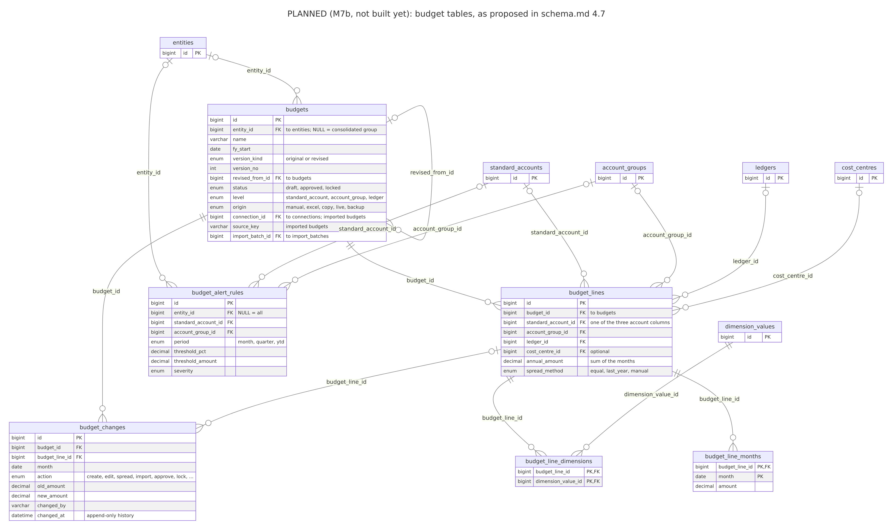

# Diagrams

Pictures of the project: what the database holds, who may read it, and how data moves. Each diagram is kept as editable source (`.mmd`, [Mermaid](https://mermaid.js.org/) text) and as images (`.svg` to zoom without losing sharpness, `.png` to view anywhere). Click an image to open it at full size.

**Regenerate everything** with `./dev.ps1 diagrams` (it needs neither the database nor Tally, and starts or stops nothing else). It first rewrites the diagrams that come from the code, then draws every `.mmd` file with the official mermaid-cli Docker image. Run it whenever the database tables or the flows change; a test fails if the generated diagrams no longer match the code.

| Diagram | Made how | Source |
| --- | --- | --- |
| ER overview and the five ER areas | **Generated** from the database models in `data-plane/core/models` by `data-plane/devtools/diagrams.py`: never edit these `.mmd` files by hand | `er-overview.mmd`, `er-organisation-accounts.mmd`, `er-masters.mmd`, `er-transactions.mmd`, `er-system-sync.mmd`, `er-system-access.mmd` |
| Databases and users | **Generated** the same way (tables from the models, users and rights from `deploy/mysql/init/01-schemas.sh`) | `schema-databases.mmd` |
| Budget tables | Written by hand from [schema.md](../schema.md) Section 4.7: **planned**, not built yet | `er-budgets-planned.mmd` |
| Data flow, levels 0 and 1 | Written by hand | `dataflow-context.mmd`, `dataflow-level1.mmd` |

`mermaid-config.json` sets how the images are drawn (each at its natural size, so large diagrams stay readable).

## How to read the ER diagrams

An **ER (entity-relationship) diagram** shows the tables and how they refer to each other.

- Each box is a **table**: its name on top, then its **key columns**, each with a type (`bigint` a whole number, `varchar` text, `decimal` an exact amount, `date`, `bool` yes/no, `json` free-form data, `enum` one of a fixed list).
- **PK** (primary key): the column that identifies each row. **FK** (foreign key): a column that points to a row of another table; the note says which ("to entities"). **UK** (unique key): no two rows may have the same value (often together with another column).
- A line joins a table to a table it points to, labelled with the pointing column. The ends say **how many**: `||` exactly one, `|o` zero or one (the column may be empty), `o{` zero or more. For example, one voucher has zero or more voucher lines, and each line belongs to exactly one voucher.
- Small boxes with only `id PK` are tables from another area, shown so the lines have somewhere to go; see their own diagram for the details.
- Only the columns that say what a row is are shown; every column is described in [schema.md](../schema.md).

## The diagrams

### ER overview: the main tables

The heart of the accounting data and how a sync is recorded: companies (`entities`) and where they come from (`entity_sources`), groups and ledgers, parties, voucher types, vouchers and their lines, stock items, and on the system side connections, sync runs, raw records and validation. Only keys are shown. Every accounting table also points to the connection and import batch it came from; to keep the picture readable those lines are drawn only for `entity_sources`.

### Organisation and chart of accounts

Companies, their branches and financial years, currencies and exchange rates, the standard chart of accounts used to compare and combine companies, and each company's own groups and ledgers (a group can sit inside another group).

### Masters

The lists vouchers refer to: parties (customers and suppliers), stock items with their groups and units, godowns (stock locations), cost centres, voucher types, and the user-defined reporting dimensions with their values.

### Transactions

A voucher and everything that belongs to it: its lines (one per ledger posting), bill allocations (which invoices a payment settles), cost-centre allocations, dimension values, stock movements (inventory lines) and tax lines. They are always replaced together when the voucher changes.

### System, part 1: connections, sync, validation

How data arrives and is checked: sources and connections, sync runs with their markers, checkpoints, slow months, unverified ranges and job output, raw records (the data exactly as received), import batches, validation runs and their issues, alerts, and the catalogue of extra fields.

### System, part 2: users, access, audit, settings

Who may see what: users, roles and permissions, which companies each user may access, masking rules, the audit log and the AI question log, and settings and KPI definitions.

### Budget tables (planned)

The budget design proposed in [schema.md](../schema.md) Section 4.7 for milestone M7b: budget versions, their lines by account, the monthly amounts, dimensions, the change history and the variance alert rules. **Not built yet**: when M7b builds them, this diagram is replaced by a generated one.

### The four databases and the database users

The data lives in four databases, one per layer: `ledgerbridge_source` (data exactly as received), `ledgerbridge_accounting` (the standard accounting model), `ledgerbridge_reporting` (views for reports and the AI, planned) and `ledgerbridge_system` (connections, sync, validation, users, audit). Each database user may do only what it needs: `migrator` changes the structure (only when migrations run), `app_rw` reads and writes data for the API and the workers, `report_ro` only reads accounting and reporting, and `ai_ro` only reads the reporting database, so the AI can never see anything else. See [schema.md](../schema.md) Section 2.

### Data flow, level 0: the outside world

LedgerBridge's data plane runs at the client and talks to Tally only with read-only requests. Users work with it directly. Planned (dashed): other sources, the client's AI provider (receiving at most a masked question and the database's description, depending on the privacy mode), and the provider's control plane, which only handles logins and licences and never receives any client data.

### Data flow, level 1: inside the data plane

A sync, started from the command line or by the worker's schedule, asks Tally for data through the connector and stores it unchanged as raw records; the transform turns them into the accounting tables; validation compares them with Tally's own figures and records results and alerts; the deletion check finds what was deleted in Tally. Planned (dashed): budgets entered by users, the reporting views, the dashboard and AI questions. Which code does each step is in [codebase-guide.md](../codebase-guide.md) Section 3.

## Change log

| Date | Change |
| --- | --- |
| 2026-10-13 | First version: ER overview and five areas, databases and users (generated); planned budget tables, data flow levels 0 and 1 (by hand). |
