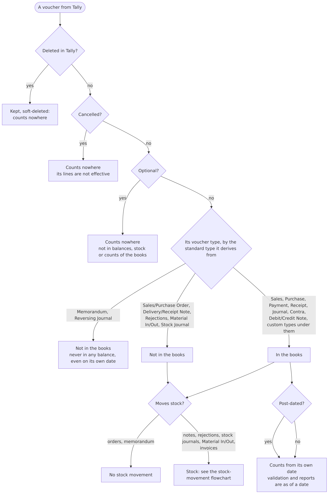
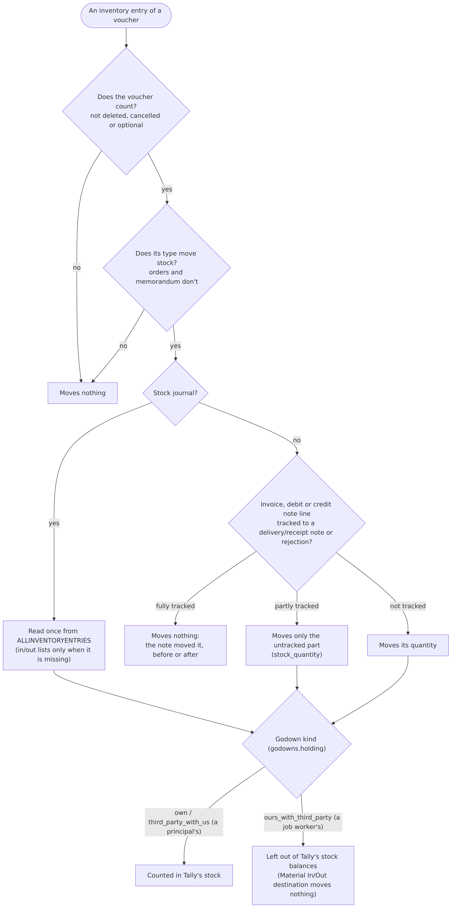
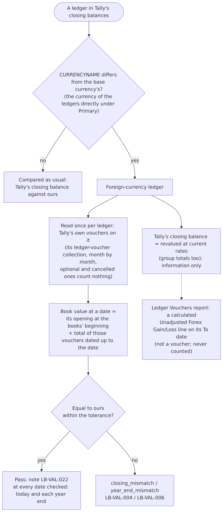
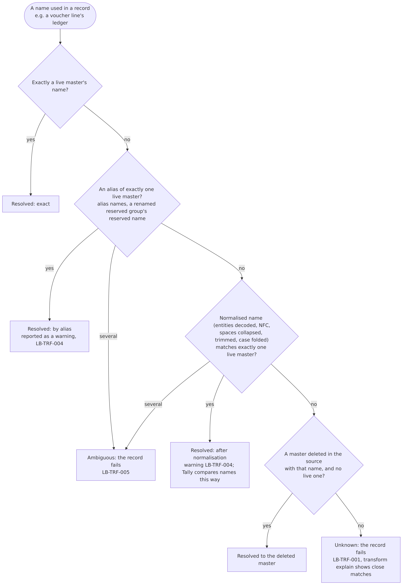

# Validation and conversion rules

| Field | Value |
| --- | --- |
| Version | 1.7 |
| Date | 2026-10-24 |
| Scope | Tally (TallyPrime) data converted into the canonical model, and its validation |

The rulebook: every rule LedgerBridge follows when it converts Tally data and validates it against Tally's own figures. For each rule: **what** it is, **why** (what the pilot showed, in counts only), **how it was proven** (a Tally report, or an experiment on LedgerBridge Test Co reproduced by the seeder), **where** it lives in the code, which **tests** cover it, and its **ADR** in [architecture.md](../architecture.md). The tables and columns named here are described in the [schema reference](../database/schema-reference.md); the problem codes (LB-xxx) in the [error catalogue](../error-catalogue.md).

Rules are built generically (PIL-003): Tally specifics live in `data-plane/connectors/tally`; the rest works for any source. Every rule about Tally's counting was reproduced on the test company and checked against Tally's own reports before it was coded (ADR-029). No client names or amounts appear here: pilot findings are counts and Tally's standard names only.

**Contents:** 1 Identity and duplicates · 2 Signs and amounts · 3 Opening balances · 4 Which vouchers count · 5 Stock moved once · 6 Stock journals and job work · 7 Stock ledgers · 8 Foreign-currency ledgers · 9 Effective dates · 10 Reference resolution · 11 Master classification · 12 Custom fields · 13 Error handling · 14 Reliable dates (Educational mode) · 15 Validation checks

---

## 1. Identity and duplicates

### 1.1 Every object is identified by the source's key

- **What:** a record's identity is the source's own key (Tally: GUID), never its name. Canonical rows are upserted on `(connection_id, source_key)`. Companies are found by their GUID too (`entity_sources`), so a company whose name is shown slightly differently is still found.
- **Why:** pilot: company names with double and trailing spaces weren't found by name (pilot run, 2026-10-12).
- **Proven:** recorded responses of the test company; names with spaces in the pilot.
- **Code:** `connectors/tally/parser.py` (`source_key`), `core/transform.py` (`_Upserter`), `workers/entities.py` (`select_entities`, `resolve`).
- **Tests:** `tests/test_sync.py` (`test_month_overlap_updates_never_duplicates`, `test_second_sync_is_incremental_and_changes_nothing`), `tests/test_entity_lookup.py`.
- **ADR:** ADR-021.

### 1.2 An unchanged record is stored once; a changed one replaces the old version

- **What:** the raw layer keeps every record exactly as received; a record whose payload hash equals the latest stored version isn't stored again. Retries and rebuilds apply only an object's latest version; older failed versions are marked superseded.
- **Code:** `core/raw_store.py`; `core/transform.py` (`retry_failed`, `rebuild`).
- **Tests:** `tests/test_raw_store.py`, `tests/test_retransform.py`.
- **ADR:** ADR-005, ADR-025 (DAT-008).

### 1.3 A voucher's child rows are replaced as a whole

- **What:** when a voucher is created or changed in the source, its lines, bill, cost-centre and dimension allocations, inventory and tax lines are deleted and written again, with the header, in one transaction.
- **Code:** `core/transform.py` (voucher preparation and write), `ON DELETE CASCADE` foreign keys.
- **Tests:** `tests/test_sync.py` (`test_altered_voucher_replaces_its_lines`).
- **ADR:** schema.md Section 8 rule 7.

### 1.4 Incremental syncs by AlterID; deletions by a separate check

- **What:** a sync fetches what changed since the highest AlterID stored per object type (`sync_markers`). Deleted objects are found by a **deletion check** that lists every key in the source and soft-deletes stored rows whose key has gone (`is_deleted`); a sync alone never soft-deletes.
- **Code:** `workers/sync.py`, `core/transform.py` (`mark_deleted`).
- **Tests:** `tests/test_sync.py` (`test_sync_alone_never_soft_deletes`, `test_deletion_check_run_soft_deletes_what_has_gone`, `test_voucher_deleted_in_source_is_soft_deleted`).
- **ADR:** ADR-018.

### 1.5 Nothing unverified is counted as complete; company numbers stay the same

- **What:** a chunk of a full sync is checkpointed only when it is known to be complete; ranges that couldn't be proven complete are recorded (`sync_unverified_ranges`) and re-fetched. In output, a company keeps its number (`company <n>`) once given, whatever order `connect` lists companies in.
- **Why:** pilot: a part-month listing returned fewer vouchers than the month; after a reconnect, entity 1 became company 2.
- **Code:** `workers/sync.py`, `workers/entities.py` (`Labels`, `connections.config.company_numbers`).
- **Tests:** `tests/test_large_sync.py`, `tests/test_entity_lookup.py` (`test_company_numbers_survive_connect_in_another_order`).
- **ADR:** ADR-022, ADR-023, ADR-033.

---

### 1.6 TallyPrime Edit Log changes nothing the sync reads

- **What:** a company opened in TallyPrime Edit Log exports the same fields, formats and values as in TallyPrime. An alteration keeps **no edit history in the XML export** (its audit lists stay empty); the altered voucher is exported as its current version with a new AlterID, like any alteration, and replaces the stored one (1.2, 1.3). Only `UPDATEDDATETIME` is now filled, which the sync doesn't fetch, so stored records and their hashes don't change.
- **Proven:** the test company opened in Edit Log (2026-10-19): every export compared with the responses recorded from TallyPrime (identical, same AlterIDs); a journal created and altered under Edit Log (seed case `EDITLOG-ALTER-1`); full sync, validation (105 checks) and report passed.
- **Code:** `connectors/tally/envelopes.py` (`VOUCHERS.fetch`).
- **Tests:** `tests/test_edit_log.py`.

## 2. Signs and amounts

### 2.1 Canonical sign: debit positive

- **What:** canonical amount = −(Tally amount): Tally writes debits negative (`ISDEEMEDPOSITIVE=Yes`). Every voucher's lines sum to zero. Amounts are exact decimals (`DECIMAL(20,4)`, Python `Decimal`), never floats.
- **Proven:** the sign check on the test company (schema.md 7.1): 21 of 21 balances agree with Tally's own `$$IsDr`.
- **Code:** `connectors/tally/signs.py` (`tally_amount`), `connectors/tally/mapping.py` (`_canonical`).
- **Tests:** `tests/connectors/tally/test_signs.py`.
- **ADR:** schema.md 7.1.

### 2.2 The postings of a voucher are read once

- **What:** `ALLLEDGERENTRIES.LIST`, when present, is the complete set of postings (it already holds the sales or purchase ledger posted through inventory). Otherwise `LEDGERENTRIES.LIST` plus the inventory entries' `ACCOUNTINGALLOCATIONS.LIST`. Entries without a ledger (a cancelled voucher's placeholder) are skipped.
- **Code:** `connectors/tally/signs.py` (`postings`).
- **Tests:** `tests/connectors/tally/test_signs.py` (`test_complete_all_ledger_entries_are_not_double_counted`, `test_cancelled_voucher_placeholder_entry_is_ignored`).
- **ADR:** schema.md 7.2.

### 2.3 Foreign-currency amounts: the base part is the books' figure

- **What:** an amount written `-$100.00 @ Rs82.00/$ = -Rs8200.00` counts by its base part (after `=`); its foreign part (before `@`) is kept in `voucher_lines.amount_fc`.
- **Code:** `connectors/tally/signs.py` (`tally_amount`, `tally_foreign_amount`).
- **Tests:** `tests/test_forex.py` (`test_a_foreign_amount_keeps_both_parts`).
- **ADR:** ADR-035, ADR-037.

---

## 3. Opening balances (as at the books' beginning)

### 3.1 Openings are fetched for a period starting on the books' beginning

- **What:** Tally computes `OPENINGBALANCE` (ledgers, stock items, opening bills) and `OPENINGVALUE` **for the requested period**: the balance at its start. Masters with openings are therefore fetched for a period starting on the company's books-from date, so the opening is the master's own.
- **Why:** pilot: ledgers and items differed from the first year end by exactly their opening.
- **Proven:** the test company: the same ledger fetched from the books' beginning and from 1 August gave its opening and its balance on 1 August.
- **Code:** `connectors/tally/envelopes.py` (`OPENING_SPECS`, `balances_period`), `connectors/tally/connector.py` (`_period_for`).
- **Tests:** `tests/test_counting_rules.py` (`test_masters_with_openings_are_fetched_as_at_the_books_beginning`, `test_opening_fields_follow_the_requested_period`).
- **ADR:** ADR-029.

### 3.2 A ledger's balance follows its own opening, not its opening bills

- **What:** opening bills affect only the bill-wise outstanding; a ledger whose opening bills total differently keeps its own opening.
- **Proven:** the test company (2026-10-15).
- **Tests:** `tests/test_counting_rules.py` (`test_a_ledgers_balance_follows_its_opening_not_its_opening_bills`).
- **ADR:** ADR-031.

### 3.3 The opening difference is the one Tally displays

- **What:** the `opening_difference` warning fires only when Tally itself shows a difference: the "Difference in opening balances" line of its own Trial Balance as at the books' beginning (its Balance Sheet then shows "Diff. in Opening Balances"), by that line's amount. When the report can't be read: the primary group openings, else ledger and item openings. `validate analyse` compares the figures and tests what a difference equals.
- **Why:** pilot: a company not integrated with inventory had no difference line in Tally's Trial Balance or Balance Sheet while its group openings didn't total zero.
- **Proven:** the test company's Trial Balance at the books' beginning (no difference line); synthetic trial balances with and without the line.
- **Code:** `connectors/tally/connector.py` (`opening_difference_shown`), `core/validation.py` (`_opening_difference`).
- **Tests:** `tests/test_forex.py` (`test_the_opening_difference_is_what_tallys_trial_balance_shows`), `tests/test_validation.py` (`test_opening_difference_warns_only_when_the_source_shows_one`), `tests/test_job_work.py`.
- **ADR:** ADR-031, ADR-033, ADR-038.

---

## 4. Which vouchers count, in the books and in stock

### 4.1 Cancelled, optional and deleted vouchers count nowhere

- **What:** their lines are stored but not effective (`voucher_lines.is_effective = false`); they move no stock.
- **Code:** `core/transform.py` (effective flag), `connectors/tally/mapping.py` (`voucher`).
- **Tests:** `tests/test_sync.py` (`test_every_voucher_balances_and_lines_are_effective_only_when_they_count`).
- **ADR:** ADR-027, ADR-029.

### 4.2 Voucher types that don't post: memorandum, reversing journals, orders, notes

- **What:** a voucher type's behaviour comes from the standard type it derives from (its reserved name, its parent, inherited through custom types). Memorandum and Reversing Journal vouchers are in no balance, **not even on their own date**; orders, delivery and receipt notes, rejections, Material In/Out and stock journals post nothing to the books. A custom type under Journal counts like Journal.
- **Why:** pilot: unbalanced and differing ledgers explained by non-posting types; 3 optional Journals per foreign-currency customer appeared only on our side in `compare-ledger`, not counted.
- **Proven:** the test company: a reversing journal on 1 and 2 September, with reversing journals enabled, was in no balance; a memorandum and an optional journal likewise.
- **Code:** `connectors/tally/mapping.py` (`NON_ACCOUNTING_VOUCHER_TYPES`, `NON_STOCK_VOUCHER_TYPES`, `voucher_type`), `core/transform.py` (`_TypeTree`).
- **Tests:** `tests/test_references.py` (`test_vouchers_of_types_that_dont_post_dont_count`, `test_voucher_type_mapping_follows_parents`), `tests/test_counting_rules.py`.
- **ADR:** ADR-027, ADR-029.

### 4.3 Post-dated vouchers count from their own date

- **What:** every balance, validation and report is computed **as of a date**: vouchers dated after it, post-dated ones included, are left out.
- **Proven:** the test company (a post-dated payment).
- **Tests:** `tests/test_validation.py` (`test_balances_as_of_a_date_leave_out_later_vouchers`).
- **ADR:** ADR-019.

---

## 5. Stock moved once (tracked invoices)

- **What:** a delivery or receipt note, or a rejection, moves stock. A sales, purchase, debit or credit note line **tracked** to one of them (`BATCHALLOCATIONS.LIST/TRACKINGNUMBER`, not "Not Applicable") moves nothing, whether the note came before or after; a partly tracked line moves only its untracked part. `inventory_lines.stock_quantity` holds what a line moves; `quantity` stays the invoiced quantity.
- **Why:** pilot: stock items differed by sales lines tracked to delivery notes (counted twice).
- **Proven:** the test company's Stock Summary with notes before and after their invoices, partly tracked invoices, and a return tracked to a rejection.
- **Code:** `connectors/tally/mapping.py` (`_tracked`, `_inventory_lines`), migration 0014.
- **Tests:** `tests/test_counting_rules.py` (`test_tracked_invoice_lines_dont_move_stock_but_the_note_does`, `test_tracked_quantity`).
- **ADR:** ADR-029.

---

## 6. Stock journals and job work

### 6.1 Stock journals are read once

- **What:** TallyPrime lists a stock journal's produced and consumed items in `ALLINVENTORYENTRIES.LIST` (with the right sign) **and** again in `INVENTORYENTRIESIN/OUT.LIST`. They are read from `ALLINVENTORYENTRIES`; the in and out lists only when it is missing.
- **Why:** reading both counted each entry twice.
- **Proven:** the test company (a manufacturing stock journal).
- **Code:** `connectors/tally/mapping.py` (`voucher`).
- **Tests:** `tests/test_job_work.py`.
- **ADR:** ADR-031.

### 6.2 Stock is counted where Tally counts it: by godown kind

- **What:** godowns carry whose stock they hold (`godowns.holding`): `own`, `ours_with_third_party` (a job worker's, Tally `ISEXTERNAL`), `third_party_with_us` (a principal's, `ISINTERNAL`). Stock at a job worker's godown is in no item balance, Stock Summary or closing stock value; a principal's stock with us is counted. A Material In/Out moves stock at its line's godown; its destination godown moves nothing. An entry spread over several godowns becomes one inventory line per godown, each going in or out as the entry does; a batch without its own amount gets its share by quantity, so an entry with no quantity of its own whose batches lack amounts stays one line.
- **Why:** pilot: stock differences on items sent for job work.
- **Proven:** the test company's godown and item balances after Material Out/In, consumption at the job worker and a principal's material.
- **Code:** `connectors/tally/mapping.py` (`_holding`, `_inventory_lines`), `core/validation.py` (`counted_godown`), migration 0015.
- **Tests:** `tests/test_job_work.py`.
- **ADR:** ADR-031.

---

## 7. Stock ledgers at the stock value

- **What:** with accounts integrated with inventory (`ISINTEGRATED`), Tally's trial balance, balance sheet and profit use the stock items' values and leave out every ledger under its reserved Stock-in-Hand group (renamed or not); the group's own opening and closing are the stock value Tally uses. Tally refuses vouchers on such a ledger. When Tally reports a stock ledger at its closing stock value (not its own opening and postings), validation compares it with that value and notes LB-VAL-021; otherwise ledger by ledger.
- **Why:** pilot: in two companies the Stock-in-Hand ledger's balance was the closing stock value at every date.
- **Proven:** the test company: a renamed Stock-in-Hand group with one ledger (its opening kept in its own balance, left out of the trial balance); the group equal to the items' value at each date; a voucher on the ledger refused.
- **Code:** `connectors/tally/connector.py` (`closing_balances`, `_stock_in_hand`), `core/validation.py` (`at_stock_value`, `_at_stock_value`).
- **Tests:** `tests/test_stock_ledger_and_dates.py`, `tests/test_job_work.py`.
- **Not integrated** (recorded on the test company with the feature switched off, 2026-10-22): Tally's trial balance, balance sheet and Profit and Loss count the stock ledgers as ordinary ledgers, and its opening and closing stock are their own balances; the items' values aren't used. The connector reads each company's own setting (`ISINTEGRATED` Yes or No).
- **ADR:** ADR-031, ADR-033, ADR-040.

---

## 8. Foreign-currency ledgers at book value

- **What:** a ledger is kept in a foreign currency when its `CURRENCYNAME` differs from the base currency's (the currency of the ledgers directly under Primary; Tally exports the rupee sign as "?"). Tally reports its closing balance, and its group totals, **revalued at current rates**; its books keep the amounts entered. Its **book value** at a date is its opening plus the total of Tally's own vouchers on it up to the date (its ledger-voucher collection, read once per ledger; optional and cancelled vouchers count nothing). Validation compares each foreign-currency ledger with its own book value at every date checked and notes LB-VAL-022; the revalued balance is information only. Tally's Ledger Vouchers report adds a calculated "Unadjusted Forex Gain/Loss" line on its To date: it is not a voucher and is never counted.
- **Why:** pilot: three foreign-currency customers differed; `compare-ledger` matched every one of Tally's vouchers with ours (47 of 47, 60 of 60, 3 of 3) with equal totals, while Tally's closing balances were revalued.
- **Proven:** the test company: a dollar customer whose closing balance and group total were 0 while Rs 8,200 was entered, with an "Unadjusted Forex Gain/Loss" line in the trial balance; its book value from its vouchers equals ours.
- **Code:** `connectors/tally/connector.py` (`_foreign`, `_book_values`, `ledger_total`, `ledger_vouchers`), `core/validation.py` (`at_book_value`, `_at_book_value`), `workers/compare.py`.
- **Tests:** `tests/test_forex.py`, `tests/test_compare_ledger.py`.
- **ADR:** ADR-035 to ADR-038 (ADR-038 current).

---

## 9. Effective dates

- **What:** a voucher's effective date (`EFFECTIVEDATE`) is kept (`vouchers.effective_date`) but **balances count by the voucher date**, as Tally does.
- **Proven:** the test company: journals and sales dated 31 August and effective 1 September (and the reverse), regular and optional: each counted on its voucher date.
- **Code:** `connectors/tally/mapping.py` (`voucher`), migration 0016.
- **Tests:** `tests/test_stock_ledger_and_dates.py` (`test_tally_counts_by_the_voucher_date_not_the_effective_date`, `test_the_effective_date_is_stored`).
- **ADR:** ADR-033.

---

## 10. Reference resolution

- **What:** a reference by name (a voucher's ledger, a ledger's group, a stock item) resolves **exact**, then by **alias** (alias names, a renamed reserved group's reserved name), then **normalised** (entities decoded, Unicode NFC, spaces collapsed, trimmed, case folded), each only when exactly one master fits; otherwise the record fails (unknown or ambiguous). Alias and normalised matches are reported (LB-TRF-004). Masters deleted in the source answer only to names no live master has. Look-alike characters and punctuation are never matched automatically; `transform explain` names the kinds of difference.
- **Why:** pilot: references matched by alias (voucher → ledger 20, voucher → party 2) and after normalisation; three customers differed as if lines sat on the wrong ledger (it turned out to be foreign currency, Section 8).
- **Proven:** the test company: "Party Lima ", "PARTY LIMA" and "Party  Lima" were taken by Tally for the existing "Party Lima"; a ledger whose alias was another ledger's name was refused; a journal naming an alias came back naming the ledger. So Tally's names compare the way our normalisation does, and one name identifies one master.
- **Code:** `core/names.py` (`NameIndex`, `normalise`), `core/transform.py` (`_by_name`, `_ref`), `workers/references.py`.
- **Tests:** `tests/test_references.py`, `tests/test_line_attribution.py`.
- **ADR:** ADR-027, ADR-034.

---

## 11. Master classification

### 11.1 Groups, natures and standard accounts

- **What:** a group's nature comes from its primary group (`ISREVENUE`, `ISDEEMEDPOSITIVE`; Capital Account and Reserves & Surplus are equity). Each ledger gets a standard account from its nearest reserved group (`STANDARD_ACCOUNT_BY_GROUP`); Indirect Expenses stays unmapped (it mixes accounts). Ledgers directly under Primary (Profit & Loss A/c) hang from a synthetic primary group mapped to reserves and surplus.
- **Code:** `connectors/tally/mapping.py` (`group`, `ledger`, `STANDARD_ACCOUNT_BY_GROUP`); the standard chart is seeded by `migrations/versions/0003_seed_reference_data.py`.
- **Tests:** `tests/test_standard_accounts.py`, `tests/test_sync.py` (`test_standard_accounts_mapped_from_groups`).
- **ADR:** schema.md 7.3.

### 11.2 Parties

- **What:** ledgers under Sundry Debtors are customers, under Sundry Creditors vendors (`PARTY_TYPE_BY_GROUP`); GSTIN, state, PAN, e-mail, phone, credit days and limit go to `parties` (sensitive: AI-015).
- **Code:** `connectors/tally/mapping.py` (`ledger`).
- **Tests:** `tests/test_sync.py`.

### 11.3 Duties & Taxes and GST tax lines

- **What:** a Duties & Taxes ledger's standard account follows its tax type (GST, TDS, TCS); `TAXTYPE` and `GSTDUTYHEAD` give `tax_type` (Central → cgst, State/UT → sgst, Integrated → igst, Cess). An empty duty head on a GST ledger is taken as Central Tax (Tally leaves defaults out) and reported (LB-TRF-007). Every line on a tax ledger becomes a `tax_lines` row.
- **Code:** `connectors/tally/mapping.py` (`_tax_type`, `STANDARD_ACCOUNT_BY_TAX_TYPE`).
- **Tests:** `tests/connectors/tally/test_mapping.py` (`test_duties_and_taxes_default_by_tax_type`, `test_empty_duty_head_is_central_tax_for_gst_only_and_warns`), `tests/test_sync.py` (`test_bills_tax_and_inventory_details`).

### 11.4 Branch / Divisions

- **What:** ledgers under Branch / Divisions map to standard account 1275 (debit balances; credit balances report as 3275 at the reporting date, M6).
- **Code:** `connectors/tally/mapping.py` (`STANDARD_ACCOUNT_BY_GROUP`).
- **Tests:** `tests/test_standard_accounts.py` (`test_suspense_and_inter_company_accounts`).

---

## 12. Custom fields and the `extra` column

- **What:** every field Tally sends that has no column (e.g. UDFs from TDL customisations, `UDF:` prefixed tags) is kept in the row's `extra` JSON and catalogued (`source_fields`, with counts and an inferred type); a catalogued voucher field can be promoted to a reporting dimension (`promote-field`). A value too long or otherwise unfit for its column is kept in full in `extra` (never truncated) and reported (LB-TRF-003); a value with characters MySQL can't store is cleaned, and if it is then still too long it is kept in `extra` too. Names kept in `extra` because they were too long are found by those names, with the same rule as every name: a deleted row never takes a live row's name (ADR-034). Undeclared XML prefixes are parsed and kept as written.
- **Why:** pilot: UDF prefixes broke parsing; values longer than their column failed records.
- **Known limitation:** the catalogue keys a field by its path cut to 255 characters (`source_fields.field_path`), so two paths that differ only after the 255th character are counted as one field. Values are unaffected (they are kept in full in `extra`); only the catalogue's counts merge. Not seen in the test company or the pilot; fixing it needs a schema change (a hash of the full path as the key), left until such paths appear (developer's decision, 2026-10-22).
- **Code:** `core/transform.py` (`_fit`, `_with_extra`, `_Catalogue`), `connectors/tally/mapping.py` (`unmapped_fields`, `USED_FIELDS`), `connectors/tally/parser.py`.
- **Tests:** `tests/test_retransform.py`, `tests/test_fit_integration.py`, `tests/test_pilot_robustness.py`.
- **ADR:** ADR-025.

---

## 13. Error handling

- **What:** a record that can't be converted fails **alone**: `raw_records.process_status = failed` with the error type and a short message (never SQL or values). A batch the database rejects is written again one record at a time, so one bad record leaves the rest converted. `transform retry` converts failed records again with the current code, `transform rebuild` every stored record, both without contacting Tally. Validation names the root cause when records failed (consequences counted, LB-TRF-001 first).
- **Why:** pilot: thousands of records failed in one batch on a data error (2,170 ledgers and 238,392 vouchers in one attempt).
- **Code:** `core/transform.py` (batch write, `retry_failed`, `rebuild`), `core/errors.py` (`short_error`), `core/validation.py` (`RootCause`).
- **Tests:** `tests/test_retransform.py` (`test_one_bad_record_in_a_batch_leaves_the_rest_converted`, `test_mysql_data_errors_are_described_without_values`, `test_validation_names_the_root_cause`).
- **ADR:** ADR-025, ADR-028.

On the fetch side: requests time out and wait for a busy source before declaring it unresponsive; slow months are split; interrupted syncs resume from their checkpoints; a run lock tied to its job keeps runs from overlapping (ADR-022, ADR-023, ADR-024, ADR-030).

---

## 14. Educational mode: reliable dates only

- **What:** TallyPrime in Educational mode gives correct balances only on the 1st, 2nd and 31st of a month. Validation runs as of the latest such date on or before the date asked; the analysis's month ends move to the next one (a 30 June month end is compared on 1 July); the output names the dates used. The connection setting `educational` (auto / yes / no) decides; auto asks Tally (`$$LicenseInfo:IsEducationalMode`). Voucher listings always request whole months.
- **Statements are stricter:** on the 1st, Tally's own Trial Balance, Profit and Loss and computed profit don't agree with its own ledger balances that day (test company, 2026-10-22: as of 1 October its ledgers equalled ours, while its reports and its Profit & Loss A/c balance didn't; the 2nd and the 31st agreed). Statements and year-end checks (whose profit carrier comparison uses Tally's computed profit) therefore use `DateRule.period_end`: the 31st where the month has one, otherwise the 2nd of the next month, never the 1st (a 31 March year end is checked on 31 March, a 30 June one on 2 July; developer's decision, 2026-10-22). A year end whose date is after the as-of date waits for the next validation.
- **Why:** on the test company a balance requested for the 30th included later vouchers; the pilot runs in Educational mode.
- **Code:** `core/dates.py` (`DateRule`, `period_end`), `connectors/tally/connector.py` (`date_rule`, `is_educational`), `workers/validate.py` (`source_controls`), `workers/analyse.py`, `workers/statements.py`.
- **Tests:** `tests/test_dates.py` (`test_period_ends_use_the_31st_or_the_2nd_never_the_1st`, `test_a_30_june_year_end_is_checked_on_2_july`).
- **ADR:** ADR-032.

---

## 15. Validation checks

Every check compares our figures with Tally's own, **as of a date** (default today, moved to a reliable date in Educational mode, Section 14). Amounts compare within the connection's **tolerance**: `validation_tolerance` in the connection's settings, else `VALIDATION_TOLERANCE`, **0 (exact) by default**. Counts and quantities always compare exactly. A *thorough* validation (every `validate` and full sync) also compares the source's controls: voucher counts, stock, bills and year ends.

| Code | Check | What it compares | Tolerance | As-of rule |
| --- | --- | --- | --- | --- |
| LB-VAL-001 | `voucher_unbalanced` | Each effective voucher's lines sum to zero | exact | every voucher |
| LB-VAL-002 | `tb_unbalanced` | The trial balance totals our opening total at the as-of date and each year end | exact | as of, year ends |
| LB-VAL-003 | `opening_difference` (warning) | Tally's own difference in opening balances (Section 3.3) | tolerance | books' beginning |
| LB-VAL-004 | `closing_mismatch` | Each ledger's balance against Tally's closing balance; stock ledgers at the stock value (Section 7); foreign-currency ledgers at book value (Section 8) | tolerance | as of |
| LB-VAL-005 | `profit_carrier_mismatch` | Profit & Loss A/c: its posted balance plus the period's profit (stock change included) against Tally's | tolerance | as of |
| LB-VAL-006 | `year_end_mismatch` | The same ledger comparison at every financial year end before the as-of date | tolerance | year ends (reliable dates) |
| LB-VAL-007 | `ledger_missing` | Ledgers on one side only | — | as of |
| LB-VAL-008 | `voucher_count_mismatch` | Vouchers per month and voucher type (cancelled and optional included, deleted excluded) | exact | months up to as of |
| LB-VAL-009 | `stock_quantity_mismatch` | Each item's closing quantity (counted vouchers, counted godowns, Sections 5 and 6) | exact | as of |
| LB-VAL-010 | `bills_mismatch` | Each party's bill-wise outstanding (opening bills plus allocations, on-account excluded) | tolerance | only as of today (Tally reports bills as of now) |
| LB-VAL-011 | `closing_unavailable` | Tally's closing balances couldn't be read | — | — |
| LB-VAL-012 | `year_end_balances_unavailable` | A year end's balances couldn't be read | — | — |
| LB-VAL-013 | `voucher_counts_unavailable` | Counts couldn't be read | — | — |
| LB-VAL-014 | `stock_quantities_unavailable` | Stock couldn't be read | — | — |
| LB-VAL-015 | `bill_outstanding_unavailable` | Bills couldn't be read | — | — |
| LB-VAL-016 | `check_not_supported` (info) | The source doesn't offer a figure | — | — |
| LB-VAL-017 | `not_compared` (info) | Stock values per item and bills on other dates are compared only in total / as of today | — | — |
| LB-VAL-018 | `source_controls_not_checked` (info) | A quick validation skipped the controls | — | — |
| LB-VAL-019 | `never_validated` | A company never validated | — | — |
| LB-VAL-020 | `validation_error` | Validation couldn't run | — | — |
| LB-VAL-021 | `stock_ledger_at_stock_value` (info) | Stock ledgers compared with Tally's closing stock value (Section 7) | tolerance | each date |
| LB-VAL-022 | `foreign_ledgers_at_book_value` (info) | Foreign-currency ledgers compared with their book value (Section 8) | tolerance | each date |
| LB-VAL-023 | `stock_value_mismatch` | The stock value stored for a date against the source's now (Section 16.2) | tolerance | as of, year ends |
| LB-VAL-024 | `statement_mismatch` | Our Trial Balance, Profit & Loss and Balance Sheet against the source's own, line by line and in total (Section 16.1) | tolerance | as of, year ends; every month end with `statements` |
| LB-VAL-025 | `statements_unavailable` | The source's statements couldn't be read for a date | n/a | as of, year ends |

- **Code:** `core/validation.py` (`Validator`), `workers/validate.py` (`run_validation`, `source_controls`), `core/problems.py` (codes, texts).
- **Tests:** `tests/test_validation.py`, `tests/test_counting_rules.py` (`test_seed_reproduces_tallys_figures`), `tests/test_retransform.py` (`test_thorough_validation_passes_on_the_test_company`), and the rule tests above.
- **Diagnostics:** `validate analyse` tests explanations for every mismatch (counts only, VAL-010); `validate compare-ledger` compares one ledger voucher by voucher (VAL-014).
- **ADR:** ADR-019, ADR-028, ADR-029.

## 16. Statements from the source's own figures

### 16.1 Statements are laid out as Tally's and match them line by line

- **What:** our Trial Balance, Profit & Loss and Balance Sheet have one line per primary group (its current name), plus Tally's own lines: Cost of Sales (Opening Stock, Add: the purchase groups, Less: Closing Stock, then Direct Expenses and any other expense group that affects gross profit, each under its own name), Profit & Loss A/c and Unadjusted Forex Gain/Loss. Direct Incomes is a line of its own, beside the sales. Each is compared with Tally's own report export line by line (by label, without "Add: " / "Less: ") and in total at the as-of date and every year end (LB-VAL-024); `./dev.ps1 statements` does the same at every month end. Trial balance lines compare their debit and credit totals.
- **Why:** reports must equal what the client sees in Tally (RPT-012).
- **Proven:** the test company at four dates (books' beginning, two month ends, the as-of date), with integration on and off: every line and total equal. Then, after the statement layout seed (2026-10-23: a Direct Expenses ledger with a 300 payment, a Direct Incomes ledger with a 120 receipt), Tally's Cost of Sales was 12,980 = 2,010 + 16,250 − 5,580 + 300, with "Direct Expenses" listed after Closing Stock, and Direct Incomes a main line: ours equal at both dates recorded. The pilot's steady two Profit & Loss differences per date (Cost of Sales and the total) were this.
- **Code:** `core/statements.py`, `connectors/tally/reports.py`, `connector.source_statements`.
- **Tests:** `tests/test_statements.py`.
- **ADR:** ADR-040.

### 16.2 Stock in the statements is the source's own figure

- **What:** the opening and closing stock are those of Tally's Profit and Loss, stored in `stock_values`. Integrated: the stock ledgers are left out and the stock appears at its opening value in the Trial Balance and its closing value in the Balance Sheet (Current Assets). Not integrated: the stock ledgers are ordinary ledgers (their balances are Tally's stock). The stored value is checked against Tally's at each date validated (LB-VAL-023).
- **Why:** with integration off Tally takes the stock ledger's balances (1,500), not the items' values (2,010 / 5,580): following Tally's own figures keeps our statements equal whatever the setting.
- **Proven:** the recordings above; the connector reads Yes and No.
- **Code:** `core/statements.py` (`Figures`), `core/validation.py` (`_statements`, `_stock_value`).
- **Tests:** `tests/test_statements.py`.

### 16.3 Ledgers directly under Primary are Profit & Loss A/c

- **What:** Tally's Profit & Loss A/c line on the Balance Sheet is the balance of the ledgers directly under Primary (Opening Balance) plus the period's profit (Current Period): liabilities side for a profit, assets side for a loss. In the Trial Balance they are listed by name when not zero.
- **Proven:** the test company: Profit & Loss A/c equal to the period's loss at every date; after the seed gave Profit & Loss A/c an opening balance (3,000 Cr, balanced by a fixed asset), Tally's Balance Sheet line was that opening plus the period's loss (4,121 Dr), still one line in its export (no Opening Balance or Current Period lines), and the Trial Balance listed the account at 3,000 Cr. How the account looks after a year end is still unproven (the test company has none): the summary below tests it on the pilot.

### 16.4 Foreign-currency ledgers at Tally's revalued balance

- **What:** in the statements, a foreign-currency ledger counts at the balance Tally reports (revalued at current rates, read for the same period and date as the statements), stored in `fx_revaluation_snapshots`; the difference to its book value is one "Unadjusted Forex Gain/Loss" line, as in Tally's reports. In the Trial Balance that line's debit is the ledgers' losses and its credit their gains, ledger by ledger (book value above the revalued balance is a loss); the Balance Sheet shows the net. Validation still compares the ledger itself at book value (rule 8).
- **Proven:** the test company's dollar customer: 0 revalued, 8,200 book, the line 8,200 Dr. After the seed added a dollar vendor with an expense entered in rupees (4,100 book, 0 revalued: a gain), Tally's Trial Balance showed the line as 8,200 Dr and 4,100 Cr, its Balance Sheet 4,100 Dr; ours equal. The pilot's steady four Trial Balance differences per date (the line's debit and credit, both totals) were this.
- **Code:** `core/statements.py` (`Figures.forex`, `trial_balance`).

### 16.5 A difference in opening balances is a note

- **What:** when the openings don't total zero (e.g. not integrated: the items' opening value 2,010 against the stock ledger's 1,500, a difference of 510), Tally's exported Trial Balance and Balance Sheet don't balance and show no line for it. Ours add "Difference in opening balances" as a detail line (not compared), so ours balance and still equal Tally's line by line.

### 16.6 A pilot-safe summary of the lines that differ

- **What:** when statements differ, validation and `./dev.ps1 statements` print, per company, one line per statement line that differs: its label (the statements' own lines and Tally's reserved group names as they are; a renamed reserved group as "<reserved name> (renamed)", any other group as "a custom group under <its nearest reserved group>", a ledger directly under Primary as such, anything else as "a line not recognised"), whether the line is missing on one side or has a different amount, on how many dates, and which tested amounts the difference equals at how many of them: Direct Expenses, Direct Incomes, the opening and closing stock, the stock ledgers' opening and closing, the stock gap (the items' own value against the stock ledgers', at the books' beginning and at the date), the foreign-currency revaluation and its losses and gains, Tally's own Unadjusted Forex Gain/Loss, Profit & Loss A/c's own balance, the net profit, the difference in opening balances, and after a year end the profit up to it and since, and the stock stored for it; the foreign-currency ledgers' openings; for a Trial Balance group line, its split with each sub-group netted first; and for an integrated company after its first year end, the closing stock less each other closing stock Tally reports (its Stock-in-Hand group's closing balance, the stock items' closing value, the current financial year's own closing stock). Never other names, never amounts. When every ledger check passes, the report gives the layout as the likely cause of a statement difference, not a ledger balance.
- **Trial Balance split, as recorded (2026-10-23):** Tally splits a group's line into debit and credit ledger by ledger, also inside a sub-group (Duties & Taxes: input tax ledgers 2,340 Dr, output tax ledgers in the 26,129 Cr); netting each sub-group first would give 0 Dr. A group setting that nets it is the open question for the pilot's Current Liabilities.
- **Why:** the pilot's statement differences can't be shown (names and amounts); the summary says which rule a difference follows, so the layout can be corrected from counts alone.
- **Code:** `core/statement_differences.py` (`Labels`, `tested_amounts`, `last_year_end`, `Summary`), `core/validation.py` (`_statements`), `workers/statements.py`, `workers/cli.py` (`_print_statement_summary`).
- **Tests:** `tests/test_statements.py` (`test_the_summary_names_each_line_safely_and_what_it_equals`, `test_validation_prints_the_summary`, `test_the_last_year_end_gives_its_profit_and_stock`).

## Change log

| Date | Version | Change |
| --- | --- | --- |
| 2026-10-24 | 1.7 | 16.6: more tested amounts (netted split, other stock figures, foreign-currency openings); the Trial Balance split as recorded; the report's likely cause without ledger differences. |
| 2026-10-23 | 1.6 | Section 16: Direct Expenses inside Cost of Sales; the Trial Balance's forex line with losses as its debit and gains as its credit; Profit & Loss A/c with an opening balance; 16.6 the pilot-safe summary of differences. |
| 2026-10-22 | 1.5 | Section 14: year-end checks use the 31st or the 2nd, never the 1st, like statements; Section 12: the 255-character field path limitation. |
| 2026-10-22 | 1.4 | Section 16: statements from the source's own figures; rule 7 without integration; checks LB-VAL-023 to LB-VAL-025. |
| 2026-10-22 | 1.3 | Values with invalid characters that are too long; long names of deleted rows. |
| 2026-10-19 | 1.2 | Rule 6.2: entries with no quantity of their own across several godowns. |
| 2026-10-19 | 1.1 | Rule 1.6: TallyPrime Edit Log. |
| 2026-10-16 | 1.0 | First edition: every conversion and validation rule up to PR #33, with flowcharts. |
