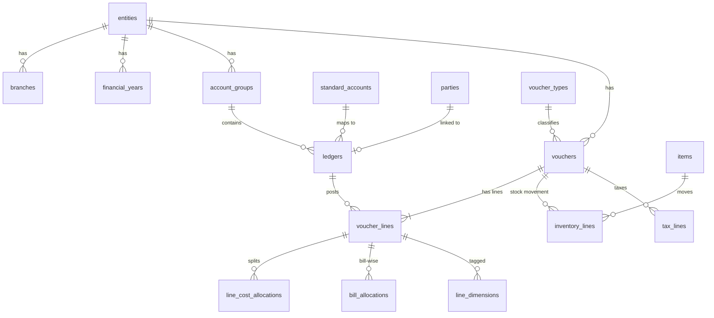

# Database Schema: Client Deployment (MySQL 8)

| Field | Value |
| --- | --- |
| Version | 0.17 (Draft) |
| Date | 2026-10-13 |
| Related | `docs/requirements.md` (DAT-*, IMP-*, VAL-*, ACC-*, AUD-*), `docs/architecture.md` Section 4 |

This document describes the database inside each **client deployment**. The control plane has its own small database (users, clients, licences), described in `docs/architecture.md` Section 3.

---

## 1. Conventions

| Topic | Convention |
| --- | --- |
| Engine / charset | InnoDB, `utf8mb4`, collation `utf8mb4_0900_ai_ci`. |
| Primary keys | `id BIGINT UNSIGNED AUTO_INCREMENT` unless stated. |
| Money | `DECIMAL(20,4)`. Never `FLOAT`/`DOUBLE`. |
| Quantities, rates | `DECIMAL(20,6)`. |
| Sign convention | **Debit = positive, credit = negative** for all amounts in the canonical layer. |
| Dates | `DATE` for accounting dates; `DATETIME(6)` in UTC for system timestamps. |
| Timestamps | Every table has `created_at`, `updated_at`. |
| Deletes | Synced data is soft-deleted (`is_deleted`), never physically removed, to keep history and audit. |
| Naming | `snake_case`, plural table names, foreign keys named `<table_singular>_id`. |
| Entity scoping | Every canonical business table carries `entity_id`, and every query from reports or AI filters by it. |

### 1.1 Source-tracking columns

Every canonical table populated from a source carries these columns (abbreviated as **[SRC]** below):

| Column | Type | Purpose |
| --- | --- | --- |
| `connection_id` | BIGINT UNSIGNED | Which connection the record came from. |
| `source_key` | VARCHAR(191) | Stable ID in the source (Tally GUID, Zoho ID, file row key). |
| `source_alter_id` | BIGINT NULL | Source change counter (Tally AlterID) for incremental sync. |
| `origin` | ENUM('live','backup','file','manual') | How the record arrived (IMP-004). |
| `import_batch_id` | BIGINT UNSIGNED NULL | Batch for backup/file imports. |
| `raw_record_id` | BIGINT UNSIGNED NULL | Link to the raw record it was built from (lineage). |
| `is_deleted` | BOOLEAN DEFAULT FALSE | Soft delete when removed in source. |
| `extra` | JSON NULL | Fields the source sent that have no column (e.g. Tally UDFs), by path; under `_unfit` values that didn't fit their column, in full (ADR-025, migration `0010`); under `_aliases` other names references may use (groups and ledgers, ADR-027). |

Unique key on `(connection_id, source_key)` makes every sync an idempotent upsert.

**Fields with no column and values that don't fit (ADR-025, DAT-009, DAT-010).** The connector puts every field its mapping doesn't use into `extra`, keyed by path below the object (for Tally, list levels included and prefixed names as Tally wrote them, e.g. `UDF:SALESMAN.LIST/UDF:SALESMAN`; a path that repeats, e.g. per ledger entry, holds a list). Tally's own bookkeeping fields (`VOUCHERKEY`, `PERSISTEDVIEW`, ...) are left out; the raw record keeps them. Before writing, each value is checked against its column (`core/fit.py`): a value too long, out of range, with more decimals than the column keeps, an invalid date, an unknown enum value or characters MySQL can't store is kept in full in `extra._unfit` (child rows of a voucher as `<table>[<line>].<column>`), and the column gets NULL, the rounded number, or `(too long; kept in extra)` for required text; the raw record gets a `process_warning`. Only a required amount, quantity or date that can't be stored fails, and only its own record.

## 2. Database layout

Four MySQL databases separate concerns and permissions. Each holds one **layer** of the design (architecture.md 4.2). The database names are readable and prefixed (ADR-016):

| Database | Layer | Contents | Who can access |
| --- | --- | --- | --- |
| `ledgerbridge_source` | Raw | Data exactly as received from sources. | Application only. |
| `ledgerbridge_accounting` | Canonical | Canonical accounting model. | Application (read/write); reporting user (read). |
| `ledgerbridge_reporting` | Reporting (semantic layer) | Views and aggregate tables. | Application; reporting user; **AI user (read-only, this database only)**. |
| `ledgerbridge_system` | System | Connections, sync, validation, security, audit, settings; Alembic's version table. | Application only. |

### 2.1 Database users

| User | Rights | Used by |
| --- | --- | --- |
| `app_rw` | `SELECT`, `INSERT`, `UPDATE`, `DELETE` on all four databases. No DDL. | API and workers. |
| `report_ro` | `SELECT` on `ledgerbridge_accounting` and `ledgerbridge_reporting`. | Reporting endpoints. |
| `ai_ro` | `SELECT` on **`ledgerbridge_reporting` only**; statement timeout set per session by the AI service (M8). | AI text-to-SQL execution (AI-003). |
| `migrator` | All privileges on the four databases, including DDL and `REFERENCES`. | Alembic migrations only, run in the one-off `migrate` container. Never available to the API or workers. |

The users and the four databases are created when MySQL first initialises its volume (`deploy/mysql/init/01-schemas.sh`), because Alembic can't create the user it runs as. Passwords come from the environment's env file.

## 3. `ledgerbridge_source` (raw layer)

### `ledgerbridge_source.raw_records`

| Column | Type | Notes |
| --- | --- | --- |
| id | BIGINT UNSIGNED PK | |
| connection_id | BIGINT UNSIGNED | |
| sync_run_id | BIGINT UNSIGNED NULL | Set for live syncs. |
| import_batch_id | BIGINT UNSIGNED NULL | Set for backup/file imports. |
| source_entity_key | VARCHAR(191) | Source company identifier. |
| object_type | VARCHAR(64) | e.g. `ledger`, `voucher`, `stock_item`. |
| source_key | VARCHAR(191) | |
| source_alter_id | BIGINT NULL | |
| payload_format | ENUM('xml','json','csv','txt') | |
| payload | LONGTEXT | Original record, unchanged. |
| payload_hash | CHAR(64) | SHA-256, skips unchanged re-deliveries. |
| received_at | DATETIME(6) | |
| process_status | ENUM('pending','processed','failed','skipped') | `skipped`: an older version of an object, superseded by a newer raw record (never transformed again). `transform retry` and `transform rebuild` only ever queue an object's latest raw record. |
| process_error | TEXT NULL | Why it failed: error type and a short message naming fields, tables and columns, never values. MySQL data errors as `MySQL <code> <kind>: <table>.<column> (<size>)`. |
| process_warning | TEXT NULL | Processed, but values were kept aside (`<kind> (<size>): <table>.<column>`; migration `0010`). |

Indexes: `(connection_id, object_type, source_key)`, `(process_status, received_at)`. Partition by month of `received_at` once volumes grow.

For XML sources, `payload` holds one source object (e.g. one Tally `<VOUCHER>` element) re-serialized from the response without changing its content. A record is skipped when the latest stored record for the same `(connection_id, object_type, source_key)` has the same `payload_hash`.

**Implementation status:**

| Migration | Milestone | Creates |
| --- | --- | --- |
| `0001` | M1 | `ledgerbridge_source.raw_records`, `ledgerbridge_system.sources`, `ledgerbridge_system.connections`, `ledgerbridge_system.sync_runs` |
| `0002` | M2 | Every other table in Sections 4 and 5, except `ledgerbridge_accounting.bank_statement_lines` (phase 2). Adds the `connections.agent_id` foreign key. |
| `0003` | M2 | Reference data: the `INR` currency and the default standard chart of accounts, 75 accounts (Section 4.2) |
| `0004` | M3 | `ledgerbridge_accounting.ledgers.tax_type` (Section 4.2) |
| `0005` | M3 | `ledgerbridge_system.sync_runs.run_type` adds `deletion_check` (Sections 5.1 and 7.4) |
| `0006` | M4 | `ledgerbridge_system.validation_runs.as_of`; `ledgerbridge_system.alerts` (Section 5.2) |
| `0007` | Pilot | `ledgerbridge_system.sync_checkpoints`, `ledgerbridge_system.sync_slow_periods` (Section 5.1, ADR-022) |
| `0008` | Pilot | `ledgerbridge_system.sync_unverified_ranges` (Section 5.1, ADR-023) |
| `0009` | Pilot | `ledgerbridge_system.sync_runs`: status `interrupted`, `heartbeat_at`, `pid`, `host`; `ledgerbridge_system.sync_logs` (Section 5.1, ADR-024) |
| `0015` | Pilot | `ledgerbridge_accounting.godowns.holding` (ADR-031) |
| `0014` | Pilot | `ledgerbridge_accounting.inventory_lines.stock_quantity` (ADR-029) |
| `0013` | Pilot | `ledgerbridge_system.validation_runs.thorough` |
| `0012` | Pilot | `ledgerbridge_accounting.voucher_types.moves_stock` |
| `0011` | Pilot | `ledgerbridge_accounting.voucher_types.standard_type` (ADR-027) |
| `0010` | Pilot | `extra` JSON on [SRC] tables and `entities`; `ledgerbridge_accounting.source_fields`; `dimensions.source_object_type`, `source_field`; wider `voucher_number`, `reference_number`, `gstin`, `pan`, `phone`, `units.symbol`, `items.code`, `hsn_code`, `cost_centres.category`; `raw_records.process_warning`; `sync_runs.run_type` `transform` (ADR-025) |

`ledgerbridge_reporting` exists from M2 but stays empty until M6 (Section 6). The per-call AI model log (AI-018) is designed in M8. Type and key choices for tables documented here only as column lists are in Section 9.

## 4. `ledgerbridge_accounting` (canonical model)

### 4.1 Organization

#### `ledgerbridge_accounting.entities`

| Column | Type | Notes |
| --- | --- | --- |
| id | BIGINT UNSIGNED PK | |
| code | VARCHAR(32) UNIQUE | Short code used in reports. |
| name | VARCHAR(255) | |
| legal_name | VARCHAR(255) NULL | |
| country_code | CHAR(2) | Default `IN`. |
| state_code | VARCHAR(8) NULL | |
| gstin | VARCHAR(32) NULL | 15 characters when valid; wider so source data that isn't fits (migration `0010`). |
| pan | VARCHAR(32) NULL | |
| base_currency_code | CHAR(3) | Default `INR`. |
| fy_start_month | TINYINT | Default 4 (April) (DAT-006). |
| books_from | DATE NULL | Company inception / books start (IMP-001). |
| is_active | BOOLEAN | |
| extra | JSON NULL | The company record's fields with no column (ADR-025). |

#### `ledgerbridge_accounting.entity_sources`

Links a source company (e.g. a Tally company) to an entity. One entity can have several sources (Tally for books, a bank feed, a CSV upstream system).

| Column | Type | Notes |
| --- | --- | --- |
| id | BIGINT UNSIGNED PK | |
| entity_id | BIGINT UNSIGNED FK | |
| connection_id | BIGINT UNSIGNED FK | |
| source_entity_key | VARCHAR(191) | Tally company GUID or name, Zoho organization ID. |
| source_entity_name | VARCHAR(255) | |
| precedence | SMALLINT | Higher wins on overlap (IMP-005). |
| active_from / active_to | DATE NULL | Period this source is authoritative for. |

Unique: `(connection_id, source_entity_key)`.

#### `ledgerbridge_accounting.branches`

`id, entity_id, code, name, state_code, gstin, is_active`. Unique `(entity_id, code)`.

#### `ledgerbridge_accounting.financial_years`

`id, entity_id, label, start_date, end_date, is_closed`. Unique `(entity_id, start_date)`.

#### `ledgerbridge_accounting.currencies` and `ledgerbridge_accounting.exchange_rates`

- `currencies`: `code CHAR(3) PK, name, decimal_places`.
- `exchange_rates`: `id, from_code, to_code, rate_date, rate DECIMAL(20,8), source`. Unique `(from_code, to_code, rate_date)`.

### 4.2 Chart of accounts

#### `ledgerbridge_accounting.standard_accounts`

The standard chart of accounts used for consolidation across entities and sources (RPT-006, CON-011). Seeded with a default structure; editable per client.

| Column | Type | Notes |
| --- | --- | --- |
| id | BIGINT UNSIGNED PK | |
| parent_id | BIGINT UNSIGNED NULL | Hierarchy. |
| code | VARCHAR(32) UNIQUE | |
| name | VARCHAR(255) | |
| nature | ENUM('asset','liability','equity','income','expense') | |
| statement | ENUM('balance_sheet','profit_loss') | |
| statement_line | VARCHAR(64) | e.g. `revenue`, `cogs`, `current_assets`. |
| cash_flow_class | ENUM('operating','investing','financing','cash','none') | For cash flow statement. |
| sort_order | INT | |

**Default chart:** 75 accounts seeded by migration `0003`, following the Schedule III layout and editable per client. Notes on specific accounts:

| Code | Account | Note |
| --- | --- | --- |
| 1275 / 3275 | Inter-company and branch receivables / payables | **Eliminated in consolidated reporting** (M6). Tally's *Branch / Divisions* group maps here: debit balances to 1275, credit balances to 3275. |
| 3290 | Suspense / unclassified | Balance can be **debit or credit**. Tally's built-in *Suspense A/c* group maps here. Cash flow: operating. |
| 1250 / 3230 | GST input tax credit / GST payable | Tally *Duties & Taxes* ledgers with tax type GST. Stored as 1250; **a credit balance at the reporting date is reported under 3230** (M6). |
| 1260 / 3240 | TDS receivable and advance tax / TDS and TCS payable | Tally *Duties & Taxes* ledgers with tax type TDS or TCS. Stored as 1260; **a credit balance at the reporting date is reported under 3240** (M6). |
| 5120 | Changes in inventories | **Not mapped from ledgers.** Derived in the reporting layer (M6) from opening and closing stock valuation. |

#### `ledgerbridge_accounting.account_groups` [SRC]

Source group hierarchy (Tally groups), kept as-is per entity.

| Column | Type | Notes |
| --- | --- | --- |
| id | BIGINT UNSIGNED PK | |
| entity_id | BIGINT UNSIGNED FK | |
| parent_id | BIGINT UNSIGNED NULL | |
| name | VARCHAR(255) | |
| nature | ENUM('asset','liability','equity','income','expense') NULL | Derived from primary group. |
| is_primary | BOOLEAN | Tally's 28 predefined primary groups. |
| affects_gross_profit | BOOLEAN | Tally flag for P&L layout. |
| standard_account_id | BIGINT UNSIGNED NULL | Default mapping for ledgers under this group. |

#### `ledgerbridge_accounting.ledgers` [SRC]

| Column | Type | Notes |
| --- | --- | --- |
| id | BIGINT UNSIGNED PK | |
| entity_id | BIGINT UNSIGNED FK | |
| group_id | BIGINT UNSIGNED FK | |
| name | VARCHAR(255) | |
| alias | VARCHAR(255) NULL | |
| ledger_kind | ENUM('party','bank','cash','tax','stock','income','expense','asset','liability','equity','other') | |
| party_id | BIGINT UNSIGNED NULL | Set for customer/vendor ledgers. |
| standard_account_id | BIGINT UNSIGNED NULL | Overrides group mapping. |
| mapping_status | ENUM('auto','suggested','confirmed','unmapped') | AI-suggested mappings stay `suggested` until confirmed. |
| opening_balance | DECIMAL(20,4) | Signed; as at `opening_balance_date`. |
| opening_balance_date | DATE NULL | |
| currency_code | CHAR(3) | |
| is_bill_wise | BOOLEAN | |
| is_cost_centre_applicable | BOOLEAN | |
| gstin | VARCHAR(32) NULL | |
| tax_type | ENUM('cgst','sgst','igst','cess','tds','tcs','vat','other') NULL | Set for tax ledgers. Voucher lines posted to them become `tax_lines` (migration `0004`, M3). |

Indexes: `(entity_id, group_id)`, `(entity_id, name)`.

### 4.3 Parties, items and other masters

#### `ledgerbridge_accounting.parties` [SRC]

| Column | Type | Notes |
| --- | --- | --- |
| id | BIGINT UNSIGNED PK | |
| entity_id | BIGINT UNSIGNED FK | |
| name | VARCHAR(255) | **Sensitive** (masking candidate). |
| party_type | ENUM('customer','vendor','both','other') | Tally: Sundry Debtors → customer, Sundry Creditors → vendor. |
| gstin | VARCHAR(32) NULL | |
| pan | VARCHAR(32) NULL | **Sensitive.** |
| state_code | VARCHAR(8) NULL | |
| country_code | CHAR(2) NULL | |
| credit_days | INT NULL | Used for ageing and overdue flags. |
| credit_limit | DECIMAL(20,4) NULL | |
| email, phone | VARCHAR(255) NULL | **Sensitive.** `phone` was 32 until migration `0010` (Tally fields may hold several numbers). |

#### Other masters [SRC]

| Table | Key columns |
| --- | --- |
| `ledgerbridge_accounting.voucher_types` | `entity_id, name, moves_stock BOOLEAN (false for orders and memorandum: their inventory lines don't move stock; migration 0012), standard_type VARCHAR(64) NULL (the source's predefined type it derives from, e.g. Tally's "Sales Order"; from a fixed list of the source's names only), base_type ENUM('sales','purchase','payment','receipt','journal','contra','debit_note','credit_note','stock_journal','delivery_note','receipt_note','other'), is_accounting, is_inventory` |
| `ledgerbridge_accounting.item_groups` | `entity_id, parent_id, name` |
| `ledgerbridge_accounting.items` | `entity_id, item_group_id, name, code VARCHAR(255), unit_id, hsn_code VARCHAR(32), gst_rate, opening_qty, opening_value` |
| `ledgerbridge_accounting.units` | `entity_id, symbol VARCHAR(255), name, decimal_places` |
| `ledgerbridge_accounting.godowns` | `entity_id, parent_id, name, holding ENUM(own, ours_with_third_party, third_party_with_us) DEFAULT own` (whose stock it holds: a job worker's location, "our stock with third party", is left out of stock balances; migration 0015) |
| `ledgerbridge_accounting.cost_centres` | `entity_id, parent_id, category VARCHAR(255), name` |

All of them also have `extra JSON NULL` ([SRC], ADR-025).

#### `ledgerbridge_accounting.source_fields` (field catalogue, ADR-025, DAT-009)

`id, entity_id, object_type VARCHAR(64), field_path VARCHAR(255), prefix VARCHAR(64) NULL, inferred_type ENUM('text','number','date','flag','mixed'), record_count BIGINT, first_seen_at, last_seen_at`; unique `(entity_id, object_type, field_path)`. Every field found in `extra` (not `_unfit`), filled by the transform: `record_count` is the number of records carrying the field (a re-transformed record is counted once). Field names only; values stay in `extra`. `fields` lists it (paths in the test environment only; elsewhere ids, kinds and counts).

### 4.4 Dimensions (DAT-005)

User-defined reporting dimensions beyond the built-in ones (entity, branch, cost centre, party, item, period).

| Table | Columns |
| --- | --- |
| `ledgerbridge_accounting.dimensions` | `id, code, name, applies_to ENUM('voucher','line'), is_active, source_object_type VARCHAR(64) NULL, source_field VARCHAR(255) NULL` |
| `ledgerbridge_accounting.dimension_values` | `id, dimension_id, entity_id NULL, parent_id NULL, code, name` |
| `ledgerbridge_accounting.line_dimensions` | `voucher_line_id, dimension_value_id` (PK both) |

**Promoted fields (ADR-025).** `promote-field --field-id N --code C --name "..."` makes a catalogued voucher field a dimension: `source_object_type` and `source_field` name the field, each distinct value becomes a `dimension_values` row per entity (`code` `e<entity id>:<value>`, or a hash for long values), and every line of a voucher carrying the field gets it in `line_dimensions` (backfilled from `extra`; the transform keeps it current when vouchers are written again). Only voucher fields for now.

### 4.5 Transactions

#### `ledgerbridge_accounting.vouchers` [SRC]

| Column | Type | Notes |
| --- | --- | --- |
| id | BIGINT UNSIGNED PK | |
| entity_id | BIGINT UNSIGNED FK | |
| branch_id | BIGINT UNSIGNED NULL | |
| voucher_type_id | BIGINT UNSIGNED FK | |
| voucher_number | VARCHAR(255) | Was 64 until migration `0010`. |
| voucher_date | DATE | |
| reference_number | VARCHAR(255) NULL | Was 128 until migration `0010`. |
| reference_date | DATE NULL | |
| effective_date | DATE NULL | The source's effective date (Tally `EFFECTIVEDATE`); balances count by `voucher_date`, as Tally does. Migration `0016`. |
| party_id | BIGINT UNSIGNED NULL | Main party, if any. |
| narration | TEXT NULL | Searchable via RAG later (AI-010). |
| currency_code | CHAR(3) | |
| exchange_rate | DECIMAL(20,8) DEFAULT 1 | |
| is_cancelled | BOOLEAN | |
| is_optional | BOOLEAN | Tally optional/memo vouchers, excluded from books. |
| is_post_dated | BOOLEAN | |

Indexes: `(entity_id, voucher_date)`, `(entity_id, voucher_type_id, voucher_date)`, `(party_id, voucher_date)`.

#### `ledgerbridge_accounting.voucher_lines`

The double-entry lines. For every voucher, `SUM(amount) = 0` (VAL-001).

| Column | Type | Notes |
| --- | --- | --- |
| id | BIGINT UNSIGNED PK | |
| voucher_id | BIGINT UNSIGNED FK | |
| entity_id | BIGINT UNSIGNED | Denormalized for fast filtering. |
| voucher_date | DATE | Denormalized for fast period queries. |
| line_no | INT | |
| ledger_id | BIGINT UNSIGNED FK | |
| amount | DECIMAL(20,4) | Base currency, debit +, credit −. |
| amount_fc | DECIMAL(20,4) NULL | Foreign-currency amount. |
| is_party_line | BOOLEAN | |
| is_effective | BOOLEAN | FALSE when the voucher is cancelled, optional or deleted, or its voucher type doesn't post to the books (`voucher_types.is_accounting` false: orders, memorandum, delivery notes, ...; ADR-027); reports use only effective lines. |

Indexes: `(entity_id, ledger_id, voucher_date)`, `(voucher_id)`.

#### Line detail tables

| Table | Columns | Source in Tally |
| --- | --- | --- |
| `ledgerbridge_accounting.line_cost_allocations` | `id, voucher_line_id, cost_centre_id, amount` | Cost category / cost centre allocations |
| `ledgerbridge_accounting.bill_allocations` | `id, voucher_line_id, party_id, bill_type ENUM('new_ref','against_ref','advance','on_account'), bill_name, bill_date, due_date, amount` | Bill allocations (receivables/payables ageing) |
| `ledgerbridge_accounting.inventory_lines` | `id, voucher_id, entity_id, voucher_date, line_no, item_id, godown_id, quantity (signed: in +, out −), stock_quantity (what the line moves in stock: the quantity, less the part tracked to a delivery or receipt note on a voucher that posts to the books; migration 0014), unit_id, rate, amount, discount_pct, batch_name` | Inventory entries |
| `ledgerbridge_accounting.tax_lines` | `id, voucher_id, voucher_line_id NULL, tax_type ENUM('cgst','sgst','igst','cess','tds','tcs','vat','other'), rate, taxable_amount, tax_amount, hsn_code` | GST / TDS details |

### 4.6 Bank data (phase 2, CON-005)

`ledgerbridge_accounting.bank_statement_lines`: `id, entity_id, ledger_id (bank ledger), txn_date, value_date, description, reference, amount (signed), running_balance, import_batch_id, matched_voucher_line_id NULL, match_status`. Used for bank reconciliation (VAL-004).

### 4.7 Budgets (proposed for M7b; BUD-001 to BUD-016, ADR-026)

User-entered planning data, kept in its own tables: the sync, `transform rebuild` and the deletion check never write them. Amounts are `DECIMAL(20,4)` in the **canonical sign** (debit positive, Section 1), like actuals; the dashboard shows natural signs. Proposed design, to be confirmed in the M7b plan.

#### `ledgerbridge_accounting.budgets`

One row per budget **version**.

| Column | Type | Notes |
| --- | --- | --- |
| id | BIGINT UNSIGNED PK | |
| entity_id | BIGINT UNSIGNED FK NULL | NULL: a budget entered for the consolidated group (lines by standard account only, BUD-001). |
| name | VARCHAR(255) | E.g. "Budget FY 2027-28". |
| fy_start | DATE | First day of the financial year (per the entity's `fy_start_month`). |
| version_kind | ENUM('original','revised') | |
| version_no | SMALLINT | 1 for the original, then 2, 3 … per revision. |
| revised_from_id | BIGINT UNSIGNED FK NULL | The version this revision was copied from. |
| status | ENUM('draft','approved','locked') | Only drafts change (BUD-005). |
| level | ENUM('standard_account','account_group','ledger') | The level of its lines (BUD-004). |
| origin | ENUM('manual','excel','copy','live','backup') | How it was created: grid, Excel upload, copy of last year's actuals, or imported from the source (`live`/`backup` as the connection's origin, BUD-015). |
| connection_id | BIGINT UNSIGNED FK NULL | Imported budgets: the connection. |
| source_key | VARCHAR(191) NULL | Imported budgets: the source's key (e.g. Tally budget GUID). |
| import_batch_id | BIGINT UNSIGNED FK NULL | Excel uploads and imports (`import_batches`). |
| growth_pct | DECIMAL(20,6) NULL | Copied budgets: the overall growth applied. |
| created_by, approved_by, locked_by | CHAR(36) NULL | User ids. |
| approved_at, locked_at | DATETIME(6) NULL | |
| notes | TEXT NULL | |
| extra | JSON NULL | Imported budgets: source fields with no column (ADR-025). |

Unique `(entity_id, fy_start, name, version_no)`; unique `(connection_id, source_key, version_no)` for imported budgets. The **current** budget of an entity and year is its latest `approved` or `locked` version (BUD-005), unless a request names another.

#### `ledgerbridge_accounting.budget_lines`

| Column | Type | Notes |
| --- | --- | --- |
| id | BIGINT UNSIGNED PK | |
| budget_id | BIGINT UNSIGNED FK | `ON DELETE CASCADE` (only drafts can be deleted). |
| standard_account_id | BIGINT UNSIGNED FK NULL | Exactly one of the three account columns is set, matching the budget's `level`. |
| account_group_id | BIGINT UNSIGNED FK NULL | |
| ledger_id | BIGINT UNSIGNED FK NULL | |
| cost_centre_id | BIGINT UNSIGNED FK NULL | Optional. |
| annual_amount | DECIMAL(20,4) | Equals the sum of the line's months (checked on every save). |
| spread_method | ENUM('equal','last_year','manual') | How the months were last filled (BUD-003). |
| growth_pct | DECIMAL(20,6) NULL | Copied lines: growth applied to last year's actuals. |
| source_ref_deleted | BOOLEAN DEFAULT FALSE | The referenced account, group, ledger or cost centre was deleted in the source: the line stays, flagged (ADR-026). |

Unique `(budget_id, standard_account_id, account_group_id, ledger_id, cost_centre_id)` (with the line's dimension values as part of the key, enforced in the application).

#### `ledgerbridge_accounting.budget_line_months`

`budget_line_id, month DATE (first day), amount DECIMAL(20,4)`; PK `(budget_line_id, month)`. Twelve rows per line (or as many months as the financial year has).

#### `ledgerbridge_accounting.budget_line_dimensions`

`budget_line_id, dimension_value_id` (PK both): custom dimensions of a line (DAT-005, including promoted fields, ADR-025).

#### `ledgerbridge_accounting.budget_changes`

Append-only history of every change (BUD-006): `id, budget_id, budget_line_id NULL, month DATE NULL, action ENUM('create','edit','spread','import','upload','copy','revise','approve','lock','unlock','delete_line'), old_amount DECIMAL(20,4) NULL, new_amount DECIMAL(20,4) NULL, changed_by CHAR(36), changed_at DATETIME(6), note VARCHAR(255) NULL`. Written in the same transaction as the change; the application user has INSERT and SELECT only on this table. Index `(budget_id, changed_at)`.

## 5. `ledgerbridge_system`

### 5.1 Integration

| Table | Key columns | Notes |
| --- | --- | --- |
| `ledgerbridge_system.sources` | `id, code ('tally','file','zoho',...), name, connector_version` | Registered connector types. |
| `ledgerbridge_system.connections` | `id, source_id, name, config JSON, credentials_enc VARBINARY, agent_id NULL, sync_interval_sec, status ENUM('active','paused','error'), created_by` | Credentials encrypted at application level (CON-009). `config` holds `url`, `origin` (`live`/`backup`), `entities` as `[{"key": <source key, e.g. Tally company GUID>, "name": <name as the source reported it>}]` (found by key; plain names from before 0.11 are still found by exact name), and optional `timeout_sec` (seconds one source request may take; **without it the `TALLY_TIMEOUT_SEC` setting applies**, read at each sync), `pause_sec` (pause between requests during a sync), `part_month_requests` (`supported`/`unsupported`, probed once when first needed, or set with `connect --part-month`), `xml_prefixes_seen` (names of undeclared XML prefixes the source used, e.g. `["UDF"]`; names only, ADR-024), `deletion_check_interval_sec`, `validation_tolerance`. New connections are `paused` until activated (ADR-020). |
| `ledgerbridge_system.agents` | `id, name, cert_fingerprint, version, last_seen_at, status` | Connector agents (SYN-004). |
| `ledgerbridge_system.sync_markers` | PK `(connection_id, source_entity_key, object_type)`, `marker_value` | Last AlterID / timestamp per object type. Saved per entity once its fetch and transform completed: the highest marker stored in `raw_records` (also for chunks fetched by an earlier, resumed attempt). |
| `ledgerbridge_system.sync_checkpoints` | `id, connection_id, source_entity_key, object_type, chunk_key VARCHAR(128), records, sync_run_id NULL`; unique `(connection_id, source_entity_key, chunk_key)` | A chunk of a full sync that was fetched, stored and committed (e.g. `chunk_key` `voucher:2023-04-01..2023-04-30`, or `ledger` for a master type). An interrupted full sync skips these when run again; the entity's checkpoints are deleted when its full sync completes, and ignored after 7 days (ADR-022, migration `0007`). |
| `ledgerbridge_system.sync_unverified_ranges` | `id, connection_id, source_entity_key, object_type, period_from, period_to, reason VARCHAR(255), sync_run_id NULL, resolved_at NULL`; index `(connection_id, source_entity_key, resolved_at)` | A range whose stored records couldn't be proven complete (listing too slow, objects missing, or empty where the source lists objects). Until resolved it is fetched again on every full sync, whatever its checkpoint says; resolved when its whole chunk is fetched and accepted (ADR-023, migration `0008`). `reason` holds counts and kinds only. |
| `ledgerbridge_system.sync_slow_periods` | PK `(connection_id, source_entity_key, object_type, month)`, `piece_days` | A month the source couldn't deliver in one request: later runs request it directly in pieces of `piece_days` days (ADR-022). |
| `ledgerbridge_system.sync_runs` | `id, connection_id, run_type ENUM('incremental','full','import','deletion_check','transform'), status ENUM('running','succeeded','failed','interrupted'), started_at, finished_at, heartbeat_at NULL, pid NULL, host VARCHAR(64) NULL, records_received, records_failed, error_summary` | SYN-005. `deletion_check` runs only look for objects deleted in the source (7.4, migration `0005`). A `running` run updates `heartbeat_at` every `SYNC_HEARTBEAT_SEC`; Ctrl+C or termination marks it `interrupted`, and so does the stale-run check when its heartbeat is older than `SYNC_STALE_SEC` or its process (`pid` on `host`) is gone; checkpoints are kept (ADR-024, migration `0009`). |
| `ledgerbridge_system.sync_logs` | `id, connection_id, job_id CHAR(36), logged_at, line TEXT`; index `(job_id, id)` | The output of a background sync job, line by line, ending with `[job finished: exit N]`; `sync watch` follows it. Lines are what the CLI prints: counts and, in the test environment only, names (ADR-024, migration `0009`). |
| `ledgerbridge_system.import_batches` | `id, connection_id, kind ENUM('backup','file'), file_name, file_sha256, period_from, period_to, status, created_by` | IMP-003, IMP-004. |
| `ledgerbridge_system.file_layouts` | `id, connection_id, name, column_mapping JSON` | Saved CSV/TXT mappings (CON-003). |

### 5.2 Validation

| Table | Key columns |
| --- | --- |
| `ledgerbridge_system.validation_runs` | `id, sync_run_id NULL, import_batch_id NULL, entity_id, as_of DATE, started_at, status, checks_passed, checks_failed, thorough BOOLEAN NULL` (`as_of` added by migration `0006`; `thorough` by `0013`: whether the source's controls were compared (voucher counts, stock, bills, year ends), so counts are compared only with a run of the same kind; NULL for older runs) |
| `ledgerbridge_system.validation_issues` | `id, validation_run_id, check_code ('voucher_unbalanced','tb_unbalanced','closing_mismatch',...), severity, object_type, object_id, expected_value, actual_value, message, resolved_at` |
| `ledgerbridge_system.alerts` | `id, kind ENUM('sync_failed','deletion_check_failed','validation_failed'), severity ENUM('error','warning'), connection_id, entity_id NULL, sync_run_id NULL, validation_run_id NULL, message, resolved_at NULL, acknowledged_at NULL, acknowledged_by VARCHAR(36) NULL` (SYN-006, migration `0006`). Index `(connection_id, kind, resolved_at)`. `message` holds counts and check codes only. Proposed for M7b: kind `budget_variance` (BUD-011), with `entity_id` set and `connection_id` NULL, so `connection_id` becomes nullable. |

**Checks (M4, VAL-001, VAL-002)**, all **as of a date** (`as_of`, default today): only vouchers dated on or before it count. Post-dated vouchers are stored as they are (`is_post_dated` recorded, `is_effective` unchanged); reports in M6 likewise calculate as of a date.

| `check_code` | Severity | Fails when | `object_type` / `expected_value` / `actual_value` |
| --- | --- | --- | --- |
| `voucher_unbalanced` | error | An effective voucher's lines don't sum to zero. | `voucher` / 0 / the sum |
| `opening_difference` | **warning**, shown prominently in status and the API | Opening balances don't total zero (Tally allows this as "Difference in opening balances"; it must be fixed in the books). | `entity` / 0 / the difference |
| `tb_unbalanced` | error | The trial balance at `as_of`, or at a financial year end before it, doesn't total the opening difference (i.e. the movements don't balance). | `entity` / the opening difference / the total |
| `stock_ledger_at_stock_value` | info | The source reports its stock ledgers at its closing stock value as of the date (not their own postings): compared with that value (VAL-012). | `entity` / closing stock value / the stock ledgers' balances |
| `closing_mismatch` | error | A ledger's balance differs from the source's own closing balance by more than the tolerance (default 0, exact). | `ledger` / source balance / ours |
| `ledger_missing` | error | A ledger exists in the source but not here, or here (not deleted) but not in the source. | `ledger` / source balance or NULL / ours or NULL |
| `profit_carrier_mismatch` | error | For a ledger whose source balance includes the computed profit (Tally *Profit & Loss A/c*): source closing − our posted balance ≠ our profit for the period (income and expense ledgers, adjusted by the change in stock value the source reports). | `ledger` / source closing / ours + computed profit |
| `closing_unavailable` | error | The source's closing balances couldn't be read (e.g. Tally unreachable); the closing checks didn't run. | `entity` |
| `closing_not_supported` | info | The connector can't report closing balances. | `entity` |
| `year_end_mismatch` | error | VAL-008: a ledger's balance at a financial year end before `as_of` differs from the source's (the profit carrier reconciled as above). | `ledger` (`object_id` `<ledger id>@<date>`) / source / ours |
| `voucher_count_mismatch` | error | VAL-005: vouchers in a month of a voucher type differ from the source's count (cancelled and optional included, deleted excluded). | `voucher_month` (`<YYYY-MM>:<voucher type id>`) / source count / ours |
| `stock_quantity_mismatch` | error | VAL-006: an item's closing quantity (opening plus movements of effective vouchers) differs from the source's. | `item` or `source_item` / source / ours |
| `bills_mismatch` | error | VAL-007: a party's bill-wise outstanding (its opening bills plus all bill allocations of effective vouchers, on account excluded) differs from the source's outstanding bills. As of today only. | `ledger` or `source_party` / source / ours |
| `<control>_unavailable` | error | One of the source's controls (`voucher_counts`, `stock_quantities`, `bill_outstanding`, `year_end_balances`) couldn't be read. | `entity` |
| `<control>_not_supported`, `stock_values_not_compared`, `bills_not_compared` | info | The connector can't report it; stock values aren't compared per item (valuation method); bills are only compared as of today. | `entity` |

The year-end, count, stock and bill checks run in **thorough** validations (`validate`, full syncs, `transform retry`); scheduled incremental syncs skip them. When raw records of the entity failed to transform, the report's **root cause** (VAL-009) lists them by object type and counts the failures above that are likely their consequences.

A run is `failed` when any error-severity issue is recorded, else `passed`. `checks_passed` and `checks_failed` count individual checks (per voucher, ledger and date). An issue (same `check_code`, `object_type`, `object_id`) that is absent from a later run gets `resolved_at` on its earlier rows; the open issues are the latest run's.

### 5.3 Security (ACC-*)

| Table | Key columns |
| --- | --- |
| `ledgerbridge_system.users` | `id CHAR(36) PK` (same ID as the control plane), `email, display_name, status, password_hash NULL` (`password_hash` used only when `AUTH_MODE=local`) |
| `ledgerbridge_system.roles` | `id, code, name, is_system` |
| `ledgerbridge_system.permissions` | `id, code` (e.g. `report.pnl.view`, `ai.query`, `connections.manage`, `validation.view`, `budget.view`, `budget.edit`, `budget.approve`) |
| `ledgerbridge_system.role_permissions` | `role_id, permission_id` |
| `ledgerbridge_system.user_roles` | `user_id, role_id` |
| `ledgerbridge_system.user_entity_access` | `user_id, entity_id, branch_id NULL` (NULL branch = all branches) |
| `ledgerbridge_system.masking_rules` | `id, role_id, target ('party.name','party.pan','ledger.salary',...), mask_type ENUM('hide','partial','hash')` |

### 5.4 Audit and AI log (AUD-*)

| Table | Key columns |
| --- | --- |
| `ledgerbridge_system.audit_log` | `id, occurred_at, user_id, action, object_type, object_id, entity_id NULL, details JSON, ip_address` — append-only |
| `ledgerbridge_system.ai_query_log` | `id, user_id, question TEXT, generated_sql TEXT, status, row_count, duration_ms, provider, model, created_at` |

### 5.5 Configuration

| Table | Key columns |
| --- | --- |
| `ledgerbridge_system.kpi_definitions` | `id, code, name, formula_view, good_threshold, bad_threshold, direction ENUM('higher_better','lower_better')` (RPT-002) |
| `ledgerbridge_system.settings` | `key PK, value JSON` |
| `ledgerbridge_system.budget_alert_rules` | `id, entity_id NULL (all), standard_account_id NULL, account_group_id NULL (all accounts), period ENUM('month','quarter','ytd'), threshold_pct DECIMAL(20,6) NULL, threshold_amount DECIMAL(20,4) NULL, direction ENUM('unfavourable','any') DEFAULT 'unfavourable', severity ENUM('warning','error'), is_active` (BUD-011; proposed for M7b). A rule fires when both set thresholds are exceeded; alerts go to `alerts` (kind `budget_variance`) and "Needs your attention". |

## 6. `ledgerbridge_reporting` (semantic layer)

Aggregate tables are refreshed by workers after each sync; views sit on top. Only this database is visible to the AI (`ai_ro`).

| Object | Type | Purpose |
| --- | --- | --- |
| `ledgerbridge_reporting.agg_ledger_daily` | Table | `entity_id, ledger_id, date, debit, credit, net`, refreshed incrementally. |
| `ledgerbridge_reporting.v_ledger_balances` | View | Opening + movements → closing per ledger per period. |
| `ledgerbridge_reporting.v_trial_balance` | View | Trial balance per entity and period. |
| `ledgerbridge_reporting.v_pnl_monthly` | View | P&L by month, by standard account and source group. |
| `ledgerbridge_reporting.v_balance_sheet` | View | Balance sheet as at a date. |
| `ledgerbridge_reporting.v_cash_flow` | View | Cash flow (indirect method) using `cash_flow_class`. |
| `ledgerbridge_reporting.v_receivables_ageing` | View | Outstanding customer bills by ageing bucket. |
| `ledgerbridge_reporting.v_payables_ageing` | View | Outstanding vendor bills by ageing bucket. |
| `ledgerbridge_reporting.v_sales_monthly` | View | Sales by month, party, item, branch. |
| `ledgerbridge_reporting.v_expenses_monthly` | View | Expenses by month, ledger, cost centre. |
| `ledgerbridge_reporting.v_consolidated_tb` | View | Trial balance across entities via `standard_accounts` (inter-company eliminations later). |
| `ledgerbridge_reporting.v_kpis` | View | Values for `ledgerbridge_system.kpi_definitions` (health indicators). |
| `ledgerbridge_reporting.semantic_catalog` | Table | Plain-language description of every view and column, used to build AI prompts (embedded in the vector store). |

**Budget views (proposed for M7b; BUD-007 to BUD-012, BUD-014).** Same rules as the other reports: actuals as of a date, effective voucher lines only, the user's entity access applied by the API (and injected into AI queries).

| Object | Type | Purpose |
| --- | --- | --- |
| `ledgerbridge_reporting.v_group_tree` | View | Each account group with every ancestor (closure), so ledger and sub-group figures roll up to any group. |
| `ledgerbridge_reporting.v_actual_monthly` | View | Actuals by `entity_id, month, ledger_id, account_group_id, standard_account_id, cost_centre_id` (cost centre from `line_cost_allocations`), from `agg_ledger_daily`; custom dimensions via `line_dimensions`. |
| `ledgerbridge_reporting.v_budget_current` | View | The current budget version per entity and financial year (latest approved or locked). |
| `ledgerbridge_reporting.v_budget_monthly` | View | Monthly budget amounts with the line's account, cost centre and dimensions, and the version's status. |
| `ledgerbridge_reporting.v_budget_vs_actual_monthly` | View | Per entity, month and account at the budget's level: `budget, actual, last_year_actual, variance (actual − budget), variance_pct (n/a when budget is 0), nature, favourable ('favourable','unfavourable','n/a')`. Favourable by nature (BUD-008), comparing in the canonical sign: income favourable when actual is more credit than budget, expenses when actual is less debit; asset, liability and equity lines `n/a`. |
| `ledgerbridge_reporting.v_budget_vs_actual_period` | View | The same, totalled for month, quarter, year to date and full year, with `ytd_budget, ytd_actual, remaining_budget, projection (ytd_actual + remaining_budget), full_year_budget, projection_variance` (BUD-009). |
| `ledgerbridge_reporting.v_budget_vs_actual_consolidated` | View | The same across the user's entities by standard account (company budgets summed, plus budgets entered for the group). |
| `ledgerbridge_reporting.v_budget_variance_alerts` | View | Lines exceeding the active `budget_alert_rules`, for the alert engine and "Needs your attention" (BUD-011). |

All budget views get entries in `semantic_catalog` so the AI can answer budget questions (BUD-014). Graph data (BUD-012) comes from these views: monthly bars and last-year line from `v_budget_vs_actual_monthly`, cumulative lines from its running totals, the waterfall from `v_budget_vs_actual_period` by account group, the heatmap from `v_budget_vs_actual_monthly` by account and month.

## 7. Tally to canonical mapping

| Tally object | Canonical table | Notes |
| --- | --- | --- |
| Company | `entities`, `entity_sources` | Company GUID → `source_entity_key`. |
| Group | `account_groups` | Keep hierarchy; primary group gives `nature`. Default standard-account mapping: *Suspense A/c* → 3290; *Branch / Divisions* → 1275 (debit balance) or 3275 (credit balance). See 4.2. |
| Ledger | `ledgers` (+ `parties` for Sundry Debtors/Creditors) | GUID → `source_key`; opening balance sign flipped (see below). |
| Voucher Type | `voucher_types` | Parent type → `base_type`. |
| Voucher | `vouchers` | GUID → `source_key`; AlterID → `source_alter_id`; cancelled/optional flags. |
| Ledger entries | `voucher_lines` | **Sign (confirmed, see 7.1):** Tally XML reports debits as negative amounts; canonical amount = −(Tally amount). Use the posting rules in 7.2. |
| Bill allocations | `bill_allocations` | |
| Cost centre allocations | `line_cost_allocations` | |
| Inventory entries | `inventory_lines` | |
| Stock Item / Stock Group / Unit / Godown | `items` / `item_groups` / `units` / `godowns` | |
| Cost Centre | `cost_centres` | |
| GST details | `tax_lines`, `items.hsn_code`, `ledgers.gstin` | Fields vary by Tally version; handled in the adapter. |

### 7.1 Sign convention: confirmed 2026-10-09

**Result:** in Tally's XML, a **debit is negative** and a **credit is positive**, for voucher ledger entries (`AMOUNT`, with `ISDEEMEDPOSITIVE=Yes` meaning debit) and for ledger `OPENINGBALANCE` and `CLOSINGBALANCE`. Canonical amount = −(Tally amount), giving debit positive and credit negative (Section 1).

**Foreign currency:** an amount in a foreign currency comes as `-$100.00 @ ₹82.00/$ = -₹8200.00`; the base-currency amount after the last `=` is used (`connectors/tally/signs.py`, `tally_amount`).

**How it was confirmed**, on LedgerBridge Test Co (TallyPrime, Educational mode), seeded by `./dev.ps1 seed-test-data` (ADR-014). Check: `python -m connectors.tally.tools sign-check`.

| Check | Result |
| --- | --- |
| Postings in 16 vouchers (payment, receipt, contra, journal, GST sales and purchases, item invoice, cancelled, altered) | 21 of 21 debits negative, 23 of 23 credits positive, all 16 vouchers sum to zero |
| Anchor voucher: Payment, Rent Dr 1,000 / Cash Cr 1,000 | Rent line is a debit with a negative `AMOUNT` |
| Anchor opening balances: Cash 50,000 Dr, Capital 50,000 Cr | Cash `OPENINGBALANCE` negative, Capital positive |
| **Independent:** Tally's own `$$IsDr` on every non-zero opening and closing balance | Agrees with "negative = debit" for 21 of 21. Rent 1,000.00 Dr, Cash 27,500.00 Dr, Capital 50,000.00 Cr, matching the seeder's expected Trial Balance |

The `$$IsDr` check matters because the seeder itself writes amounts using this convention. `$$IsDr` is Tally's own judgement of the side, so it would expose a wrong assumption.

### 7.2 Reading postings from a voucher (rules for M3)

Found while confirming the sign convention on TallyPrime exports:

- **`ALLLEDGERENTRIES.LIST`, when present, is the complete set of postings.** In item invoices it already includes the sales or purchase ledger posted through inventory. Do **not** also add the inventory `ACCOUNTINGALLOCATIONS.LIST`, or that amount is counted twice.
- When `ALLLEDGERENTRIES.LIST` is absent, `LEDGERENTRIES.LIST` holds only the non-inventory lines. Add the inventory `ACCOUNTINGALLOCATIONS.LIST` to complete the voucher.
- **Cancelled vouchers** (`ISCANCELLED=Yes`) keep an empty `ALLLEDGERENTRIES.LIST` placeholder with no ledger or amount. Skip entries without a ledger name.
- **Educational mode:** TallyPrime silently returns nothing for report periods whose dates aren't the 1st, 2nd or 31st. The connector therefore always sends an exclusive end date on the 1st of the following month and filters with `$Date < end` (`connectors/tally/envelopes.py`).

### 7.3 Field mapping (M3, `connectors/tally/mapping.py`)

All amounts: canonical = −(Tally amount). Masters are referred to by name within the company, because that's how Tally refers to them.

| Tally object | Fields used → canonical |
| --- | --- |
| Company | `NAME` → `entities.name`; `BASICCOMPANYFORMALNAME` → `legal_name`; `BOOKSFROM` → `books_from`; month of `STARTINGFROM` → `fy_start_month`; `STATENAME` → `state_code` (GST state code); `GSTREGISTRATIONNUMBER`, `INCOMETAXNUMBER` → `gstin`, `pan`. The entity (code from the name, e.g. `LEDGERBRIDGE_TEST_CO`) and its `entity_sources` row (company GUID) are created on the first sync. |
| Group | `NAME`, `PARENT` (empty or *Primary* means a primary group; Tally writes it as `&#4; Primary`, which is read as *Primary*). A predefined group the user renamed keeps its `RESERVEDNAME` as an alias (`extra._aliases`), so references by the reserved name still find it; alias names (`LANGUAGENAME.LIST`) are aliases too (ADR-027). The nature of a primary group comes from `ISREVENUE` and `ISDEEMEDPOSITIVE` (revenue: expense or income; otherwise asset or liability), except *Capital Account* and *Reserves & Surplus*, which are equity. Sub-groups inherit. `AFFECTSGROSSPROFIT` → `affects_gross_profit`. |
| Ledger | `NAME`, `PARENT` → `group_id`; `OPENINGBALANCE` → `opening_balance`, as at the entity's `books_from`; `ISBILLWISEON`, `ISCOSTCENTRESON`; GSTIN from `PARTYGSTIN` or `LEDGSTREGDETAILS.GSTIN`; state from `LEDSTATENAME` or `LEDMAILINGDETAILS.STATE`; `INCOMETAXNUMBER` (PAN), `EMAIL`, `LEDGERMOBILE`/`LEDGERPHONE`, `BILLCREDITPERIOD` (credit days) and `CREDITLIMIT` go to the party. `TAXTYPE` and `GSTDUTYHEAD` → `tax_type`: Central → cgst, State or UT → sgst, Integrated → igst, Cess → cess, TDS/TCS/VAT. **Assumption, to verify on client data:** an empty duty head on a ledger whose `TAXTYPE` is GST means Central Tax, because Tally leaves default values out of the export (the test company's Central Tax ledgers come back empty). It applies to GST ledgers only, and every use is reported as a warning in the sync output. |
| Voucher type | `NAME`; `standard_type` is the predefined Tally type it derives from: its `RESERVEDNAME` or `PARENT` if that is one of Tally's predefined voucher types, otherwise inherited from the parent type (a type under a custom type), resolved through the voucher type tree (ADR-027). `base_type` follows from it (Sales, Purchase, Payment, Receipt, Journal, Contra, Debit/Credit Note, Stock Journal, Delivery/Receipt Note; anything else → other). Order, memorandum, reversing journal, attendance and stock-only types are not accounting types (`is_accounting` false), so their vouchers' lines aren't effective. `AFFECTSSTOCK` → `is_inventory`. |
| Unit / Stock group / Godown / Stock item / Cost centre | Name, parent (*Primary* → none). Item: `BASEUNITS`, `OPENINGBALANCE` (quantity), `OPENINGVALUE`. Unit: `ORIGINALNAME`, `DECIMALPLACES`. Cost centre: `CATEGORY`. |
| Voucher | `GUID`, `ALTERID`, `DATE`, `VOUCHERTYPENAME`, `VOUCHERNUMBER`, `REFERENCE`, `REFERENCEDATE`, `PARTYLEDGERNAME` → `party_id`, `NARRATION`, `ISCANCELLED`, `ISOPTIONAL`, `ISPOSTDATED`. |
| Ledger entries | Postings per 7.2 → `voucher_lines` (`ISPARTYLEDGER` → `is_party_line`). `is_effective` is false for cancelled, optional and deleted vouchers. |
| Bill allocations | `NAME`, `BILLTYPE` (New Ref → new_ref, Agst Ref → against_ref, Advance, On Account), `AMOUNT` → `bill_allocations`, party from the line's ledger. |
| Cost centre allocations | `CATEGORYALLOCATIONS.COSTCENTREALLOCATIONS` `NAME`, `AMOUNT` → `line_cost_allocations`. |
| Inventory entries | `STOCKITEMNAME`, `ACTUALQTY` (number and unit), `RATE`, `AMOUNT`, `DISCOUNT`, first batch allocation's `GODOWNNAME`, `BATCHNAME`, from `ALLINVENTORYENTRIES.LIST` (or `INVENTORYENTRIES.LIST`), and for stock and manufacturing journals from `INVENTORYENTRIESIN.LIST` (produced or received: positive) and `INVENTORYENTRIESOUT.LIST` (consumed or sent: negative). Otherwise quantity is positive when `ISDEEMEDPOSITIVE=Yes` (inward) and negative otherwise. Inventory lines of vouchers whose type doesn't move stock (orders, memorandum) don't count in stock (`voucher_types.moves_stock`). |
| Tax lines | Every voucher line posted to a ledger with a `tax_type` → `tax_lines` (`tax_amount` = the line amount). |

**Standard-account mapping** (approved for M3), by Tally reserved group; user sub-groups and ledgers inherit from the nearest ancestor that has one:

| Tally group | Standard account |
| --- | --- |
| Capital Account | 2100 |
| Reserves & Surplus; the *Primary* group holding *Profit & Loss A/c* | 2200 |
| Loans (Liability), Secured Loans, Unsecured Loans | 3110 |
| Bank OD A/c / Bank OCC A/c | 3210 |
| Sundry Creditors | 3220 |
| Current Liabilities | 3270 |
| Provisions | 3280 |
| Suspense A/c | 3290 |
| Branch / Divisions | 1275, reclassified to 3275 for credit balances **at the reporting date** (M6) |
| Fixed Assets | 1110 |
| Investments | 1150 |
| Stock-in-Hand | 1210 |
| Sundry Debtors | 1220 |
| Cash-in-Hand | 1231 |
| Bank Accounts | 1232 |
| Loans & Advances (Asset) | 1240 |
| Deposits (Asset) | 1160 |
| Current Assets, Misc. Expenses (ASSET) | 1270 |
| Sales Accounts | 4110 |
| Direct Incomes | 4130 |
| Indirect Incomes | 4220 |
| Purchase Accounts | 5110 |
| Direct Expenses | 5130 |
| **Duties & Taxes** | **By the ledger's tax type**, decided by balance side at the reporting date: GST → 1250 (debit) or 3230 (credit); TDS/TCS → 1260 (debit) or 3240 (credit). The ledger stores the debit-side default (1250 or 1260, `auto`); M6 applies the balance rule. Other tax types (VAT, none) stay `unmapped`. |
| **Indirect Expenses** | **unmapped**: it holds ledgers belonging to different standard accounts (rent, power, salaries). Its ledgers stay `unmapped` until mapped by hand (CON-011). |

Mapped ledgers get `mapping_status = 'auto'`; every sync lists the unmapped ones.

**Unmapped ledgers in reports (M6).** So that statements always total, reports place an unmapped ledger under the nearest standard parent account of its Tally primary group: *Indirect Expenses* → 5500 Other expenses; *Duties & Taxes* → 1200 Current assets (debit balance) or 3200 Current liabilities (credit balance). This is a reporting placement only: `mapping_status` stays `unmapped` and the ledger keeps appearing in the unmapped list until it is mapped.
 `ledger_kind` comes from the group: Bank Accounts and Bank OD → bank, Cash-in-Hand → cash, Duties & Taxes → tax, Sundry Debtors and Creditors → party (customer or vendor), Stock-in-Hand → stock; otherwise the nature. Party ledgers also get a `parties` row with the ledger's GUID as its key.

*Profit & Loss A/c* sits directly under Tally's *Primary*, so each company gets a synthetic `Primary` account group (key `primary:<company GUID>`), mapped to 2200. Tally reports this ledger's closing balance as the period's computed profit, which isn't posted through vouchers: closing-balance comparisons (M4) must treat it separately.

### 7.4 Sync rules (M3)

- **Fields:** each collection requests only the fields above (`envelopes.py`). This makes exports about 10× smaller than fetching every field.
- **Incremental:** `sync_markers` holds the highest AlterID per company and object type. Later runs request only `$AlterID > marker`, across all dates, because an old voucher can be altered today. Tally keeps separate AlterID counters for masters and for vouchers. Markers advance only after a successful run.
- **Deletions:** a separate **deletion check** run (`run_type = 'deletion_check'`) fetches the GUIDs that exist now, per object type, and soft-deletes rows whose GUID has gone. Lines of deleted vouchers become ineffective. Rows derived under another key, like the synthetic *Primary* group, are never deleted this way. Listing every GUID costs about 1.3 KB per voucher, far more than an incremental sync, so it has its own schedule: every `connections.config.deletion_check_interval_sec` seconds, default `DELETION_CHECK_INTERVAL_SEC` = 3600 (ADR-018). `sync --full` (`./dev.ps1 sync full`) also runs one; `./dev.ps1 sync deletions` runs one on its own.
- **Full sync re-applies the mapping:** a full sync (`--full`) also marks unchanged raw records pending again, so changed mapping rules (for example the standard-account table) reach data that hasn't changed in the source. Incremental syncs transform only new or changed records.
- **Overlaps:** an object delivered twice, for example by two overlapping requests, updates one row through the upsert on `(connection_id, source_key)`. Its child rows are written once.
- **Several companies:** one run can cover several companies; the connection remembers which ones (`connections.config.entities`).
- **Origin:** `connections.config.origin` (`live` or `backup`) tags every row's `origin` (IMP-004).

### 7.5 Tally's counting rules (ADR-029, DAT-012)

Checked against Tally's own balances and Stock Summary on LedgerBridge Test Co (2026-10-14); the seed reproduces each case (`devtools/tally_seed/data.py`) and its expected figures equal Tally's.

| Rule | What Tally does | Here |
| --- | --- | --- |
| Openings | `OPENINGBALANCE` (ledgers, stock items, opening bills) and `OPENINGVALUE` are computed **for the requested period**: the balance at its start. For a period from 1 August, Cash showed its balance on 1 August, income and expense ledgers 0, and *Profit & Loss A/c* the profit so far; without a period Tally uses its current period. With a period starting on the books' beginning they are the master's own openings. | Ledgers, stock items and opening bills are fetched for a period starting on the company's books-from date (`envelopes.OPENING_SPECS`). |
| Stock moved once | A delivery or receipt note, or a rejection (in or out), moves stock. A sales, purchase, debit or credit note line with a tracking number (`BATCHALLOCATIONS.LIST/TRACKINGNUMBER`, not `Not Applicable`) never moves stock, whether the note came before or after it; untracked invoice lines do. The note posts nothing to the books; the invoice does. A credit note tracked to a rejection that was never entered made Tally's P&L count the return's value inconsistently (its Sales Accounts group total differed from its ledgers); with the rejection entered, Tally is consistent. | `inventory_lines.stock_quantity` is the quantity less the tracked part on vouchers that post to the books; stock validation and stock reports use it. `quantity` stays the invoiced quantity. |
| Job work and godowns | Stock at a godown marked "our stock with third party" (`ISEXTERNAL`, a job worker's location) is in no item balance, nor the Stock Summary, nor the closing stock value; stock at a "third-party stock with us" godown (`ISINTERNAL`, a principal's material) is counted. A Material Out / In moves stock at its line's godown (`GODOWNNAME`); its `DESTINATIONGODOWNNAME` (the job worker's) moves nothing in Tally's balances, whose batches at the job worker show only consumption there. | `godowns.holding` (`own`, `ours_with_third_party`, `third_party_with_us`); stock validation leaves out lines at `ours_with_third_party` godowns. An entry spread over several godowns becomes one inventory line per godown. |
| Stock journals | Tally lists a stock journal's produced and consumed items in `ALLINVENTORYENTRIES.LIST` (with `ISDEEMEDPOSITIVE`) and again in `INVENTORYENTRIESIN/OUT.LIST`. | Read from `ALLINVENTORYENTRIES`; the in and out lists only when it is missing (reading both counted each entry twice, from PR #20). |
| Stock ledgers | With accounts integrated with inventory (company `ISINTEGRATED`), Tally's trial balance, balance sheet and profit use the stock items' values ("Opening Stock", "Closing Stock") and leave out every ledger under its reserved Stock-in-Hand group, renamed or not. Such a ledger keeps its own opening and postings in its own balance (here 1,500, while the items' opening stock was 2,010). Without integration, those ledgers are the stock. Tally refuses a voucher posting to such a ledger when integrated ("Ledger under Stock-in-Hand"). The reserved Stock-in-Hand group's own opening and closing for a period are the items' stock value (2,010 and 5,580 here). In two pilot companies the ledger's own balance was the closing stock value at every date. | The connector's `closing_balances` takes the opening and closing stock from the Stock-in-Hand group (`GROUP_BALANCES`; items' sums when Tally gives no total) and lists the stock ledgers; validation compares them with the closing stock value when the source reports them at it, else ledger by ledger (`stock_ledger_at_stock_value`, VAL-012). |
| Opening difference | Tally's difference in opening balances is its ledger openings (without Stock-in-Hand ledgers, when integrated) plus the opening stock value (stock not balanced by a ledger shows as a difference, in the Balance Sheet's totals). Its primary groups' openings for a period from the books' beginning, with those of ledgers directly under Primary, are its trial balance's and total that difference. | `opening_difference` warns only when Tally's own primary group openings don't total zero (as its trial balance from the books' beginning shows); ledger and item openings only when Tally gives no group totals. `validate analyse` compares the two. |
| Not causes (checked 2026-10-15) | A reversing journal isn't in any balance even on its own date, also with reversing journals enabled. A voucher dated before the books' beginning is refused ("Out of Range"). A ledger's balance follows its own opening, also when its opening bills total differently (only the bill-wise outstanding uses the bills). A Stock-in-Hand ledger can't be given dated closing values through XML (integrated or not). In Educational mode a balance requested for a date other than the 1st, 2nd or 31st is wrong (for the 30th Tally included later vouchers): validation and analysis use those days only (`core/dates.py`, ADR-032). | `validate analyse` tests them on client data: ledger profiles with the books' first day, counts of optional, cancelled, post-dated, reversing and memorandum vouchers, one month's lines around a year end, opening bills against the opening, and the closing stock value at every date; and what the source's opening difference equals. |
| Names | A master's name is compared trimmed, with spaces collapsed and case ignored: importing "Party Lima ", "PARTY LIMA" or "Party  Lima" changed the existing "Party Lima" (its name list took the name given). A ledger whose alias is another ledger's name is refused. A voucher naming an alias is stored naming the ledger. | References resolve exact, alias, then normalised (core/names.py: the same master for Tally's data); masters deleted in the source answer only to names no live master has (ADR-034). |
| Effective dates | A voucher keeps an effective date (`EFFECTIVEDATE`) that can differ from its date. Balances count by the date: a journal dated 31 August, effective 1 September, is in the balance on 31 August (journals and sales, regular and optional, checked on 31 August and 1 and 2 September). | Stored in `vouchers.effective_date`; counting uses `voucher_date`. `validate analyse` counts vouchers whose two dates fall on different sides of a date compared. |
| In the books | Optional vouchers, memorandum vouchers and reversing journals are in no balance (nor in a period's opening). A custom type under Journal counts like Journal; a post-dated voucher counts from its date. | Their lines aren't effective (optional flag; voucher types that don't post, inherited by custom types); dates decide the rest. |

## 8. Processing rules

1. Connectors write source data to `ledgerbridge_source.raw_records` only.
2. A transform step converts pending raw records to canonical rows with upserts on `(connection_id, source_key)`.
3. A record deleted in the source is soft-deleted; its voucher lines get `is_effective = FALSE`.
4. Overlapping data from several sources for the same entity and period is resolved using `entity_sources.precedence` and `active_from/active_to` (IMP-005).
5. Validation runs after each transform (Section 5.2).
6. Aggregates in `ledgerbridge_reporting` are refreshed for affected entities and dates only.
7. **A voucher's child rows are replaced as a whole.** Whenever a voucher is created or changed in the source, all its child rows are deleted and re-inserted from the new version, together with the voucher header update, **in one transaction**. The child rows are `voucher_lines`, `bill_allocations`, `line_cost_allocations`, `line_dimensions`, `inventory_lines` and `tax_lines`. Edits therefore never leave stale lines behind, and a reader never sees half a voucher. The child tables carry no [SRC] columns; their origin is their voucher's. Their foreign keys to the voucher, or to its lines, use `ON DELETE CASCADE` so the replacement is a single delete. The voucher row itself is never physically deleted: a voucher deleted in the source is soft-deleted (rule 3). The sync implementation is M3.

8. **Short transactions while syncing (ADR-020).** Inserts into tables with a foreign key to `ledgerbridge_system.connections` lock that connection's row until commit. Syncs therefore commit each batch as soon as it is written and never wait for the source with uncommitted writes. Stored error summaries (`sync_runs.error_summary`, `raw_records.process_error`) hold the error type and a short message only, never SQL statements or parameters.

## 9. Implementation rules (M2)

Where Sections 4 and 5 give only column lists, migration `0002` applies these rules. The SQLAlchemy models in `data-plane/core/models/` are kept identical, and a test asserts it.

| Topic | Rule |
| --- | --- |
| Names, codes | `name`, `display_name`, `bill_name`, `file_name`: `VARCHAR(255)`. `code`, `label`: `VARCHAR(64)`. Since `0010`, columns filled from source text are wider: `voucher_number`, `reference_number`, `units.symbol`, `items.code`, `cost_centres.category`, `email`, `phone`: `VARCHAR(255)`; `gstin`, `pan`, `hsn_code`: `VARCHAR(32)`. Values that still don't fit go to `extra` (ADR-025). |
| Amounts, rates, quantities | Money `DECIMAL(20,4)` (`amount`, `*_value`, `credit_limit`, `expected_value`, `actual_value`, thresholds). Rates, percentages and quantities `DECIMAL(20,6)` (`rate`, `gst_rate`, `discount_pct`, `quantity`, `opening_qty`). Exchange rates `DECIMAL(20,8)`. |
| Flags | `BOOLEAN NOT NULL DEFAULT FALSE`, except `is_active` (`DEFAULT TRUE`). |
| Statuses | `ENUM`s: `import_batches.status` (`pending`, `running`, `succeeded`, `failed`); `validation_runs.status` (`running`, `passed`, `failed`); `validation_issues.severity` (`error`, `warning`, `info`); `agents.status` (`active`, `disabled`); `users.status` (`active`, `disabled`, `locked`); `ai_query_log.status` (`succeeded`, `failed`, `refused`). |
| Free text | `narration`, `message`, `question`, `generated_sql`, `error_summary`: `TEXT`. JSON columns: `JSON`. |
| [SRC] tables | `connection_id` and `source_key` are `NOT NULL`, with a unique `(connection_id, source_key)`. `origin` is `NOT NULL`. `raw_record_id` is indexed but has **no foreign key**, because `ledgerbridge_source.raw_records` will be partitioned (Section 3), and MySQL doesn't allow foreign keys to partitioned tables. |
| Foreign keys | Every `*_id` column has a foreign key, including across databases, except `raw_record_id` (above) and `user_id` in `audit_log` and `ai_query_log`, which must outlive the users they mention. Voucher child tables cascade on delete (Section 8, rule 7). |
| Added unique keys | `roles.code`, `permissions.code`, `users.email`, `agents.name`, `dimensions.code`, `kpi_definitions.code`, `(dimension_values.dimension_id, code)`, `(file_layouts.connection_id, name)`, `(user_entity_access.user_id, entity_id, branch_id)`. Link tables (`role_permissions`, `user_roles`, `line_dimensions`) use their two columns as primary key. |
| Added indexes | `(validation_issues.validation_run_id)`, `(audit_log.occurred_at)`, `(audit_log.user_id)`, `(ai_query_log.user_id, created_at)`, `(raw_record_id)` on [SRC] tables. MySQL indexes every foreign key automatically. |
| Timestamps | `created_at`, `updated_at` `DATETIME(6)` UTC on every table, set by the application. |

## 10. Open schema questions

- Inter-company elimination rules for consolidation (when consolidated reporting is built).
- Exact GST fields needed for GST reports (phase 2).
- Whether budgets from Tally are in scope (would add `ledgerbridge_accounting.budgets`).
- Partitioning thresholds once real data volumes are known.
- **To verify on client data (M9):** for books spanning several financial years, that Tally's *Profit & Loss A/c* closing balance for a period starting at the books-from date equals its opening plus all profit since then (the `profit_carrier_mismatch` rule), and how a company without integrated inventory reports closing stock.
- **Assumption to verify on client data (M9):** an empty GST duty head means Central Tax (7.3). Check the sync warnings on the pilot companies: every GST ledger listed should really be a Central Tax ledger.

## Change log

| Date | Version | Change |
| --- | --- | --- |
| 2026-10-08 | 0.1 | Initial draft. |
| 2026-10-08 | 0.2 | `ledgerbridge_system.users.password_hash` for local auth mode (pilot). |
| 2026-10-09 | 0.3 | M1: first migration (`ledgerbridge_source.raw_records`, `ledgerbridge_system.sources`, `ledgerbridge_system.connections`, `ledgerbridge_system.sync_runs`); raw payload and de-duplication rules. |
| 2026-10-09 | 0.4 | M1: sign convention confirmed (7.1); rules for reading voucher postings and the Educational-mode date limitation (7.2). |
| 2026-10-09 | 0.5 | M2: databases renamed to `ledgerbridge_source`, `ledgerbridge_accounting`, `ledgerbridge_reporting`, `ledgerbridge_system` (ADR-016); grants tightened (`app_rw` DML only, `ai_ro` reporting only, `migrator` for DDL); implementation status per migration; Section 8 rule 7 (voucher child rows replaced as a whole in one transaction); Section 9 implementation rules for M2. |
| 2026-10-09 | 0.6 | Default standard chart of accounts (75 accounts) with notes for suspense (3290), inter-company and branch accounts (1275/3275, eliminated on consolidation) and changes in inventories (5120, derived in M6); Tally group mappings for *Suspense A/c* and *Branch / Divisions* (Section 7). |
| 2026-10-16 | 0.26 | Section 7.5: how Tally compares names; deleted masters in reference resolution. |
| 2026-10-15 | 0.25 | `vouchers.effective_date` (migration 0016); Section 7.5: Tally's own group totals (stock value, opening difference), stock ledgers at the stock value, effective dates; `stock_ledger_at_stock_value`. |
| 2026-10-15 | 0.24 | Section 7.5: what was ruled out on the test company (reversing journals, vouchers before the books, opening bills, dated closing values, Educational mode dates). |
| 2026-10-15 | 0.23 | Section 7.5: stock ledgers with integrated inventory; the opening difference leaves them out. |
| 2026-10-15 | 0.22 | Migration `0015`: `godowns.holding`; Section 7.5: job work and godowns, stock journals, opening difference. |
| 2026-10-14 | 0.21 | Migration `0014`: `inventory_lines.stock_quantity`; Section 7.5 Tally's counting rules (openings fetched at the books' beginning, stock moved once, what counts in the books). |
| 2026-10-14 | 0.20 | Migration `0013`: `validation_runs.thorough`. |
| 2026-10-14 | 0.19 | Migration `0012`: `voucher_types.moves_stock`; stock journal inventory lists mapped; foreign currency amounts read in the base currency. |
| 2026-10-13 | 0.18 | Migration `0011`: `voucher_types.standard_type`; `extra._aliases`; lines of non-posting voucher types not effective; voucher type and group mapping (ADR-027). |
| 2026-10-13 | 0.17 | Proposed budget design for M7b: Section 4.7 (`budgets`, `budget_lines`, `budget_line_months`, `budget_line_dimensions`, `budget_changes`), `budget_alert_rules` (5.5), budget permissions (5.3), budget-vs-actual reporting views (6). ADR-026. |
| 2026-10-13 | 0.16 | `raw_records.process_status` `skipped` used for superseded versions; `transform rebuild` (no schema change). |
| 2026-10-13 | 0.15 | Migration `0010` (ADR-025): `extra` JSON, `source_fields`, promoted dimensions, wider source text columns, `raw_records.process_warning`, run type `transform`; validation checks VAL-005 to VAL-009. |
| 2026-10-13 | 0.14 | `sync_runs` status `interrupted`, `heartbeat_at`, `pid`, `host`; `sync_logs`; `connections.config.xml_prefixes_seen` (migration `0009`, ADR-024). |
| 2026-10-13 | 0.13 | `sync_unverified_ranges` (migration `0008`); `connections.config` `pause_sec`, `part_month_requests`; `timeout_sec` optional (ADR-023). |
| 2026-10-12 | 0.12 | `sync_checkpoints`, `sync_slow_periods` (migration `0007`); markers saved per entity from what is stored; `connections.config.timeout_sec` (ADR-022). |
| 2026-10-12 | 0.11 | `connections.config.entities` stores each entity's key with its name (ADR-021). |
| 2026-10-12 | 0.10 | Section 8 rule 8: short transactions while syncing; error summaries without SQL (ADR-020). |
| 2026-10-12 | 0.9 | M4: validation check codes, severities and the as-of-date rule (5.2); `validation_runs.as_of` and `alerts` (migration `0006`). |
| 2026-10-12 | 0.8 | M3 review: *Deposits (Asset)* → 1160; *Duties & Taxes* mapped by tax type (GST 1250/3230, TDS/TCS 1260/3240, by balance side at the reporting date, applied in M6); reports place unmapped ledgers under the nearest standard parent of their Tally primary group (M6); the empty-GST-duty-head rule is an assumption to verify, applied to GST ledgers only and reported as a warning; deletion check as its own run on its own schedule (migration `0005`). |
| 2026-10-12 | 0.7 | M3: `ledgers.tax_type` (migration `0004`); Section 7.3 field mapping, standard-account mapping by Tally group (*Duties & Taxes* and *Indirect Expenses* unmapped), synthetic *Primary* group, *Branch / Divisions* classified by balance at the reporting date; Section 7.4 sync rules (incremental by AlterID, deletions, overlaps, several companies, origin). |
